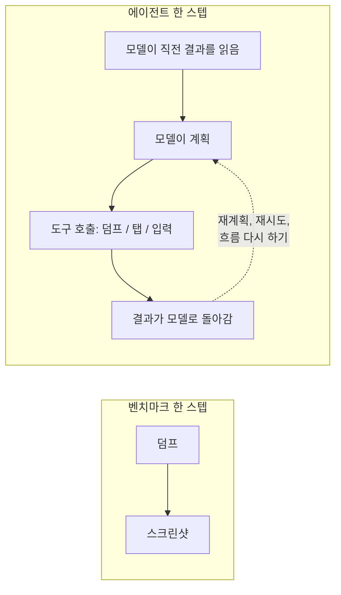

LLM 에이전트가 안드로이드 화면을 읽는 도구는 한 번 부를 때마다 2,250ms쯤 걸렸다. 앱 안에서 스냅샷을 뜨게 바꾸자 270ms 안팎으로 줄었다. 벤치마크 평균으로 8.3배다. 며칠 뒤 세션별 시간 분해 지표를 붙였더니 덤프 호출은 테스트 세션 시간의 1.1% 정도였다.

## 덤프가 병목처럼 보였던 이유

하네스는 실기기에 깐 안드로이드 앱을 상대로 UI 테스트 케이스를 돌리고, 테스트는 LLM 에이전트가 셸 도구로 한다. 덤프 도구는 현재 UI 트리를 텍스트로 돌려준다. 탭과 입력은 `adb`로 보내고 텍스트로 부족하면 스크린샷을 찍는다.

덤프 도구는 `uiautomator dump`를 감싼 것이었다. 벤치마크용 폰(Snapdragon 888, Android 15, USB ADB)에서는 화면의 노드 수와 상관없이 2,250ms 정도가 들었다. 대부분이 uiautomator 프로세스를 띄우는 비용이다. 스크린샷을 찍어 가져오면 570ms가 더 붙었다. 그때 벤치마크를 정리한 내 문서는 이렇게 계산했다. 한 스텝에 2,800ms쯤이니 10스텝짜리 작업은 UI 상태를 모으는 데만 28초가량 쓴다. 그리고 덤프를 "에이전트 루프의 주요 병목"이라고 적었다.

나는 그 문장을 믿었다. 정작 원한 건 세션이 빨라지는 것이었다. 무거운 테스트 케이스는 오래 돌다가 손으로 다시 판정해야 하는 결과로 끝나는 일이 잦았다. 눈에 보이는 도구 중에 가장 느린 게 덤프였으니 거기부터 손댔다.

## 트리를 앱에 직접 묻는다

호출당 비용을 줄이려고 시스템 대신 앱에 트리를 물었다. 디버그·베타 빌드에만 들어가는 작은 라이브러리를 만들었다. 프로세스 안에서 View 계층과 Compose 시맨틱 트리를 훑어 JSON으로 내준다. 벤치마크에서는 앱이 스냅샷을 파일로 쓰고 하네스가 그 파일을 폴링했다. 하네스에서는 `adb forward`로 연결한 로컬 소켓으로 응답했다.

화면 유형 여섯 가지(순수 View, 순수 Compose, View 안의 Compose, Compose 안의 View, 50개짜리 `LazyColumn`, 입력 필드 20개짜리 폼)를 각각 10회씩 쟀다.

| 화면 | uiautomator | 앱 내부 | 배율 |
|---|---|---|---|
| View | 2,262ms | 252ms | 9.0x |
| Compose | 2,240ms | 268ms | 8.4x |
| View + Compose | 2,254ms | 278ms | 8.1x |
| Compose + View | 2,272ms | 266ms | 8.5x |
| 50개 리스트 | 2,290ms | 283ms | 8.1x |
| 20필드 폼 | 2,290ms | 293ms | 7.8x |

프로세스 안에서 트리를 뜨는 시간은 0.5~16.8ms였다. 남은 250ms 남짓은 거의 다 ADB 왕복이다. uiautomator가 버리는 정보도 덤으로 따라왔다. Compose의 역할(탭이 그냥 `View`로 나오지 않는다)과 선택된 탭, 노드가 View와 Compose 경계의 어느 쪽에 있는지 같은 것들이다.

공개 API 밖에서 Compose 시맨틱을 읽으려면 숨겨진 클래스를 리플렉션으로 건드려야 한다. Compose나 Android를 올리면 깨질 수 있다. 사용자에게 나가지 않는 빌드라서 그 유지보수 비용은 감수했다.

## 되돌릴 근거로 둔 섀도 모드

새 경로를 넣은 첫 엔진 버전에는 기존·앱 내부·섀도 세 가지 모드를 뒀다. 섀도 모드에서 에이전트는 앱 내부 결과를 받는다. 같은 호출 안에서 예전 uiautomator 덤프도 함께 돌리고, 에이전트가 찾은 요소 수가 두 쪽에서 같은지 로그로 남긴다. 새 트리에 빠진 게 있으면 그 로그를 보고 되돌릴 생각이었다.

그 로그로는 테스트 세션이 실제로 빨라졌는지 알 수 없었다. 호출 하나의 지연은 쉽게 보인다. 세션 시간은 에이전트가 하는 나머지 모든 일에 달렸는데 벤치마크 루프는 그 대부분을 빼놓고 있었다.



벤치마크가 잰 건 왼쪽 상자다. 세션은 오른쪽 상자가 여러 번 도는 것이고, 내가 안 보던 곳이 점선이었다.

## 세션 시간을 통째로 재다

러너가 테스트마다 도구 지표와 로그로 계산하는 분해 지표를 붙였다. 남기는 항목은 이렇다.

- 덤프 호출 안에서 쓴 시간의 합
- 에이전트가 셸 명령으로 건 `sleep` 초의 합
- 계획 단계로 다시 들어간 횟수
- 글 작성 흐름으로 다시 들어간 횟수
- `adb shell input text`를 날것으로 부른 횟수

대시보드는 엔진 버전마다 모든 실행의 덤프 시간 합을 세션 시간 합으로 나눴다. 계산은 대략 이렇다.

```python
def dump_share(runs):
    dump_s = sum(r.breakdown.dump_ms for r in runs) / 1000
    session_s = sum((r.finished_at - r.started_at).total_seconds() for r in runs)
    return dump_s / session_s if session_s else 0.0
```

시간 가중 비율이라 긴 세션이 더 크게 반영된다. 무거운 케이스가 오래 걸리는 게 바로 문제였으니 이 가중치가 맞았다.

## 그 버전에서 1.1%

그때 돌리던 버전에서 덤프 호출은 세션 시간의 평균 1.1% 정도였다. 그 버전에서 손으로 다시 판정해야 했던 케이스는 대부분 동영상 첨부·편집·뷰어 흐름에 몰려 있었다. 앞선 버전들에서 들여다본 무거운 케이스의 로그에도 느린 도구는 없었다. 에이전트가 같은 일을 되풀이하고 있었다.

- 글 작성 화면을 다시 열고 같은 제목과 본문을 또 입력한다
- 설정 화면(예약, 공개 범위 토글)에서 엉뚱한 분기로 들어갔다가 빠져나온다
- 미디어 선택 화면에서 좌표 탭과 화면 요약, 다시 탭을 계속 반복한다

성능 회귀처럼 보인 케이스가 하나 있었다. 토큰 15만 개쯤과 152초를 쓰고 손 판정으로 넘어간 실행이다. 들여다보니 긴 세션 도중에 환경 설정 파일 경로가 바뀌어서 도구 호출이 그 파일을 제대로 다시 쓰지 못하고 있었다. 이것부터 고쳤다. 이런 실행이 섞인 채로 속도를 비교하면 버그를 재는 셈이다.

덤프가 빨라진 건 호출마다 분명한 이득이었다. 무거운 세션이 몇 분씩 잃는 곳은 따로 있었다.

## 에이전트가 되풀이하던 흐름을 도구로 묶다

먼저 섀도 모드를 껐다. 알아야 할 건 이미 알았는데 덤프를 부를 때마다 없애려던 느린 경로 값까지 치르고 있었다. 앱 내부 스냅샷은 기본 경로로 남겼다. 역할과 선택 상태, 스위치의 체크 상태까지 담긴 트리 덕분에 에이전트는 예전엔 스크린샷이 필요했던 자리에서 텍스트만으로 판단했다.

쉬운 길은 작은 도구를 더 만드는 것이었다. 더 나은 탭이나 더 나은 대기 같은 것들이다. 탭하고 기다리는 동작 도구와 날짜·시간 선택 도구는 이미 만들어 둔 상태였다. 분해 지표를 보면 동작 하나하나는 느리지 않았다. 에이전트가 계획을 자꾸 다시 세우고 같은 순서를 되풀이했다. 그래서 실패가 몰리는 흐름을 큰 도구 몇 개로 묶었다.

- 제목과 본문을 채우고 설정을 열고 등록이나 임시저장까지 한 번에 하는 작성 도구
- 예약과 공개 범위 옵션을 정하고 작성 화면으로 돌아오는 설정 도구
- 입력과 설정이 함께 필요한 케이스를 위해 둘을 합친 레시피 도구
- 앨범을 바꾸고 그리드에서 동영상을 고르고 편집 화면에서 확인한 뒤 작성 화면 복귀를 기다리는 미디어 선택 도구

도구만 추가해서는 잘 쓰이지 않았다. 어느 화면에서 어떤 도구를 먼저 쓰라고 프롬프트에 적은 뒤에야 사용 횟수가 올랐다. 분해 지표가 세션마다 도구별 호출 수를 세고 있어서 그걸 알 수 있었다. 이 도구들이 가장 크게 줄인 건 모델이 멈춰서 다시 계획하고 같은 걸 두 번 확인할 틈이었다. 셸 호출 수가 준 건 그보다 작은 효과였다.

## "잔여"를 네 갈래로 나누다

며칠 뒤에는 분해 지표가 "잔여"로 뭉뚱그리던 부분까지 나눴다. 러너가 최상위 구조화 도구 호출마다 시간을 재서 네 칸(대기, 상호작용, 작성 흐름, 미디어·복구) 중 하나로 분류한다. 도구가 다른 도구를 부르는 중첩 호출은 두 번 세지 않게 건너뛴다. 스크린샷 시간은 따로 집계하고 있었으니 호출 안에 겹친 만큼 덜어낸다.

핵심만 일반적인 이름으로 다시 쓰면 이렇다.

```python
from collections import defaultdict

def residual_buckets(tool_calls, screenshot_calls):
    buckets = defaultdict(int)
    for call in tool_calls:
        if call.nested:  # counted inside its parent already
            continue
        overlap = sum(s.duration_ms for s in screenshot_calls
                      if call.start_ms <= s.at_ms <= call.end_ms)
        own_ms = max(call.duration_ms - overlap, 0)
        buckets[BUCKET.get(call.category, "other")] += own_ms
    return dict(buckets)

BUCKET = {"wait": "wait", "interaction": "interaction",
          "write_flow": "write_flow", "settings_flow": "write_flow",
          "recipe": "write_flow", "media_flow": "media_recovery",
          "recovery": "media_recovery"}
```

`nested` 검사나 겹침 빼기 중 하나만 빠져도 같은 밀리초가 두 칸에 들어간다.

## 벤치마크 숫자와 세션 숫자

이 모든 게 빠르게 지나갔다. 기준 버전 이후 이틀 동안 엔진 버전이 26개 쌓였다.

| 항목 | 값 | 잰 방법 |
|---|---|---|
| uiautomator 덤프 1회 | 2,240~2,290ms | 벤치마크, 화면 6종 x 10회, 폰 한 대 |
| 앱 내부 스냅샷 1회 | 252~293ms | 같은 벤치마크 |
| 배율 | 7.8~9.0배, 평균 8.3배 | 같은 벤치마크 |
| 프로세스 안 캡처만 | 0.5~16.8ms | 같은 벤치마크, ADB 제외 |
| 세션 시간 중 덤프 비중 | 약 1.1% | 한 엔진 버전의 덤프 시간 합 / 세션 시간 합 |

위의 네 줄은 모델이 빠진 루프에서 나온 숫자다. 그 루프 안에서는 덤프가 정말로 스텝 시간의 대부분이었다. 세션의 한 스텝에는 모델이 결과를 읽고 다음 행동을 정하고 가끔은 처음부터 다시 하기로 하는 시간까지 들어 있다. 벤치마크 문서에도 한계는 적혀 있었다. 기기 한 대와 샘플 앱, 그리고 풍부해진 트리가 모델의 행동 선택을 돕는지는 따로 볼 문제라는 것이었다. "이 루프에는 모델이 없다"는 그 목록에 없었다.

## 최적화보다 세션 분해가 먼저였다

세션 분해 지표를 최적화보다 먼저 만들었어야 했다. 오후 한나절이면 끝났을 일이다. 그랬다면 느린 도구는 작은 조각이고 낭비는 반복되는 흐름에 있다는 걸 일찍 알았다. 첫 작업도 더 빠른 기본 도구 대신 큰 도구 몇 개로 잡았을 것이다.

빠르게 만들려는 도구가 있다면 위의 `dump_share`처럼 계산해 보길 권한다. 한 버전의 모든 실행에서 그 도구가 쓴 시간을 더하고 세션 시간 합으로 나눈다. 빠른 버전을 짜기 전에 그 숫자부터 본다.
