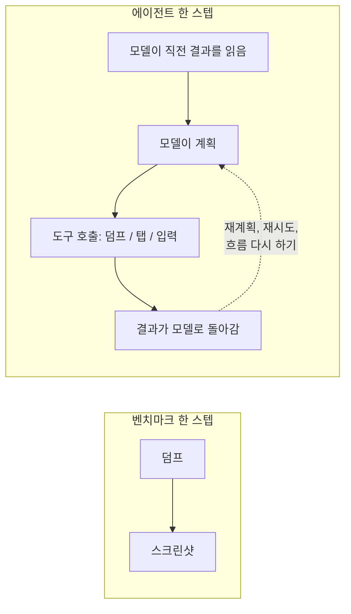

LLM 에이전트가 안드로이드 화면을 읽는 도구는 한 번 부를 때마다 2,250ms쯤 걸렸다. 앱 안에서 스냅샷을 뜨게 바꾸자 270ms 안팎으로 줄어, 벤치마크 평균으로 8.3배 빨라졌다. 그런데 며칠 뒤 세션별 시간 분해 지표를 붙여 보니 덤프 호출은 테스트 세션 시간의 1.1% 정도에 불과했다.

## 덤프가 병목처럼 보인 이유

하네스는 실기기에 설치한 안드로이드 앱을 상대로 UI 테스트 케이스를 돌리고, 테스트는 LLM 에이전트가 셸 도구로 수행한다. 덤프 도구는 현재 UI 트리를 텍스트로 돌려주고, 탭과 입력은 `adb`로 보내며, 텍스트로 부족하면 스크린샷을 찍는다.

덤프 도구는 `uiautomator dump`를 감싼 것이었다. 벤치마크용 폰(Snapdragon 888, 안드로이드 15, USB ADB)에서는 화면의 노드 수와 상관없이 2,250ms 정도가 걸렸는데, 대부분이 uiautomator 프로세스를 띄우는 비용이다. 스크린샷을 찍어 가져오면 570ms가 더 걸렸다. 그때 벤치마크를 정리하면서 나는 한 스텝에 2,800ms쯤이므로 10스텝짜리 작업은 UI 상태를 모으는 데만 28초가량 쓴다고 문서에 계산해 두었고, 덤프를 "에이전트 루프의 주요 병목"이라고 적었다.

나는 그 문장을 믿었다. 정작 내가 바란 것은 세션 전체가 빨라지는 것이었다. 무거운 테스트 케이스는 오래 돌다가 결국 손으로 다시 판정해야 하는 결과로 끝나는 일이 잦았다. 눈에 보이는 도구 중에 가장 느린 것이 덤프였으므로 거기부터 손을 댔다.

## 앱에서 직접 트리 가져오기

호출당 비용을 줄이려고 시스템 대신 앱에서 직접 트리를 받아 오기로 했다. 디버그·베타 빌드에만 들어가는 작은 라이브러리를 만들었는데, 프로세스 안에서 뷰 계층과 Compose 시맨틱 트리를 훑어 JSON으로 돌려준다. 벤치마크에서는 앱이 스냅샷을 파일로 쓰고 하네스가 그 파일을 폴링했고, 실제 하네스에서는 앱이 `adb forward`로 연결한 로컬 소켓으로 응답했다.

화면 유형 여섯 가지(순수 View, 순수 Compose, View 안의 Compose, Compose 안의 View, 50개짜리 `LazyColumn`, 입력 필드 20개짜리 폼)를 각각 10번씩 측정했다.

| 화면 | uiautomator | 앱 내부 | 배율 |
|---|---|---|---|
| View | 2,262ms | 252ms | 9.0x |
| Compose | 2,240ms | 268ms | 8.4x |
| View + Compose | 2,254ms | 278ms | 8.1x |
| Compose + View | 2,272ms | 266ms | 8.5x |
| 50개 리스트 | 2,290ms | 283ms | 8.1x |
| 20필드 폼 | 2,290ms | 293ms | 7.8x |

프로세스 안에서 트리를 뜨는 시간은 0.5~16.8ms였고, 남은 250ms 남짓은 거의 다 ADB 왕복이다. uiautomator가 버리는 정보도 함께 얻을 수 있었다. Compose의 역할(탭이 그냥 `View`로 나오지 않는다), 선택된 탭, 노드가 View와 Compose 경계의 어느 쪽에 있는지 같은 것들이다.

다만 공개 API 밖에서 Compose 시맨틱을 읽으려면 숨겨진 클래스를 리플렉션으로 건드려야 하므로, Compose나 안드로이드를 올리면 깨질 수 있다. 사용자에게 나가지 않는 빌드라서 그 유지보수 비용은 감수했다.

## 롤백 판단용 섀도 모드

새 경로를 넣은 첫 엔진 버전에는 기존, 앱 내부, 섀도 세 가지 모드를 뒀다. 섀도 모드는 새 경로를 쓰면서 옛 경로도 뒤에서 같이 돌려 결과를 견주는 모드다. 이 모드에서 에이전트는 앱 내부 결과를 받고, 같은 호출 안에서 예전 uiautomator 덤프도 함께 돌려 에이전트가 찾은 요소 수가 두 쪽에서 같은지 로그로 남긴다. 새 트리에 빠진 것이 있으면 그 로그를 보고 롤백할 생각이었다.

하지만 그 로그로는 테스트 세션이 실제로 빨라졌는지 알 수 없었다. 호출 하나의 지연 시간은 쉽게 보이지만, 세션 시간은 에이전트가 하는 나머지 모든 일에 달려 있는데 벤치마크 루프는 그 대부분을 빼놓고 있었다.



벤치마크가 측정한 것은 왼쪽 상자다. 세션은 오른쪽 상자가 여러 번 도는 것이고, 내가 보지 않던 곳이 바로 점선이었다.

## 세션 시간 전체 측정

세션 시간 분해 지표를 붙였다. 러너가 테스트마다 도구 지표와 로그로 아래 항목을 계산해 남긴다.

- 덤프 호출 안에서 쓴 시간의 합
- 에이전트가 셸 명령으로 건 `sleep` 초의 합
- 계획 단계로 다시 들어간 횟수
- 글 작성 흐름으로 다시 들어간 횟수
- `adb shell input text`를 직접 부른 횟수

대시보드는 엔진 버전마다 모든 실행의 덤프 시간 합을 세션 시간 합으로 나눴다. 코드로 옮기면 대략 이렇다.

```python
def dump_share(runs):
    dump_s = sum(r.breakdown.dump_ms for r in runs) / 1000
    session_s = sum((r.finished_at - r.started_at).total_seconds() for r in runs)
    return dump_s / session_s if session_s else 0.0
```

시간 가중 비율이라서 긴 세션이 더 크게 반영된다. 무거운 케이스가 오래 걸리는 것이 바로 문제였으므로 이 가중치가 맞았다.

## 그 버전에서 덤프 비중 1.1%

그때 돌리던 버전에서 덤프 호출은 세션 시간의 평균 1.1% 정도였다. 그 버전에서 손으로 다시 판정해야 했던 케이스는 대부분 동영상 첨부·편집·뷰어 흐름에 몰려 있었다. 앞선 버전들에서 들여다본 무거운 케이스의 로그에도 느린 도구는 없었고, 대신 에이전트가 같은 일을 되풀이하고 있었다.

- 글 작성 화면을 다시 열고 같은 제목과 본문을 또 입력한다
- 설정 화면(예약, 공개 범위 토글)에서 엉뚱한 분기로 들어갔다가 빠져나온다
- 미디어 선택 화면에서 좌표 탭, 화면 요약, 다시 탭을 계속 반복한다

토큰 15만 개쯤, 시간 152초를 쓰고 수동 판정으로 넘어간 실행 하나는 성능 저하처럼 보였는데, 들여다보니 긴 세션 도중에 환경 설정 파일 경로가 바뀌어서 도구 호출이 그 파일을 제대로 다시 쓰지 못하고 있었다. 이것부터 고쳤다. 이런 실행이 섞인 속도 비교는 버그를 재는 일이 되기 때문이다.

즉, 덤프가 빨라진 것은 호출마다 분명한 이득이었지만 무거운 세션에서 몇 분씩 새는 곳은 따로 있었다.

## 되풀이하던 흐름을 도구로 묶기

먼저 섀도 모드를 껐다. 알아야 할 것은 이미 확인했는데도, 덤프를 부를 때마다 없애려던 느린 경로의 비용이 계속 들고 있었기 때문이다. 앱 내부 스냅샷은 기본 경로로 남겼다. 역할과 선택 상태, 스위치의 체크 상태까지 담긴 트리 덕분에 에이전트는 예전에는 스크린샷이 필요했던 자리에서 텍스트만으로 판단할 수 있었다.

가장 쉬운 방법은 탭이나 대기를 더 잘하는 작은 도구를 더 만드는 것이었다. 탭하고 기다리는 동작 도구와 날짜·시간 선택 도구는 이미 만들어 둔 상태였는데, 분해 지표를 보면 동작 하나하나는 느리지 않았다. 에이전트가 계획을 자꾸 다시 세우고 같은 순서를 되풀이했으므로, 실패가 몰리는 흐름을 큰 도구 몇 개로 묶었다.

- 제목과 본문을 채우고 설정을 열고 등록이나 임시저장까지 한 번에 하는 작성 도구
- 예약과 공개 범위 옵션을 정하고 작성 화면으로 돌아오는 설정 도구
- 입력과 설정이 함께 필요한 케이스를 위해 둘을 합친 레시피 도구
- 앨범을 바꾸고 그리드에서 동영상을 고르고 편집 화면에서 확인한 뒤 작성 화면 복귀를 기다리는 미디어 선택 도구

도구만 추가해서는 잘 쓰이지 않았고, 어느 화면에서 어떤 도구를 먼저 쓰라고 프롬프트에 적은 뒤에야 사용 횟수가 올랐다. 분해 지표가 세션마다 도구별 호출 수를 세고 있어서 이것을 확인할 수 있었다. 이 도구들로 가장 크게 줄어든 것은 모델이 멈춰서 계획을 다시 세우고 같은 것을 두 번 확인하는 일이었고, 셸 호출 수가 준 것은 그보다 작은 효과였다.

## 나머지 시간을 네 가지로 나누기

며칠 뒤에는 분해 지표가 "나머지 시간"으로 뭉뚱그리던 부분까지 나눴다. 러너가 최상위 구조화 도구 호출마다 시간을 재서 네 가지(대기, 상호작용, 작성 흐름, 미디어·복구) 중 하나로 분류한다. 도구가 다른 도구를 부르는 중첩 호출은 두 번 세지 않도록 건너뛰고, 스크린샷 시간은 이미 따로 집계하고 있었으므로 호출 안에 겹친 만큼 뺀다.

그 분류의 핵심을 이름만 일반적으로 바꿔 옮겼다.

```python
from collections import defaultdict

def residual_buckets(tool_calls, screenshot_calls):
    buckets = defaultdict(int)
    for call in tool_calls:
        if call.nested:  # counted inside its parent already
            continue
        overlap = sum(s.duration_ms for s in screenshot_calls
                      if call.start_ms <= s.at_ms <= call.end_ms)
        own_ms = max(call.duration_ms - overlap, 0)
        buckets[BUCKET.get(call.category, "other")] += own_ms
    return dict(buckets)

BUCKET = {"wait": "wait", "interaction": "interaction",
          "write_flow": "write_flow", "settings_flow": "write_flow",
          "recipe": "write_flow", "media_flow": "media_recovery",
          "recovery": "media_recovery"}
```

`nested` 검사나 겹침 빼기 중 하나만 빠져도 같은 시간이 두 분류에 이중으로 집계된다.

## 벤치마크 숫자와 세션 숫자

이 모든 일이 빠르게 진행돼서, 기준 버전 이후 이틀 동안 엔진 버전이 26개 쌓였다.

| 항목 | 값 | 측정 방법 |
|---|---|---|
| uiautomator 덤프 1번 | 2,240~2,290ms | 벤치마크, 화면 6종 x 10번, 폰 한 대 |
| 앱 내부 스냅샷 1번 | 252~293ms | 같은 벤치마크 |
| 배율 | 7.8~9.0배, 평균 8.3배 | 같은 벤치마크 |
| 프로세스 안 캡처만 | 0.5~16.8ms | 같은 벤치마크, ADB 제외 |
| 세션 시간 중 덤프 비중 | 약 1.1% | 한 엔진 버전의 덤프 시간 합 / 세션 시간 합 |

위의 네 줄은 모델이 빠진 루프에서 나온 숫자이고, 그 루프 안에서는 덤프가 정말로 스텝 시간의 대부분이었다. 하지만 세션의 한 스텝에는 모델이 결과를 읽고 다음 행동을 정하고, 가끔은 처음부터 다시 하기로 하는 시간까지 들어 있다. 벤치마크 문서에도 한계는 적어 뒀다. 기기 한 대, 샘플 앱, 그리고 풍부해진 트리가 모델의 행동 선택을 돕는지는 따로 볼 문제라는 것이었는데, "이 루프에는 모델이 없다"는 그 목록에 없었다.

## 최적화 전에 세션 분해부터

다시 한다면 세션 분해 지표를 최적화보다 먼저 만들겠다. 오후 한나절이면 끝났을 일이다. 그랬다면 느린 도구가 차지하는 몫은 작고 낭비는 반복되는 흐름에 있다는 것을 일찍 알았을 테고, 첫 작업으로 큰 도구 몇 개를 골랐을 것이다.

점검 방법은 위의 `dump_share` 함수다. 빠르게 만들려는 도구가 있으면 한 버전의 모든 실행에서 그 도구가 쓴 시간을 더해 세션 시간 합으로 나누고, 빠른 버전을 짜기 전에 그 숫자부터 본다.
