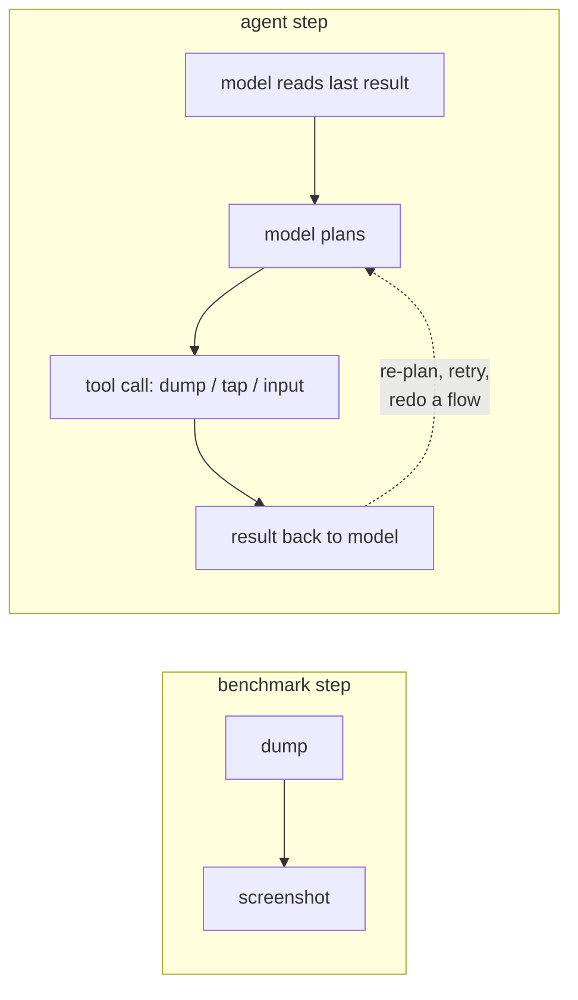

The tool my LLM agent used to read an Android screen took about 2,250 ms per call. I replaced it with an in-app snapshot that answered in about 270 ms, an 8.3x average speedup on a benchmark. A few days later I added a per-session time breakdown, and the dump calls came to about 1.1% of the time a test session spent running.

## Why the dump looked like the bottleneck

The harness runs UI test cases against an Android app on real phones, with an LLM agent doing the testing through shell tools. A dump tool returns the current UI tree as text, `adb` sends taps and input, and the agent takes a screenshot when text isn't enough.

The dump tool wrapped `uiautomator dump`. On the benchmark phone (Snapdragon 888, Android 15, USB ADB) it cost about 2,250 ms no matter how many nodes were on screen, since most of that is starting the uiautomator process. A screenshot plus pull added about 570 ms. My write-up at the time did the arithmetic: about 2,800 ms per step, so a 10-step task spends about 28 seconds just collecting UI state. It called the dump "the main bottleneck of the agent loop."

I believed that sentence. What I actually wanted was faster sessions. Heavy test cases ran long and often ended with a verdict that needed a manual check, and the dump was the slowest single tool I could see. So I started there.

## Asking the app for its own tree

To cut the per-call cost I stopped asking the system for the tree and asked the app. I wrote a small library, included only in debug and beta builds, that walks the View hierarchy and the Compose semantics tree from inside the process and returns JSON. In the benchmark the app wrote the snapshot to a file that the harness polled. In the harness it answered over a local socket reached through `adb forward`.

I benchmarked six screen types (plain Views, plain Compose, Views hosting Compose, Compose hosting Views, a 50-item `LazyColumn`, a 20-field form), 10 runs each:

| Screen | uiautomator | in-app | speedup |
|---|---|---|---|
| View | 2,262 ms | 252 ms | 9.0x |
| Compose | 2,240 ms | 268 ms | 8.4x |
| View + Compose | 2,254 ms | 278 ms | 8.1x |
| Compose + View | 2,272 ms | 266 ms | 8.5x |
| 50-item list | 2,290 ms | 283 ms | 8.1x |
| 20-field form | 2,290 ms | 293 ms | 7.8x |

The capture inside the process took 0.5 to 16.8 ms. Almost all of the remaining ~250 ms was the ADB round trip. The in-app tree also carried things uiautomator drops: Compose roles (a tab comes back as a tab, where uiautomator just says `View`), selected tabs, and which side of a View/Compose boundary a node sits on.

Reading Compose semantics outside the public API meant reflection on hidden classes, which can break on a Compose or Android upgrade. I accepted that maintenance cost for builds that never ship to users.

## A shadow mode for rollback

The first engine version with the new path had three modes: legacy, in-app, and shadow. In shadow mode the agent saw the in-app result, and the same call also ran the old uiautomator dump and logged whether the two returned the same number of matches for the agent's query. If the new tree was missing things, that log would tell me to roll back.

It couldn't tell me whether test sessions got faster. Per-call latency was easy to see. Session time depends on everything else the agent does, and the benchmark loop had left most of that out:



The benchmark timed the left box. A session is the right box many times over, and I hadn't been looking at the dashed edge.

## Timing whole sessions

I added a breakdown that the runner computes for every test from its tool metrics and log. It records:

- total time spent inside dump calls
- total seconds of `sleep` the agent issued in shell commands
- how many times the agent re-entered its planning step
- how many times it re-entered the post-composer flow
- how many raw `adb shell input text` calls it made

For each engine version, the dashboard divided total dump time by total session time across all runs. Roughly:

```python
def dump_share(runs):
    dump_s = sum(r.breakdown.dump_ms for r in runs) / 1000
    session_s = sum((r.finished_at - r.started_at).total_seconds() for r in runs)
    return dump_s / session_s if session_s else 0.0
```

That's a time-weighted share, so long sessions count more than short ones. Heavy cases running long was the whole problem, so that's the weighting I wanted.

## 1.1% on that version

On the version I was running, dump calls averaged about 1.1% of session time. The cases on that version that needed a manual check were mostly in video attach, edit and viewer flows. Across the heavy cases I'd looked at over the previous versions, the logs didn't show slow tools. They showed the agent repeating itself:

- reopening the post-composer screen and typing the same title and body again
- going into the wrong branch of a settings screen (scheduling, visibility toggles) and backing out
- in the media picker, a raw coordinate tap, then a fresh summary of the screen, then another tap, over and over

One case looked like a performance regression: about 150,000 tokens and 152 seconds before it ended with a verdict that needed a manual check. Partway through that long session, the path to the file holding its environment setup had shifted, and tool calls could no longer reliably reuse it. I fixed that first. A speed comparison that includes runs like that measures the bug.

So the faster dump was a real per-call gain, and heavy sessions were losing their minutes somewhere else.

## Bundling the flows the agent kept redoing

I ended shadow mode first. It had answered its question, and every dump call was still paying for the slow path it was meant to replace. The in-app snapshot stayed as the default. Its richer tree (roles, selection, checked state of switches) let the agent skip screenshots in places where it used to need them.

The easy next step was more small tools, a better tap or a better wait. I'd already added a tap-and-wait action and a date/time picker tool. The breakdown said no single action was slow. The agent kept re-planning and redoing sequences. So I bundled the flows where failures clustered into a few high-level tools:

- a composer tool that fills title and body, opens settings, and submits or saves a draft in one call
- a settings tool that sets the scheduling and visibility options and returns to the composer
- a recipe tool that does both, for cases that need input and settings together
- a media picker tool that switches album, picks videos from the grid, confirms in the editor, and waits for the composer to come back

Usage of the new tools only went up once the prompt said which tool to prefer on which screen. I could see that because the breakdown counted each tool's calls per session. What the tools bought most was fewer chances for the model to stop, re-plan, and verify the same thing twice. The drop in shell calls mattered less.

## Splitting the residual

A few days later I extended the breakdown into the part it had been calling "residual." The runner timed each top-level structured tool call and put it in one of four buckets: wait, interaction, write flow, or media and recovery. It skipped nested calls, so a tool calling another tool didn't count twice, and it subtracted any screenshot time inside a call because screenshots were already counted separately.

The core of that split, rewritten with generic names:

```python
from collections import defaultdict

def residual_buckets(tool_calls, screenshot_calls):
    buckets = defaultdict(int)
    for call in tool_calls:
        if call.nested:  # counted inside its parent already
            continue
        overlap = sum(s.duration_ms for s in screenshot_calls
                      if call.start_ms <= s.at_ms <= call.end_ms)
        own_ms = max(call.duration_ms - overlap, 0)
        buckets[BUCKET.get(call.category, "other")] += own_ms
    return dict(buckets)

BUCKET = {"wait": "wait", "interaction": "interaction",
          "write_flow": "write_flow", "settings_flow": "write_flow",
          "recipe": "write_flow", "media_flow": "media_recovery",
          "recovery": "media_recovery"}
```

Drop either the `nested` check or the overlap subtraction and the same milliseconds land in two buckets.

## Benchmark numbers next to the session number

All of this moved fast: I logged 26 engine versions over two days after the baseline.

| what | value | how it was measured |
|---|---|---|
| uiautomator dump, per call | 2,240 to 2,290 ms | benchmark, 6 screens x 10 runs, one phone |
| in-app snapshot, per call | 252 to 293 ms | same benchmark |
| speedup | 7.8x to 9.0x, average 8.3x | same benchmark |
| in-process capture alone | 0.5 to 16.8 ms | same benchmark, ADB excluded |
| dump share of session time | about 1.1% | sum of dump time / sum of session time, one engine version |

The first four rows come from a loop with no model in it. In that loop the dump really was most of each step. In a session, a step also includes the model reading the result, deciding what to do, and sometimes deciding to start over. The benchmark write-up listed its limits (one device, a sample app, an open question about whether the richer tree would help the model pick better actions), and "the model isn't in this loop" wasn't one of them.

## Build the session breakdown first

If I did it again, I'd build the per-session breakdown before the optimization. It would have taken an afternoon. It would have shown that the slow tool was a small slice, that the waste was in repeated flows, and that the first project should be a handful of high-level tools.

The check is the `dump_share` function above, pointed at whatever tool you're about to speed up: sum that tool's time across every run of one version, divide by the summed session time, and look at the result before you write the faster version.
