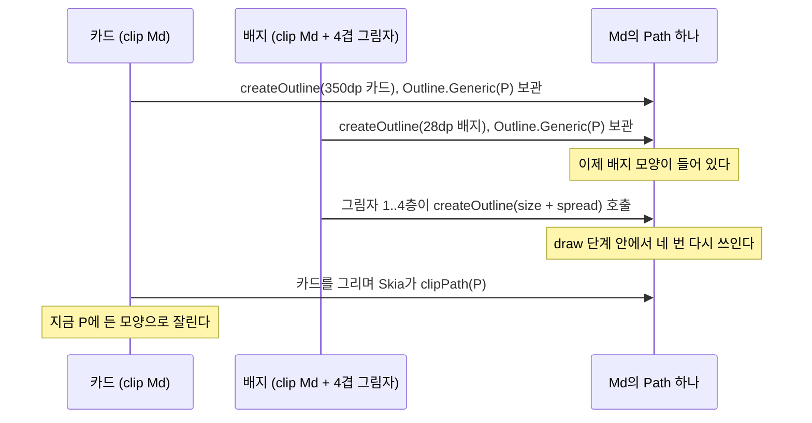

앱 홈 탭에서 높이 28dp짜리 연속 학습 배지와 폭이 350dp쯤 되는 주간 카드가 iOS에서 서로의 모양으로 잘렸다. 둘은 레이아웃에서 자리도 다른 별개의 컴포저블이었고, 안드로이드에서는 둘 다 제대로 그려졌다. 알고 보니 둘은 `Path` 객체 하나를 함께 쓰고 있었다. 둘 다 같은 모서리 shape 토큰을 썼는데, 그 토큰이 호출하는 쪽 모두에게 같은 가변 버퍼를 넘겨주고 있었다.

## 연속 곡률 모서리 토큰 도입

앱은 코틀린으로 한 번 작성하고 Compose Multiplatform으로 안드로이드와 iOS에 배포한다. 당시 버전은 Kotlin 2.3.10, Compose Multiplatform 1.10.2였다. 그날 저녁 화면 곳곳에 흩어져 있던 `RoundedCornerShape` 값을 반경 단계별 모서리 토큰으로 바꿨는데, 토큰의 모양은 오픈소스 `ContinuousRoundedCornerShape` 라이브러리가 그리는 연속 곡률('스쿼클') 모서리다. 작은 드롭 섀도 라이브러리를 이용하여 여러 겹 쌓는 부드러운 그림자도 같이 넣었다. 토큰을 object 안에 뒀으므로 반경 단계 하나하나가 싱글턴이고, 약 30곳이 같은 객체를 쓴다. 정의는 다음과 같다.

```kotlin
object Corners {
    val Md: Shape = ContinuousRoundedCornerShape(12.dp)   // 카드, 버튼, 목록 행, 칩...
}
```

shape 토큰은 보통 이렇게 만들고, `RoundedCornerShape`였다면 아무 문제가 없었을 것이다.

## shape 인스턴스당 Path 하나

연속 곡률 모서리는 3차 곡선이라 `Outline.Rounded`로는 표현할 수 없다. 그래서 라이브러리는 `Path`를 참조로 들고 있는 `Outline.Generic`을 돌려준다. 구현을 보면 shape 인스턴스마다 `Path`를 하나 두고, `createOutline`이 불릴 때마다 그 path를 rewind해서 다시 채운 뒤 돌려준다. 쓰던 버전(1.0.6)의 배포 소스 jar에서 해당 부분을 찾아본 결과는 다음과 같다.

```console
$ unzip -p <shape-library>-1.0.6-sources.jar '*/ContinuousRoundedCornerShapeImpl.kt' \
    | grep -n "Path()\|rewind\|Outline.Generic"
28:    private val path = Path()
71:                path.rewind()
73:                return Outline.Generic(path)
```

뼈대만 남기면 다음과 같은 모양이다.

```kotlin
class SharedBufferShape : Shape {
    private val path = Path()                       // shape 인스턴스당 하나

    override fun createOutline(size: Size, layoutDirection: LayoutDirection, density: Density): Outline {
        path.rewind()
        buildCorners(into = path, size = size)
        return Outline.Generic(path)                // 모든 호출자가 같은 객체를 받는다
    }
}
```

쓰는 자리마다 shape를 새로 만들면 호출자 하나에 버퍼 하나가 대응되므로 문제가 생기지 않는다. 하지만 싱글턴 토큰에서는 앱이 들고 있는 outline이 전부 같은 버퍼를 가리키고, 그 버퍼에는 마지막으로 쓴 호출자의 모양만 남는다.

## 그림자 네 겹과 버퍼 덮어쓰기

그림자가 없었다면 가끔 보이는 오류에 그쳤을 텐데, 여러 겹 그림자를 얹으면서 매 프레임 버퍼가 다시 쓰이게 됐다. 드롭 섀도 모디파이어는 자체 캐시 없이 draw 단계 안에서 `shape.createOutline`을 호출하고, 이때 콘텐츠 크기에 그 층의 spread를 더한 크기를 넘긴다. 내 그림자 스펙은 옅은 층을 두 개에서 네 개까지 쌓고 층마다 spread가 다르므로, 층마다 요청하는 크기도 달라진다. 그래서 배지에 네 겹 그림자를 달자 그리는 도중에 공유 버퍼가 프레임마다 네 번 다시 쓰였고, 배지는 그 크기들 가운데 가장 좁은 모양으로 잘렸다.

카드와 배지만 남겨 iOS에서 한 프레임을 그리는 순서를 정리하면 다음과 같다.



## iOS에서만 왜 잘렸나

두 백엔드는 클립 모양을 가져가는 시점이 다르다. 정리하면 다음과 같다.

| | 클립 모양을 가져가는 시점 | 나중에 다시 쓰면 |
|---|---|---|
| 안드로이드 | 렌더 노드에 outline을 설정할 때. `android.graphics.Outline.setPath`가 path를 복사한다(`mPath.set(path)`) | 영향 없음. 노드가 자기 복사본을 갖고 있다 |
| iOS(skiko 위의 Skia) | 그리는 시점에 `Path`에 들어 있는 모양으로 | 마지막에 쓴 모양으로 잘린다 |

안드로이드 쪽은 플랫폼 소스를 열어 확인했다. API 36.1 소스의 `Outline.java`에서 `setPath`는 자기 `Path`를 한 번 만들어 두고 `mPath.set(path)`를 호출한다. 렌더 노드마다 복사본을 가지므로 outline을 설정하는 시점에 모양이 고정된다. 반면 iOS에서는 Skia가 그리는 순간 `Path`에 들어 있는 모양으로 클립을 건다. 버그는 공통 코드에 있었지만 iOS에서만 눈에 띈 이유가 이것이다.

## 토큰에서 outline 복사하기

버퍼를 공유하게 만든 곳이 토큰이므로 토큰을 고쳤다. 반경 단계마다 라이브러리 shape를 감싸고, outline이 generic이면 복사본을 돌려주게 했다.

```kotlin
class OwnPathShape(private val inner: Shape) : Shape {
    override fun createOutline(size: Size, layoutDirection: LayoutDirection, density: Density): Outline =
        when (val outline = inner.createOutline(size, layoutDirection, density)) {
            is Outline.Generic -> Outline.Generic(Path().apply { addPath(outline.path) })
            else -> outline                          // Rounded, Rectangle은 이미 값 타입이다
        }

    // shape를 키로 쓰는 modifier가 예전과 같은 토큰으로 보도록 동등성을 위임한다.
    override fun equals(other: Any?) = other is OwnPathShape && other.inner == inner
    override fun hashCode() = inner.hashCode()
}

object Corners {
    val Md: Shape = OwnPathShape(ContinuousRoundedCornerShape(12.dp))
}
```

반경은 그대로 두었으므로 디자인 명세도 바뀌지 않았다. 대신 `createOutline`을 호출할 때마다 `Path`가 하나씩 할당된다. 그림자는 draw 단계에서 outline을 구하므로 이 할당이 그림자 층마다, 프레임마다 생기는데, 라이브러리가 어차피 그 자리에서 곡선을 다시 만들고 있으니 결국 그 위에 할당이 하나 더 붙는다.

## 그림자 outline 크기별 캐시

몇 분 뒤에는 그림자 쪽도 고쳤다. 병렬로 돌리던 AI 코딩 세션이 드롭 섀도가 그릴 때마다 outline을 다시 계산한다고 짚었는데, 그 메모에는 층마다 새 3차 곡선 `Path`를 할당한다고 적혀 있었다. 두 라이브러리 코드를 읽어 보니 큰 방향은 맞았지만 세부 내용은 틀렸다. shape가 버퍼 하나를 재사용하므로 새 `Path`는 생기지 않는다. 대신 층 하나를 그릴 때마다 `RoundedPolygon`과 꼭짓점별 `CornerRounding` 리스트, 변환된 복사본 한 벌이 새로 생긴다. 셰이더 애니메이션 때문에 매 프레임 다시 그리는 배지에서는 이 비용이 계속 쌓인다.

`createOutline`을 그대로 메모이제이션하는 방법도 있었지만, 그 아래에 라이브러리의 공유 버퍼가 있으므로 캐시한 outline 네 개가 모두 같은 `Path`를 가리키게 된다. 층마다 크기가 다르니 마지막에 그린 층이 나머지 세 층의 모양까지 정하고, 캐시가 그 모양을 계속 들고 있었을 것이다. 따라서 캐시는 크기를 키로 쓰고, generic outline은 넣을 때 복사하게 만들었다.

```kotlin
class SizeCachedShape(private val inner: Shape) : Shape {
    private val cache = mutableMapOf<Pair<Size, LayoutDirection>, Outline>()

    override fun createOutline(size: Size, layoutDirection: LayoutDirection, density: Density): Outline =
        cache.getOrPut(size to layoutDirection) {
            if (cache.size >= 8) cache.clear()       // 그림자 층당 한 칸이라 크기가 묶여 있다
            when (val o = inner.createOutline(size, layoutDirection, density)) {
                is Outline.Generic -> Outline.Generic(Path().apply { addPath(o.path) })
                else -> o
            }
        }
}
```

범용 캐시는 아니고, 크기 종류가 적고 고정돼 있다고 가정한다. 층 수를 그림자 스펙이 정하므로 이 가정은 지켜진다. 크기 애니메이션 때문에 가정이 깨지면 항목을 하나씩 밀어내지 않고 캐시를 통째로 비운다.

두 수정을 나란히 놓으니 같은 수정을 두 번 한 것처럼 보여서, 둘 다 남겨 둔 이유를 표로 적어 두었다.

| 장치 | 위치 | 막는 문제 |
|---|---|---|
| 복사 래퍼 | 모서리 토큰 | 약 30곳이 함께 쓰는 싱글턴이 iOS에서 서로의 모양으로 잘린 문제 |
| 크기별 캐시 | 부드러운 그림자 | 층마다, 그릴 때마다 outline을 다시 만드는 문제. 움직이는 컴포넌트에서 프레임당 polygon 네 개 |

캐시는 복사 래퍼보다 바깥에 있다. 캐시 히트면 안쪽 shape를 아예 호출하지 않으므로 복사 비용은 캐시 미스 때만 든다. 캐시 안에서도 복사하는 이유는 그림자가 아무 `Shape`나 받기 때문이다. 누가 라이브러리 shape를 감싸지 않고 넘기면 그 층들이 버퍼 하나로 겹친다. 그래서 디자인 시스템 문서에는 규칙 하나만 적었다. 드롭 섀도를 직접 호출하지 말고, 캐시가 걸린 부드러운 그림자 모디파이어를 거친다.

## 정리

그래픽 API가 돌려준 객체는 당연히 받은 쪽이 소유한다고 믿고 있었다. 하지만 `Outline.Generic`은 참조를 감쌀 뿐 그런 보장을 하지 않으므로, 만든 쪽이 그 버퍼에 계속 써도 된다. 안드로이드에서 이 믿음이 깨지지 않은 건 `setPath`가 path를 복사해 준 덕분이었다. 그래서 지금은 Compose Multiplatform 버그가 한쪽 플랫폼에서만 보이면 백엔드마다 무엇을 복사하고 무엇을 그리는 순간 읽는지부터 확인한다.

shape 토큰은 쓰는 자리마다 만들거나, outline마다 자기 모양을 갖도록 감싸는 것이 좋다. 서드파티 shape를 토큰 object에 넣거나 캐시 뒤에 두기 전에는 앞에서 쓴 `grep`을 그 소스 jar에 한 번 돌려 본다. 필드에 든 `Path()` 옆에 `rewind`가 보이면 호출하는 쪽 모두가 버퍼 하나를 나눠 쓴다는 뜻이다.
