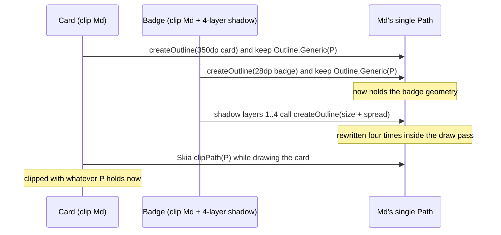

On my app's home tab, iOS clipped a 28 dp-high streak badge and a full-width weekly card, about 350 dp wide, against each other's geometry. They're separate composables in separate parts of the layout, and Android drew both correctly. What they had in common was one `Path` object: both used the same corner-shape token, and that token handed every caller the same mutable buffer.

## Moving the corners onto continuous-corner tokens

The app is written once in Kotlin and ships to Android and iOS with Compose Multiplatform (Kotlin 2.3.10, Compose Multiplatform 1.10.2 at the time). That evening I replaced the `RoundedCornerShape` values scattered through the screens with a radius scale of corner tokens. The tokens use continuous ("squircle") corners from an open-source `ContinuousRoundedCornerShape` library. I also added a layered soft shadow built on a small drop-shadow library. The tokens live in an object, so each step of the scale is a singleton that about 30 consumers share:

```kotlin
object Corners {
    val Md: Shape = ContinuousRoundedCornerShape(12.dp)   // cards, buttons, rows, chips...
}
```

That's how shape tokens are usually defined, and with `RoundedCornerShape` it's harmless.

## One Path per shape instance

A continuous corner is a cubic curve, so the shape can't return `Outline.Rounded`. It returns `Outline.Generic`, which holds a `Path` by reference. The library keeps one `Path` per shape instance, and on every `createOutline` it rewinds that path, refills it and returns it. I searched the published sources jar for the version I used (1.0.6):

```console
$ unzip -p <shape-library>-1.0.6-sources.jar '*/ContinuousRoundedCornerShapeImpl.kt' \
    | grep -n "Path()\|rewind\|Outline.Generic"
28:    private val path = Path()
71:                path.rewind()
73:                return Outline.Generic(path)
```

Stripped down, the pattern looks like this:

```kotlin
class SharedBufferShape : Shape {
    private val path = Path()                       // one per shape instance

    override fun createOutline(size: Size, layoutDirection: LayoutDirection, density: Density): Outline {
        path.rewind()
        buildCorners(into = path, size = size)
        return Outline.Generic(path)                // every caller gets this same object
    }
}
```

If each call site creates its own shape, there's one caller per buffer and nothing goes wrong. With a singleton token, every outline the app holds points at the same buffer, and the buffer holds whatever geometry the last caller wrote.

## Four shadow layers, four rewrites per frame

Without the shadow this would have been an occasional glitch. With it, the buffer got rewritten every frame. The drop-shadow modifier calls `shape.createOutline` inside its draw pass, with no cache of its own, at the content size plus the layer's spread. My shadow specs stack two to four faint layers, each with its own spread, so each layer asks for a different size. A four-layer shadow on a badge rewrote the shared buffer four times per frame in the middle of drawing, and the badge ended up clipped to the narrowest of those sizes.

This is one frame on iOS, reduced to the card and the badge:



## Android copies the path when it sets the outline

Android and iOS take the clip geometry at different moments:

| | When the clip geometry is taken | Effect of a later rewrite |
|---|---|---|
| Android | when the outline is set on the render node; `android.graphics.Outline.setPath` copies the path (`mPath.set(path)`) | none, the node has its own copy |
| iOS (Skia via skiko) | at draw time, from the live `Path` | the clip uses whatever was written last |

On Android I read it in the platform source. In `Outline.java` (API 36.1 sources), `setPath` allocates its own `Path` once and calls `mPath.set(path)`, so the render node keeps a private copy and each consumer's geometry is frozen when it's set. On iOS, Skia clips with the live `Path` when it draws. That's why I only saw the bug on iOS, even though it was in shared code.

## Copying the outline inside the token

The token is where the sharing starts, so I fixed it there. Each step of the scale now wraps the library shape, and the wrapper returns a copy whenever the outline is generic:

```kotlin
class OwnPathShape(private val inner: Shape) : Shape {
    override fun createOutline(size: Size, layoutDirection: LayoutDirection, density: Density): Outline =
        when (val outline = inner.createOutline(size, layoutDirection, density)) {
            is Outline.Generic -> Outline.Generic(Path().apply { addPath(outline.path) })
            else -> outline                          // Rounded and Rectangle are values already
        }

    // Delegate equality so modifiers keyed on the shape see the same token as before.
    override fun equals(other: Any?) = other is OwnPathShape && other.inner == inner
    override fun hashCode() = inner.hashCode()
}

object Corners {
    val Md: Shape = OwnPathShape(ContinuousRoundedCornerShape(12.dp))
}
```

I kept the radii as they were, so the design spec didn't move. The cost is one `Path` allocation per `createOutline` call. The shadow resolves its outline in the draw pass, so that's one allocation per frame per shadow layer, on top of the curve the library rebuilds there anyway.

## Caching the shadow outline without aliasing it

Minutes later I made a second change, this time to the shadow. An AI coding session I had running in parallel had flagged that the drop shadow recomputes the outline on every draw. Its note said each layer allocates a fresh cubic `Path`. When I read the two libraries, the mechanism held up and the detail didn't. No new `Path` gets allocated, because the shape reuses its one buffer. What does get allocated, once per layer per draw, is a `RoundedPolygon`, its per-vertex `CornerRounding` list and a transformed copy. On the badges that redraw every frame because a shader animates inside them, that adds up.

I could have memoised `createOutline` directly, but with the library's shared buffer underneath, all four cached outlines would have pointed at the same `Path`. Each layer asks for a different size, so the last layer to draw would have set the geometry for the other three, and the cache would have kept it that way for good. So the cache keys outlines by size and copies generic ones as they go in:

```kotlin
class SizeCachedShape(private val inner: Shape) : Shape {
    private val cache = mutableMapOf<Pair<Size, LayoutDirection>, Outline>()

    override fun createOutline(size: Size, layoutDirection: LayoutDirection, density: Density): Outline =
        cache.getOrPut(size to layoutDirection) {
            if (cache.size >= 8) cache.clear()       // bounded: one entry per shadow layer
            when (val o = inner.createOutline(size, layoutDirection, density)) {
                is Outline.Generic -> Outline.Generic(Path().apply { addPath(o.path) })
                else -> o
            }
        }
}
```

It isn't a general-purpose cache. It assumes a small, fixed set of sizes, which holds because the shadow spec fixes the layer count. If a resize animation breaks that, the cache clears itself rather than evicting entries one by one.

Side by side, the two changes looked like the same fix applied twice, so I wrote down why both stay:

| Guard | Level | Problem it solves |
|---|---|---|
| copying wrapper | corner tokens | singletons shared by about 30 consumers clipped against each other's geometry on iOS |
| size-keyed cache | soft shadow | the outline was rebuilt per layer per draw, four polygons a frame on animating components |

The cache sits above the copy. A cache hit skips the inner shape entirely, so the copy costs one allocation per miss. I kept the copy inside the cache as well, because the shadow accepts any `Shape`, and a caller passing a bare library shape would otherwise alias all its layers onto one buffer. The design-system doc ends that section with one rule: don't call the drop shadow directly, go through the soft-shadow modifier that applies the cache.

## Reading the producer before trusting an Outline

I'd assumed that an object a graphics API hands back to me is mine. `Outline.Generic` doesn't promise that. It wraps a reference, and the producer can keep writing to it. Android's copy in `setPath` kept that assumption from failing there. Now, when a Compose Multiplatform bug shows up on only one platform, one of the first things I ask is what each backend copies and what it reads live.

For shape tokens, I either build the shape per call site or wrap it so every outline owns its geometry. Before putting a third-party shape in a token object or behind a cache, the `grep` over its sources jar from earlier is a quick check. A `Path()` held in a field next to a `rewind` means every caller shares one buffer.
