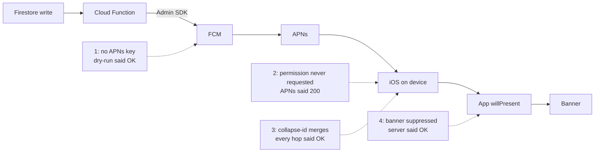

8월 1일부터 5일 사이에 내가 만드는 iOS 앱에서 채팅 알림이 오지 않는 원인을 네 개 찾아 고쳤는데, 네 번 모두 파이프라인 어딘가에서는 성공했다는 응답이 돌아왔다. FCM dry-run은 통과했고 FCM은 실제 메시지 ID를 돌려줬다. APNs에 직접 보낸 요청도 HTTP 200을 받았고 Cloud Function 로그에는 "보냄"이 찍혔지만 정작 받는 기기에는 배너가 뜨지 않았다.

## Firestore 쓰기부터 배너까지의 구간

작은 비공개 채팅 앱으로, 클라이언트는 iOS 18을 타겟으로 한 SwiftUI 앱이고 백엔드는 Firebase다. Cloud Functions는 Node 20에서 `firebase-admin` 13으로 돈다. Firestore에 메시지 문서가 생기면 Cloud Function(`onDocumentCreated`)이 알림을 만들어 Admin SDK로 FCM에 넘기고, FCM이 이를 다시 APNs로 전달하는 구조다. 같은 헬퍼로 새 기록·일정 변경·기념일·오늘의 질문 답변·콕 찌르기 같은 "활동" 푸시도 보낸다.

구간마다 '성공'의 기준이 달랐고, 네 버그도 모두 서로 다른 구간에 있었다.



내 환경에서는 시뮬레이터에 푸시 배너가 뜨지 않았기 때문에 끝까지 확인하려면 매번 실기기 두 대가 필요했다. 게다가 어느 단계에서도 에러가 나지 않았다. 트리거는 돌았고 서버의 미읽음 카운터도 올라갔다. 증상이라고는 알림이 없다는 것뿐이었는데, 없는 것은 눈에 잘 띄지 않고 로그에서 찾기도 어렵다.

## APNs 키 없이 통과한 dry-run

7월 31일에 TestFlight 빌드를 실제로 쓰기 전에 준비 상태를 점검했다. 푸시는 Admin SDK의 `send(message, true)`, 즉 dry-run으로 확인했는데 통과했으므로 "APNs 키 구성됨"이라고 적어 두었다.

다음 날 두 기기를 페어링하고 나니 채팅 알림이 오지 않았다. dry-run 대신 실제로 보내 보자 모든 토큰에서 실패했다.

```
DRY  OK
REAL FAIL  messaging/third-party-auth-error
           "Request is missing required authentication credential"
```

알고 보니 Firebase 프로젝트에 APNs 인증 키를 올린 적이 없었다. 다른 프로젝트에서 쓰던 `.p8` 파일을 그대로 가져왔는데, 그건 빌드를 업로드할 때 쓰는 App Store Connect API 키였다. 두 키 모두 `AuthKey_<KEYID>.p8`이라는 이름으로 내려받아져서 헷갈렸다. dry-run은 요청과 토큰의 형식만 확인할 뿐 APNs가 그 자격증명을 받아 줄지는 보지 않는다.

발송 헬퍼 때문에 문제가 더 커졌다. 응답을 무효 토큰 정리에만 쓰고 실패는 로그로 남기지 않았기 때문에 보낼 때마다 `third-party-auth-error`가 나도 아무 흔적이 없었다. 그래서 `failureCount > 0`이면 토큰별 에러를 남기고 아니면 성공 건수만 남기도록 바꿨다.

```typescript
import { getMessaging, type MulticastMessage } from "firebase-admin/messaging";

async function sendAndReport(msg: MulticastMessage, scope: string) {
  const res = await getMessaging().sendEachForMulticast(msg);
  if (res.failureCount === 0) {
    console.log(`[push] ${scope}: sent ${res.successCount}`);
    return res;
  }
  const failures: string[] = [];
  res.responses.forEach((r, i) => {
    if (!r.success) failures.push(`${msg.tokens[i].substring(0, 8)}… ${r.error?.code}`);
  });
  console.error(`[push] ${scope}: ${res.failureCount} of ${res.responses.length} failed`, failures);
  return res;
}
```

로그에는 토큰 앞부분만 찍는다. 기기 토큰 전체를 남기지 않아도 어느 기기인지는 충분히 구분된다. `third-party-auth-error`는 일부러 토큰 삭제 사유에 넣지 않았고, 죽은 토큰을 뜻하는 에러 코드를 처리하는 정리 로직은 그대로 두었다. 이번에는 토큰이 아니라 프로젝트 설정이 문제였으므로 여기서 토큰을 지웠다면 설정 하나 고칠 일이 모든 기기의 재등록 문제로 번졌을 것이다.

APNs 키는 Firebase 콘솔에서만 올릴 수 있다. Firebase Management API에도 CLI에도 해당 엔드포인트가 없어서 이 단계는 손으로 했다. 파일 이름만 봐서는 어느 `.p8`이 무엇인지 구분되지 않으므로 로컬 키 옆에 짧은 README를 두고 각 파일의 용도를 적었다.

## 알림 권한 없는 앱이 받은 APNs 200

진짜 APNs 키를 올리자 FCM이 실제 메시지 ID를 돌려줬지만 알림은 여전히 뜨지 않았다. 여섯 번을 다시 보내도 결과는 같았다.

FCM이 성공을 돌려준 뒤의 구간은 서버에서 들여다볼 방법이 없었다. 그래서 구간을 나누려고 앱이 원시 APNs 기기 토큰과 APNs 환경을 사용자 문서에 저장하게 했다. 환경은 development 또는 production이고 `aps-environment` 엔타이틀먼트와 같은 값이다. FCM 등록 토큰으로는 APNs에 직접 보낼 수 없으니 FCM을 건너뛰는 방법은 이것뿐이었다. APNs로 직접 보내서 도착하면 Firebase 구간의 문제이고, 그래도 안 오면 기기 쪽 문제다.

직접 보낸 요청은 HTTP 200을 받았는데도 알림은 오지 않았다. 그제야 iOS 설정을 열어 봤더니 이 앱의 '알림' 항목 자체가 없었다.

iOS는 앱이 권한을 한 번이라도 요청해야 그 항목을 만든다. 내 앱에서 `requestAuthorization`을 부르는 곳은 온보딩 한 단계뿐이었는데, 거기서 "나중에"를 누르면 앱은 다시 묻지 않았고 앱의 설정 화면에도 알림 항목이 없었다. 반면 원격 알림 등록은 그대로 진행되어 기기 토큰도 정상적으로 나왔다. 토큰 등록은 사용자 권한과 상관이 없기 때문이다. Apple의 `registerForRemoteNotifications()` 문서에도 권한이 없으면 시스템이 원격 알림을 앱에 조용히 전달한다고 나와 있다. 즉, 서버에서 보면 이 상태의 기기는 아무 문제가 없어 보인다.

그래서 앱 설정 화면에 알림 항목을 만들고 권한 상태를 셋으로 나눠 다뤘다.

- 아직 정하지 않음: 버튼을 누르면 권한을 묻고 토큰까지 등록한다. 권한만 있고 토큰이 없으면 여전히 아무것도 오지 않기 때문이다.
- 거부: iOS가 같은 창을 다시 띄우지 않으므로 시스템 설정으로 보낸다.
- 허용: 켜짐으로 보여 준다.

화면에 들어올 때마다 상태를 다시 읽으므로 시스템 설정에서 바꾸고 돌아와도 바로 반영된다.

## 대화마다 고정한 collapse-id

8월 5일쯤에는 증상이 바뀌어 있었다. 첫 채팅 메시지는 알림이 뜨는데 그다음부터는 뜨지 않았다. FCM과 APNs는 둘 다 성공을 돌려줬고 함수 로그에는 메시지마다 "보냄"이 찍혔다.

처음 채팅 푸시를 만들 때 대화마다 고정된 `apns-collapse-id`를 붙였는데, 메시지가 몰려와도 잠금화면에는 하나만 남기고 싶어서였다. 하지만 이 헤더가 하는 일은 그게 아니다. Apple 문서는 이 값을 "여러 알림을 사용자에게 알림 하나로 합칠 때 쓰는 식별자"라고 설명한다. 새 메시지 알림이 올 때마다 이전 알림을 대체했으므로, 받는 쪽에서는 새 메시지가 알림 없이 들어온 것처럼 보였다.

collapse-id가 없는 활동 푸시는 멀쩡했기 때문에 채팅만 문제가 있는 것처럼 보였다.

내가 원한 것은 `thread-id`였다. `aps` 안에 넣는 키로, Apple은 "관련 알림을 묶기 위한 앱 고유 식별자"라고 설명한다. 알림 센터에서 묶어서 보여 줄 뿐 합치지는 않으므로 메시지마다 알림이 하나씩 남는다.

collapse-id가 맞는 자리는 콕 찌르기 하나다. 연달아 누르면 "N번 콕 찔렀어요" 알림 하나만 남아야 하고 의미가 있는 것은 가장 최근 알림뿐이다. 따라서 최신 알림만 의미가 있으면 collapse를 쓰고, 알림 하나하나가 의미가 있으면 thread를 쓰기로 했다.

이 판단을 순수 함수로 빼서 Firebase 없이 테스트할 수 있게 만들었다.

```typescript
import type { ApnsConfig, Aps } from "firebase-admin/messaging";

interface Display { badge: number; replaceKey?: string; groupKey?: string }

export function apnsFor(d: Display): ApnsConfig {
  const aps: Aps = { sound: "default", badge: d.badge };
  if (d.groupKey) aps.threadId = d.groupKey;          // group, never merge
  return {
    headers: d.replaceKey ? { "apns-collapse-id": d.replaceKey } : undefined,
    payload: { aps },
  };
}
```

`node:test` 케이스 다섯 개로 동작을 고정했다. 채팅에는 collapse 헤더 없이 thread id가 붙고 콕 찌르기에는 collapse 헤더가 붙으며, 요청하지 않은 키는 만들지 않는다. 뱃지와 소리는 항상 싣고 뱃지 0도 보내는데, 이 값이 앱 아이콘의 숫자를 지우는 신호이기 때문이다. 테스트 프레임워크는 따로 들이지 않았고 `tsc && node --test`만으로 충분했다.

같은 변경에서 메시지 트리거의 early return마다 로그를 한 줄씩 넣었다. 작성자 ID가 없을 때·삭제된 메시지일 때·본문이 비었을 때다. 전에는 "트리거가 이 메시지를 건너뜀"과 "트리거가 아예 안 돎"이 로그에서 똑같아 보였다. 이 함수 변경은 8월 5일에 배포했다.

## 채팅 탭의 배너 억제 조건

마지막 건은 받는 쪽 앱에 있었고 같은 날 밤에 고쳤다. 앱이 포그라운드일 때 채팅 푸시가 오면 `userNotificationCenter(_:willPresent:)`에서 배너를 띄울지 정한다. 방금 읽은 메시지가 배너로 한 번 더 겹쳐 뜨지 않도록, 사용자가 채팅을 보고 있는 동안에는 채팅 배너를 숨겼다.

이 부분은 이미 한 번 잘못 만든 적이 있었다. 첫 버전은 채팅 뷰의 `onAppear`와 `onDisappear`로 "채팅 보는 중" 플래그를 바꿨는데, 셀프 리뷰를 하다가 `TabView`가 탭을 살려 두므로 `onDisappear`가 불린다는 보장이 없다는 것을 알았다. 플래그가 true에서 풀리지 않으면 다른 탭에 있는 동안 채팅 알림이 사라진다. 그래서 항상 하나로 정해지는 선택된 탭을 플래그의 기준으로 삼았다.

그런데 채팅 탭이 선택됐다고 해서 채팅을 읽는 중인 것은 아니었다. 채팅 탭을 켜 둔 채 알림 센터나 제어 센터를 내리거나 앱 스위처에 머물러도 플래그는 true로 남는다. 커밋 메시지에도 적었지만 이 상태에서도 `willPresent`는 불리는데, 사용자는 대화를 읽고 있지 않으므로 여기서 배너를 숨기면 알림이 그대로 사라진다.

그래서 억제 조건을 두 값이 모두 참일 때로 바꾸고, 앱의 `scenePhase`를 최상위에서 주입했다.

```swift
@Observable @MainActor
final class BannerGate {
    var chatTabSelected = false
    var appActive = false            // set from scenePhase == .active

    var suppressChatBanner: Bool { chatTabSelected && appActive }
}
```

두 플래그는 모두 false에서 시작하므로 입력 하나를 연결하지 않고 빠뜨려도 알림은 보이는 쪽으로 남는다. 배너가 한 번 겹치는 건 사소한 불편이지만 메시지 알림이 사라지는 건 내가 거의 일주일 동안 쫓던 바로 그 버그다. `onChange`는 값이 바뀔 때만 불리므로 `onChange(of: scenePhase, initial: true)`로 처음 상태도 반영했다. 유닛 테스트 네 개로 경우를 나눴다. 대화를 읽는 중이면 숨기고 채팅 탭이어도 앱이 비활성이면 보이며, 다른 탭이거나 기본 상태여도 보인다.

## 네 가지 성공 신호와 실제 원인

네 문제를 나란히 놓으면 잘못된 성공 신호 말고는 공통점이 거의 없다.

| # | 성공이라고 응답한 곳 | 실제 원인 | 원인을 드러낸 것 | 고친 방법 |
|---|---|---|---|---|
| 1 | FCM dry-run | Firebase 프로젝트에 APNs 인증 키 없음(App Store Connect 키를 APNs 키로 착각) | 실제 발송, 모든 토큰에서 `third-party-auth-error` | 진짜 APNs 키 업로드, 토큰별 실패 로그 |
| 2 | FCM 메시지 ID, 이어서 APNs HTTP 200 | 온보딩에서 "나중에"를 누르면 `requestAuthorization`을 다시 부르지 않음 | 저장한 원시 토큰으로 APNs 직접 발송, iOS 설정에 알림 항목 없음 | 설정 화면에 권한 세 상태별 알림 항목 |
| 3 | FCM, APNs, 함수 로그 | 대화별 고정 `apns-collapse-id`가 새 메시지를 이전 알림에 합침 | 활동 푸시는 되고 채팅만 안 됨 | 채팅은 `thread-id`, collapse-id는 콕에만, 테스트 5개 |
| 4 | 서버 경로 전체 | 배너 억제를 "채팅 탭 선택"만으로 판단 | `willPresent`가 불리는 상태를 따져 봄 | 탭 선택이면서 앱이 활성일 때만 억제, 테스트 4개 |

## 푸시는 실기기 실제 발송으로만 판단

이제 프로젝트 런북에는 푸시 동작 여부를 실기기에 실제로 발송한 결과로만 판단한다고 적어 두었다. dry-run과 FCM 메시지 ID, APNs 200은 각자 한 구간만 설명할 뿐 배너에 대해서는 아무것도 알려 주지 않는다. 다음에는 APNs 직접 발송 경로와 실패 로그를 세 번째 문제를 겪은 뒤가 아니라 첫 실기기 테스트 전에 만들어 둘 생각이다.

알림이 빠지면 지금은 트리거 호출 수부터 센다. 0건이면 Firestore 쓰기 자체가 없었다는 뜻이다. 호출도 있고 성공 로그도 있는데 알림이 오지 않으면 표시 쪽 문제이므로 collapse-id부터 본다.
