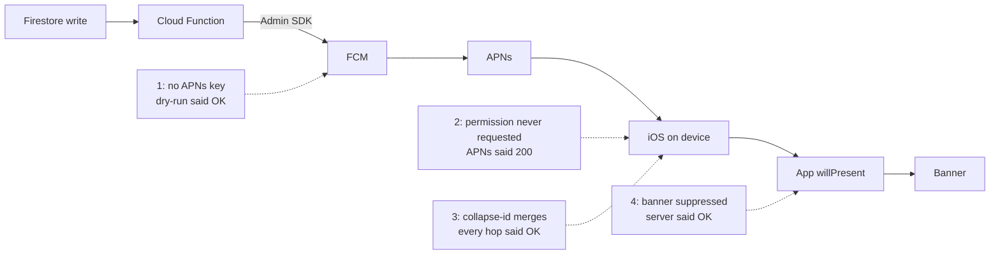

Between August 1 and August 5, I fixed four separate reasons why chat notifications didn't arrive in an iOS app I build. Each time, some layer said it had worked. A Firebase Cloud Messaging dry-run passed, FCM returned real message IDs, a direct request to APNs returned HTTP 200, and my Cloud Function logged "sent". No banner appeared on the receiving phone.

## From a Firestore write to a banner

The app is a small private chat app with a SwiftUI client targeting iOS 18 and a Firebase backend, with Cloud Functions on Node 20 using `firebase-admin` 13. When a message document is created in Firestore, a Cloud Function (`onDocumentCreated`) builds a notification and sends it through the Admin SDK to FCM, which forwards it to APNs. The same helper also sends "activity" pushes: new records, calendar changes, anniversaries, answers to a daily question, and pokes.

Each hop has its own idea of success, and the four bugs sat at four different hops:



In my setup the simulator couldn't show a push banner, so every end-to-end check needed two real phones. And nothing ever failed loudly. The trigger ran and the server's unread counter went up. The only symptom was a notification that wasn't there, which is easy to miss and hard to search for in logs.

## A dry-run passed with no APNs key

On July 31 I ran a readiness check before sending a TestFlight build to real use. For push I called the Admin SDK's `send(message, true)`, which is a dry-run. It passed, and I wrote down "APNs key configured."

The next day, after the two devices were paired, chat notifications didn't arrive. I sent a real message instead of a dry-run, and every token failed:

```
DRY  OK
REAL FAIL  messaging/third-party-auth-error
           "Request is missing required authentication credential"
```

Nobody had ever uploaded an APNs authentication key to the Firebase project. I'd reused a `.p8` file from another project, and it was an App Store Connect API key, the kind you use to upload builds. Both kinds download as `AuthKey_<KEYID>.p8`, which is how I mixed them up. The dry-run had checked the shape of the request and the tokens, and nothing about whether APNs would accept the credentials.

My send helper made it worse. It read the response only to prune invalid tokens and never logged failures, so `third-party-auth-error` on every send left no trace. I changed it to log each failed token whenever `failureCount > 0`, and a success line with the count otherwise:

```typescript
import { getMessaging, type MulticastMessage } from "firebase-admin/messaging";

async function sendAndReport(msg: MulticastMessage, scope: string) {
  const res = await getMessaging().sendEachForMulticast(msg);
  if (res.failureCount === 0) {
    console.log(`[push] ${scope}: sent ${res.successCount}`);
    return res;
  }
  const failures: string[] = [];
  res.responses.forEach((r, i) => {
    if (!r.success) failures.push(`${msg.tokens[i].substring(0, 8)}… ${r.error?.code}`);
  });
  console.error(`[push] ${scope}: ${res.failureCount} of ${res.responses.length} failed`, failures);
  return res;
}
```

The log gets only a token prefix, which is enough to tell devices apart without writing whole device tokens into it. I deliberately didn't make `third-party-auth-error` a reason to delete tokens. Pruning stayed as it was, for the error codes that mean a token is dead. These tokens were fine and the project configuration wasn't, so deleting them would have turned a config fix into a re-registration problem on every device.

The APNs key can only be uploaded in the Firebase console. Neither the Firebase Management API nor the CLI has an endpoint for it, so that step stayed manual. I also put a short README next to the local keys saying which `.p8` is which, since the file names give no hint.

## APNs returned 200 to an app without permission

With the real APNs key uploaded, FCM returned real message IDs. Notifications still didn't show up. I repeated the send six times with the same result.

Past FCM's OK there was nothing I could query from the server. To split the path, I made the app store its raw APNs device token and its APNs environment (development or production, matching the `aps-environment` entitlement) in the user's document. An FCM registration token can't be used to talk to APNs directly, so this was the only way around FCM. If a direct APNs send arrived, the problem was in the Firebase leg. If it didn't, it was on the device.

The direct send got HTTP 200, and the phone showed nothing. Then I opened iOS Settings and found that the app had no Notifications entry.

iOS creates that entry only after the app has asked for authorization at least once. My only call to `requestAuthorization` was in an onboarding step. If you tapped "Later" there, the app never asked again, and the app's own settings screen had no notification controls. The app still registered for remote notifications and got a device token, because token registration doesn't depend on the user's permission. Apple's documentation for `registerForRemoteNotifications()` says that without authorization the system delivers remote notifications to the app silently. From the server, a device in that state looks perfect.

I added a notifications section to the app's Settings screen that handles three states:

- Not determined: a button that prompts, then registers the token, because permission without a token still delivers nothing.
- Denied: a link to the system Settings, since iOS won't show the prompt again.
- Authorized: shown as on.

The screen re-reads the state every time it appears, so a change made in system Settings shows up on return.

## One collapse-id per conversation

By August 5 the symptom had changed. The first chat message produced a notification and the ones after it didn't. FCM and APNs both reported success, and the function logged "sent" for each.

When I first added chat pushes, I gave every chat notification a fixed `apns-collapse-id` per conversation, because I wanted a burst of messages to leave one item on the lock screen. The header does something else. Apple's documentation describes it as an identifier "you use to merge multiple notifications into a single notification for the user." Each new message replaced the previous notification instead of appearing as a new one, so on the receiving side new messages arrived without announcing themselves.

Activity pushes worked, and they had no collapse-id. Only chat looked broken.

What I'd wanted was `thread-id`, a key inside `aps` that Apple describes as "an app-specific identifier for grouping related notifications." Notification Center groups those notifications without merging them, and each message keeps its own.

Pokes are the one place where collapse-id is right. Tapping the poke button several times in a row should leave one "poked you N times" notification, and only the latest matters. So I collapse when only the newest notification has meaning and use a thread when each one does.

I moved that decision into a pure function so I could test it without Firebase:

```typescript
import type { ApnsConfig, Aps } from "firebase-admin/messaging";

interface Display { badge: number; replaceKey?: string; groupKey?: string }

export function apnsFor(d: Display): ApnsConfig {
  const aps: Aps = { sound: "default", badge: d.badge };
  if (d.groupKey) aps.threadId = d.groupKey;          // group, never merge
  return {
    headers: d.replaceKey ? { "apns-collapse-id": d.replaceKey } : undefined,
    payload: { aps },
  };
}
```

Five `node:test` cases pin it down. Chat gets a thread id and no collapse header, a poke gets the collapse header, and neither key appears unless requested. Badge and sound are always present, and a badge of 0 is still sent because it clears the icon. I didn't add a test framework, since `tsc && node --test` was enough.

In the same change I logged each early return in the message trigger: no author ID, deleted message, empty body. Until then "the trigger skipped this message" and "the trigger never ran" looked identical in the logs. I deployed this function change on August 5.

## Suppressing banners on the chat tab

The last case was in the receiving app, and I closed it the same night. When a chat push arrives while the app is in the foreground, `userNotificationCenter(_:willPresent:)` decides whether to show a banner. I suppressed chat banners while the user was looking at the chat, so a message they'd just read wouldn't pop up on top of itself.

I'd already gotten this wrong once. My first version set a "chat is visible" flag from the chat view's `onAppear` and `onDisappear`. During a self-review I realized that a `TabView` keeps tabs alive, so `onDisappear` isn't guaranteed. If the flag stuck at true, chat notifications would vanish while the user was on another tab. I switched the flag to follow the selected tab, which is deterministic.

A selected chat tab still doesn't mean someone is reading the chat. With the chat tab selected, pulling down Notification Center or Control Center, or sitting in the app switcher, left the flag true. As I noted in the commit, `willPresent` is still called in those states, and the user clearly isn't reading the conversation. Suppressing the banner there drops the notification.

I made suppression depend on two conditions and injected the app's `scenePhase` at the top level:

```swift
@Observable @MainActor
final class BannerGate {
    var chatTabSelected = false
    var appActive = false            // set from scenePhase == .active

    var suppressChatBanner: Bool { chatTabSelected && appActive }
}
```

Both flags start false, so if I forget to wire up either input, the gate fails toward showing the notification. A duplicate banner is a small annoyance, and a missing message was the bug I'd spent most of a week chasing. `onChange` alone fires only on changes, so I used `onChange(of: scenePhase, initial: true)` to apply the initial phase too. Four unit tests cover reading the conversation (suppress), chat tab with the app inactive (show), another tab (show), and the default state (show).

## Four signals, four hops

Side by side, the four failures had little in common except the false signal:

| # | What reported success | Actual cause | What exposed it | Fix |
|---|---|---|---|---|
| 1 | FCM dry-run | No APNs auth key in the Firebase project (an App Store Connect key had been mistaken for it) | A real send: `third-party-auth-error` on every token | Upload a real APNs key; log per-token failures |
| 2 | FCM message ID, then APNs HTTP 200 | App never called `requestAuthorization` after "Later" in onboarding | Direct APNs send via stored raw token; no Notifications entry in iOS Settings | Notification controls in Settings for all three authorization states |
| 3 | FCM, APNs, and the function log | Fixed `apns-collapse-id` per conversation merged each message into the previous notification | Chat broken while activity pushes worked | `thread-id` for chat; collapse-id only for pokes; 5 tests |
| 4 | The whole server path | Banner suppression keyed on "chat tab selected" only | Reasoning about the states where `willPresent` fires | Suppress only when tab selected and app active; 4 tests |

The project runbook now says push is judged only by a real send to a real device. A dry-run, an FCM message ID and an APNs 200 each describe one hop, and none of them describes the banner. Next time I'd set up the direct APNs path and the failure logging before the first real-device test instead of after the third failure.

When a notification goes missing, I count trigger invocations first. Zero means nothing was written. If there are invocations with success logs, the problem is in how the notification is displayed, and the first thing I check is the collapse-id.
