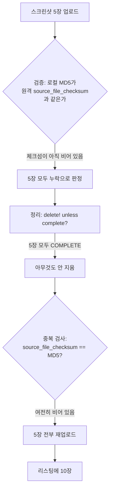

App Store 리스팅 하나에서 6.5인치 스크린샷 세트가 Apple이 정한 상한인 10장까지 차 있었다. 그중 넉 장은 예전 스크린샷 파이프라인이 만든 이미지였는데, 그것을 대체한 지금 이미지 넉 장이 바로 옆에 그대로 있었다. 지금 이미지 중 두 장은 두 번씩 들어가 있었다. 파이프라인은 아무 경고도 내지 않았고 나는 스토어 페이지를 보다가 알았다.

원인은 버그 두 개가 겹친 것이었다. 하나는 배포할 때마다 리스팅에 스크린샷이 쌓이게 만든 기본값이고, 다른 하나는 배포 한 번 안에서 세트 전체를 다시 올린 `deliver`의 재시도였다. 두 번째 버그는 처음에 원인을 잘못 짚었다.

## iOS 레인에서만 생긴 문제

Kotlin Multiplatform 코드베이스 하나에서 iOS 앱 네 개를 로컬 fastlane 레인으로 배포한다(fastlane 2.237.0). 앱마다 화면 크기별로 정해진 스크린샷이 몇 장씩 있고, 스크린샷 파이프라인이 만든 이 이미지를 저장소에 flavor별로 둔다. 스크린샷 업로드는 몇 릴리즈 전에 켰고 그 전에는 App Store Connect에서 손으로 관리했다.

안드로이드에서는 이 문제가 없었다. fastlane `supply`는 업로드하기 전에 `deleteall_edit_image`를 호출하므로 Play 스토어 리스팅이 늘 로컬 파일과 같다. 문제는 iOS의 `deliver`에서만 생겼고, 그래서 저장소만 봐서는 내내 멀쩡해 보였다.

## `overwrite_screenshots`의 기본값 false

나는 `deliver`의 `overwrite_screenshots` 기본값 `false`를 "이미 있는 스크린샷은 건드리지 않는다"로 이해했다. 실제 의미는 "이미 있는 스크린샷 위에 로컬 세트를 더 올린다"였다. 업로드는 켜고 덮어쓰기는 끈 상태였으므로 배포할 때마다 리스팅에 스크린샷이 쌓였다.

내가 본 리스팅도 그렇게 옛 이미지와 새 이미지가 섞인 채 장수 제한에 걸려 있었다. 10장이 차면 `deliver`는 더 올리지 않고 파일마다 다음 로그를 남긴다.

```
Too many screenshots found for device '...' in '...', skipping this one (...)
```

즉, 세트가 한번 차면 리스팅에는 이미 있던 이미지가 그대로 남고 파이프라인이 올리려던 이미지는 빠진다. 남는 흔적은 이 로그 한 줄뿐이다. 이 문제는 `overwrite_screenshots: true` 플래그 하나로 고쳤다.

## 배포 한 번에 5장이 10장으로

플래그를 바꾸자 배포를 거듭하며 쌓이는 문제는 멈췄다. 그런데 다른 리스팅에서는 로컬 파일이 5장인데 배포 한 번 만에 이미지가 10장이 됐다. 배포 로그에는 원인을 짐작할 만한 줄이 하나 있었다.

```
Failed to upload all screenshots... Tries remaining: 4
```

남은 재시도 횟수가 5에서 4로 줄었으니 재시도가 한 번 있었던 것이고, 리스팅에는 로컬 세트의 두 배가 들어 있었다.

처음에는 재시도 경로가 오래된 상태를 읽은 게 아닐까 생각했다. 업로드 전 상태를 들고 있는 iterator를 조회하는 바람에 방금 올린 스크린샷을 찾지 못하고 다시 올렸으리라고 봤다. 그 추측을 바탕으로 수정을 만들었고(아래에 나온다) 커밋 메시지에도 그렇게 적었다. 그런데 다음 날 소스를 제대로 읽어 보고 그다음 커밋에서 그 설명을 철회했다. iterator는 `get_app_screenshot_sets`를 호출해 매번 새로 요청하므로 상태는 최신이었고, 그 안의 필드 하나가 아직 비어 있었을 뿐이다.

deliver 2.237.0은 업로드 뒤에 이렇게 움직인다.



App Store Connect는 스크린샷을 `COMPLETE`로 바꾸고 시간이 좀 지난 뒤에야 `source_file_checksum`을 채운다. 검증 단계는 체크섬을 비교하다가 일치하는 것을 하나도 찾지 못하자 업로드가 실패했다고 판단한다. 이어지는 재시도에는 가드가 두 개 있는데 둘이 보는 필드가 다르다. 정리 단계는 `complete?`를 보므로 끝난 스크린샷 5장을 하나도 지우지 않는다. 중복 검사는 체크섬을 보므로 5장을 모두 처음 보는 파일로 여겨 다시 올린다. 내가 리스팅을 열었을 때는 체크섬이 이미 다 채워져 있어서 모든 것이 정상으로 보였고 장수만 두 배였다.

## 업로드와 제출 사이의 중복 제거

버전을 심사에 제출하면 스크린샷이 잠기므로 정리는 업로드 뒤, 제출 전에 끝내야 한다. 그래서 `deliver` 호출 하나를 둘로 나누고 그 사이에 중복 제거 단계를 넣었다.

```ruby
deliver(api_key: key, skip_binary_upload: false, skip_screenshots: false,
        overwrite_screenshots: true, submit_for_review: false)

ScreenshotDedupe.run(api_key: key)

deliver(api_key: key, skip_binary_upload: true, skip_metadata: true,
        skip_screenshots: true, submit_for_review: true)
```

두 번째 호출은 스크린샷을 건너뛰어야 한다. 스크린샷을 건드리면 방금 지운 중복이 다시 생기기 때문이다.

deliver의 `sync_screenshots: true`도 살펴봤다. 체크섬 대신 `COMPLETE` 개수를 비교하므로 이런 식으로 실패하지는 않는다. 다만 환경 변수로 켜는 베타 기능이고, 자체 재시도가 수렴하지 않으면 레인을 실패시킨다. 릴리즈를 막는 것보다는 리스팅에 흠이 남는 편이 낫다고 판단해서 쓰지 않았다.

## 체크섬 대신 파일 이름으로 묶기

중복 제거 첫 버전은 스크린샷을 `source_file_checksum`으로 묶고 체크섬이 비어 있으면 파일 이름을 쓰게 했다. 체크섬은 파일 내용으로 정해지므로 더 나은 키처럼 보였지만 9분 뒤에 바꿨다. 중복 제거는 업로드 몇 초 뒤에 도는데, 체크섬이 비어 있는 때가 바로 그때다. 한 쌍 중 한 장에만 체크섬이 있으면 두 장이 각각 한 장짜리 그룹에 들어가 둘 다 남는다. 고치려던 버그를 중복 제거 단계 안에서 다시 만들 뻔했다.

키는 `file_name`으로 정했다. 한 스크린샷 세트 안에서 파일 이름은 업로드한 순간부터 바뀌지 않는다. 세트는 이름이 겹칠 수 없는 디렉터리 하나에서 채워지므로, 파일 이름 하나는 로컬 파일 하나를 가리키기도 한다. 그러니 세트 안에 같은 이름이 두 번 있으면 중복 업로드일 수밖에 없다.

```ruby
# fastlane이 노출하는 Spaceship::ConnectAPI 객체 기준
def remove_duplicates(version)
  removed = 0
  version.get_app_store_version_localizations.each do |loc|
    loc.get_app_screenshot_sets.each do |set|
      (set.app_screenshots || []).group_by(&:file_name).each_value do |copies|
        # 가장 먼저 올라간 사본을 남긴다: 리스팅의 순서에 의미가 있다
        copies.drop(1).each { |dup| dup.delete!; removed += 1 }
      end
    end
  end
  removed
end

# 제출했거나 출시된 버전이면 nil: 고칠 버전이 없다
version = app.get_edit_app_store_version
```

이 단계는 묶기 전에 처리 중인 스크린샷이 없어질 때까지 폴링한다(5초 간격, 180초 타임아웃). 너무 일찍 읽으면 두 번째 사본을 보지 못하고 중복이 남은 리스팅을 정상이라고 보고하기 때문이다. 타임아웃이 나도 배포를 실패시키지 않고 경고만 남긴 뒤 보이는 것만 정리한다. 베타 동기화를 쓰지 않은 것과 같은 이유다.

## 라이브 버전의 중복 개수 출력

현재 버전이 이미 출시됐거나 심사 중이어서 편집할 수 있는 버전이 없으면 중복 제거 단계는 아무것도 지울 수 없다. 예전에는 이때 "no editable version, skipping"만 남겼는데, 이 문구는 "볼 것 없음"처럼 읽혔다. 하지만 이 메시지가 말하지 않은 중복이 바로 사용자에게 보이고 있던 중복이었다. 그래서 라이브 버전의 파일 이름 중복을 세어 출력하도록 바꿨다.

```
dedupe: ... has no editable version — live 2.2.72 carries 5 duplicate screenshot(s), which only the next release can clear
```

늘어난 비용은 읽기 요청 한 번뿐이다.

## dry run과 첫 실제 배포 결과

| 확인 항목 | 방법 | 결과 |
|---|---|---|
| 배포를 거듭하며 쌓이는 문제 | `overwrite_screenshots: true` | 멈춤 |
| 두 배가 된 리스팅(로컬 파일 5장) | 중복 제거 레인 dry run, 실제 리스팅 대상 | 5장 유지, 5장을 중복으로 식별 |
| 편집할 수 없는 라이브 리스팅 | 보고 경로 | 라이브 버전에서 중복 5장 보고 |
| 업로드·제출 분리 레인, 첫 실제 배포 | 앱 네 개 | 네 앱 모두 업로드 성공, 제출 호출은 실패 |

마지막 줄의 실패는 내 실수였다. 두 번째 `deliver` 호출에 `metadata_path`를 넘기지 않아서 deliver가 기본 메타데이터 폴더를 검증했는데, 플랫폼별 하위 폴더를 로케일 이름으로 보고 거부한 뒤 제출 전에 멈췄다. 바이너리는 이미 App Store Connect에 올라간 상태였다. 다음 날 제출 호출에도 업로드 호출과 같은 경로를 넘겨 고쳤다.

그 뒤에 fastlane의 현재 master를 보니 재시도 전 정리 단계가 완료됐지만 체크섬이 아직 없는 스크린샷도 지우도록 바뀌어 있었다. 내 리스팅을 두 배로 만든 바로 그 상태다.

## 가드마다 읽는 필드

첫 설명이 틀렸어도 손해는 크지 않았다. 어느 쪽이든 수정은 업로드와 제출 사이에 들어가야 했기 때문이다. 나중에 따로 정리해 둔 것은 두 가드의 차이다. 정리 단계와 중복 검사는 둘 다 스크린샷 업로드가 끝났는지 확인한다. 하나는 `complete?`를, 다른 하나는 체크섬을 보기 때문에 업로드 직후 한동안은 두 판단이 서로 엇갈린다. 그런데 deliver에서 이것을 찾고 몇 분도 지나지 않아 나도 중복 제거 키를 체크섬으로 잡았다. 가장 정밀해 보이는 필드였기 때문이다.

그래서 지금은 같은 코드 경로에서 두 검사가 "끝났는지"를 확인하면 각각 어느 필드를 읽는지, 그 필드가 언제 채워지는지부터 찾아본다. 손쓸 수 없는 단계라도 본 것은 로그에 남긴다. 개수 없이 "skipping"만 남긴 로그 때문에 중복 다섯 장이 있는 라이브 리스팅이 문제없는 것처럼 보였다.
