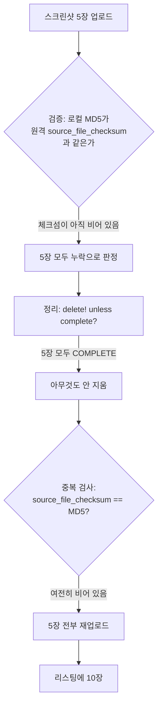

내 App Store 리스팅 하나의 6.5인치 스크린샷 세트가 10장이었다. Apple이 정한 상한이다. 그중 넉 장은 예전 스크린샷 파이프라인이 만든 이미지였고 그 자리를 대신한 현재 이미지 넉 장이 바로 옆에 있었다. 현재 이미지 중 두 장은 두 번씩 들어가 있었다. 파이프라인은 경고 하나 내지 않았고 나는 스토어 페이지를 보다가 알았다.

버그 두 개가 겹쳐 있었다. 하나는 배포할 때마다 리스팅에 스크린샷을 더 쌓게 둔 기본값이다. 다른 하나는 배포 한 번 안에서 세트 전체를 다시 올린 `deliver`의 재시도다. 두 번째 버그의 원인은 처음에 잘못 짚었다.

## iOS 레인만 어긋났다

Kotlin Multiplatform 코드베이스 하나에서 iOS 앱 네 개를 로컬 fastlane 레인으로 배포한다(fastlane 2.237.0). 앱마다 화면 크기별로 정해진 스크린샷 몇 장이 있다. 스크린샷 파이프라인이 만든 이미지를 저장소의 flavor별 디렉터리에 둔다. 스크린샷 업로드는 몇 릴리스 전에 켰고 그 전에는 App Store Connect에서 손으로 관리했다.

Android는 이 문제가 없었다. fastlane `supply`는 올리기 전에 `deleteall_edit_image`를 부르기 때문에 Play 리스팅은 늘 로컬 파일과 같다. 어긋난 건 iOS `deliver`뿐이었다. 저장소만 봐서는 내내 멀쩡했다.

## `overwrite_screenshots` 기본값은 false다

`deliver`의 `overwrite_screenshots` 기본값 `false`를 나는 "있는 스크린샷은 건드리지 않는다"로 읽었다. 실제 뜻은 "이미 있는 것 위에 로컬 세트를 더 올린다"다. 업로드는 켜고 덮어쓰기는 끈 상태여서 배포할 때마다 리스팅에 스크린샷이 쌓였다.

내가 본 리스팅도 그렇게 파일명 두 세대를 품은 채 상한에 닿았다. 10장이 차면 `deliver`는 더 올리지 않고 파일마다 이런 줄을 남긴다.

```
Too many screenshots found for device '...' in '...', skipping this one (...)
```

세트가 한번 차면 리스팅은 이미 있던 것을 그대로 두고 파이프라인이 올리려던 이미지를 버린다. 흔적은 이 로그 한 줄뿐이다. 이 절반은 플래그 하나 `overwrite_screenshots: true`로 고쳤다.

## 배포 한 번에 로컬 파일 5장이 10장이 됐다

플래그를 바꾸자 배포 간 누적은 멈췄다. 그런데 다른 리스팅이 배포 한 번 만에 로컬 파일 5장에 대해 10장이 되어 나왔다. 배포 로그에 이유를 짐작할 줄이 하나 있었다.

```
Failed to upload all screenshots... Tries remaining: 4
```

재시도 횟수가 5에서 4로 줄었으니 재시도는 한 번이었다. 리스팅에는 로컬 세트의 두 배가 들어 있었다.

처음에는 재시도 경로가 오래된 뷰를 읽었다고 봤다. 업로드 이전 시점의 상태를 들고 있는 iterator에게 물어서 아무것도 못 보고 다시 올렸다고 생각했다. 그 추측 위에 수정을 만들었고(아래) 커밋 메시지에도 그렇게 적었다. 다음 날 소스를 제대로 읽었고 그다음 커밋에서 그 설명을 철회했다. iterator는 `get_app_screenshot_sets`를 불러 매번 새로 요청한다. 뷰는 최신이었고 그 안의 필드 하나가 아직 비어 있었다.

deliver 2.237.0이 업로드 뒤에 하는 일을 그려 보면 이렇다.



App Store Connect는 스크린샷을 `COMPLETE`로 바꾸고 시간이 좀 지나서야 `source_file_checksum`을 채운다. 검증 단계는 체크섬을 비교하다 하나도 못 찾고 업로드가 실패했다고 판단한다. 이어지는 재시도에는 가드가 두 개 있는데 둘이 보는 필드가 다르다. 정리 단계는 `complete?`를 보고 끝난 스크린샷 5장이니 아무것도 지우지 않는다. 중복 검사는 체크섬을 보고 모르는 파일 5장이니 전부 다시 올린다. 내가 리스팅을 열었을 때는 체크섬이 다 채워져 있었다. 모든 게 맞아 보였고 장수만 두 배였다.

## 업로드와 제출 사이에서 중복을 지운다

버전을 심사에 제출하면 스크린샷이 잠긴다. 그러니 정리는 업로드 뒤, 제출 전에 끝내야 한다. `deliver` 호출 하나를 둘로 쪼개고 그 사이에 중복 제거 단계를 넣었다.

```ruby
deliver(api_key: key, skip_binary_upload: false, skip_screenshots: false,
        overwrite_screenshots: true, submit_for_review: false)

ScreenshotDedupe.run(api_key: key)

deliver(api_key: key, skip_binary_upload: true, skip_metadata: true,
        skip_screenshots: true, submit_for_review: true)
```

두 번째 호출은 스크린샷을 건너뛰어야 한다. 건드리면 방금 지운 중복이 다시 생긴다.

deliver의 `sync_screenshots: true`도 살펴봤다. 체크섬 대신 `COMPLETE` 개수를 비교하니 이런 식으로는 실패하지 않는다. 다만 환경 변수로 켜는 베타 기능이고 자체 재시도가 수렴하지 않으면 레인을 실패시킨다. 나는 릴리스를 막는 쪽보다 리스팅에 흠집을 남기는 쪽이 낫다고 판단했다.

## 체크섬 대신 파일명으로 묶었다

중복 제거 첫 버전은 스크린샷을 `source_file_checksum`으로 묶고 체크섬이 비면 파일명을 쓰게 했다. 체크섬은 바이트를 가리키니 더 나은 키처럼 보였다. 9분 뒤에 바꿨다. 중복 제거는 업로드 몇 초 뒤에 도는데 체크섬이 비어 있는 게 바로 그때다. 한 쌍 중 한 장만 체크섬이 있으면 둘이 각각 한 장짜리 그룹에 들어가 둘 다 살아남는다. 치우려던 버그를 중복 제거 안에서 다시 만들 뻔했다.

키는 `file_name`이 됐다. 한 스크린샷 세트 안에서 파일명은 업로드 순간부터 바뀌지 않는다. 세트는 이름이 겹칠 수 없는 디렉터리 하나에서 채워지니 파일명 하나는 로컬 파일 하나를 가리킨다. 세트 안에 같은 이름이 두 번 있으면 중복 업로드일 수밖에 없다.

```ruby
# fastlane이 노출하는 Spaceship::ConnectAPI 객체 기준
def remove_duplicates(version)
  removed = 0
  version.get_app_store_version_localizations.each do |loc|
    loc.get_app_screenshot_sets.each do |set|
      (set.app_screenshots || []).group_by(&:file_name).each_value do |copies|
        # 가장 먼저 올라간 사본을 남긴다: 리스팅의 순서에 의미가 있다
        copies.drop(1).each { |dup| dup.delete!; removed += 1 }
      end
    end
  end
  removed
end

# 제출했거나 출시된 버전이면 nil: 고칠 버전이 없다
version = app.get_edit_app_store_version
```

묶기 전에 이 단계는 처리 중인 스크린샷이 없어질 때까지 폴링한다(5초 간격, 180초 타임아웃). 너무 일찍 읽으면 두 번째 사본을 못 보고 깨끗하지 않은 리스팅을 깨끗하다고 보고한다. 타임아웃이 나도 배포를 실패시키지는 않는다. 경고를 남기고 보이는 것만 정리한다. 베타 동기화를 쓰지 않은 것과 같은 이유다.

## 라이브 버전의 중복을 세어 알린다

편집할 수 있는 버전이 없으면 중복 제거는 아무것도 지울 수 없다. 현재 버전이 이미 출시됐거나 심사 중인 경우다. 예전에는 이때 "no editable version, skipping"만 남겼고 "볼 것 없음"처럼 읽혔다. 그런데 이 메시지가 말하지 않은 중복이 바로 사용자들이 보고 있던 중복이었다. 그래서 라이브 버전의 파일명 중복을 세어 출력하게 바꿨다.

```
dedupe: ... has no editable version — live 2.2.72 carries 5 duplicate screenshot(s), which only the next release can clear
```

읽기 한 번이 더 들 뿐이다.

## dry run과 첫 실제 배포

| 확인 항목 | 방법 | 결과 |
|---|---|---|
| 배포 간 누적 | `overwrite_screenshots: true` | 멈춤 |
| 두 배가 된 리스팅(로컬 파일 5장) | 중복 제거 레인 dry run, 실제 리스팅 대상 | 5장 유지, 5장을 중복으로 식별 |
| 편집할 수 없는 라이브 리스팅 | 보고 경로 | 라이브 버전에서 중복 5장 보고 |
| 업로드·제출 분리 레인, 첫 실제 배포 | 앱 네 개 | 네 앱 모두 업로드 성공, 제출 호출은 실패 |

마지막 줄의 실패는 내가 만든 회귀다. 두 번째 `deliver` 호출에 `metadata_path`가 없어서 기본 메타데이터 폴더를 검증했다. 플랫폼별 하위 폴더를 로케일 이름으로 읽어 거부했고 제출 전에 멈췄다. 바이너리는 이미 App Store Connect에 올라가 있었다. 다음 날 제출 호출에도 업로드 호출과 같은 경로를 넘겨 고쳤다.

그 뒤 fastlane 현재 master를 보니 재시도 전 정리 단계가 완료됐지만 체크섬이 아직 없는 스크린샷도 지우도록 바뀌어 있었다. 내 리스팅을 두 배로 만든 바로 그 상태다.

## 가드마다 어느 필드를 보는가

첫 설명이 틀렸어도 잃은 건 많지 않았다. 어느 쪽이든 수정은 업로드와 제출 사이에 들어가야 했다. 나중에 적어 둔 건 두 가드 이야기다. 정리 단계와 중복 검사는 둘 다 스크린샷이 끝났는지를 묻는다. 하나는 `complete?`로, 하나는 체크섬으로 묻고 업로드 직후 한동안은 서로 반대로 답한다. deliver에서 이걸 찾고 몇 분도 안 돼 나도 중복 제거 키를 체크섬으로 잡았다. 가장 정밀해 보이는 필드였기 때문이다.

그래서 같은 코드 경로의 두 검사가 "끝났나"를 물으면 각각 어느 필드를 읽는지, 그 필드가 언제 채워지는지부터 찾아본다. 손쓸 수 없는 단계라도 본 것은 로그에 남긴다. 개수 없는 "skipping"은 중복 다섯 장을 단 라이브 리스팅을 문제없음처럼 보이게 했다.
