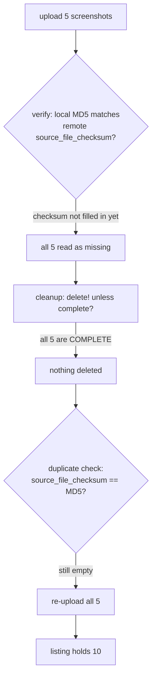

One of my App Store listings had ten screenshots in its 6.5-inch set, which is Apple's cap. Four came from an earlier screenshot pipeline and sat next to the four current images that replaced them, and two of the current ones appeared twice. The pipeline hadn't complained. I found it by looking at the store page.

Two bugs had stacked up. A default flag let every deploy add to the listing, and a retry inside `deliver` uploaded the whole set again within one deploy. I got the cause of the second one wrong the first time.

## Only the iOS lane drifted

I ship four iOS apps from one Kotlin Multiplatform codebase with local fastlane lanes (fastlane 2.237.0). Each app has a small fixed set of screenshots per display type, produced by a screenshot pipeline and stored per flavor in the repository. I'd switched on screenshot upload a few releases earlier. Before that, I managed screenshots by hand in App Store Connect.

Android never had the problem. fastlane's `supply` calls `deleteall_edit_image` before uploading, so the Play listing always matches the local files. Only iOS `deliver` drifted, which is why the repository looked right the whole time.

## `overwrite_screenshots` defaults to false

I had read `deliver`'s `overwrite_screenshots: false` default as "leave existing screenshots alone". It means "upload the local set on top of whatever is already there". With upload on and overwrite off, every deploy added to the listing.

That's how the listing I noticed reached the cap with two generations of file names in it. At ten, `deliver` stops adding and logs a line per file:

```
Too many screenshots found for device '...' in '...', skipping this one (...)
```

So once a set is full, the listing keeps whatever it already has and drops the images the pipeline meant to publish, with only that log line to show for it. I fixed this half with one flag, `overwrite_screenshots: true`.

## Ten images from five files in one deploy

The flag stopped the pile-up across deploys. A second listing still came out of one deploy with ten images for five local files. One line in the deploy log pointed at why:

```
Failed to upload all screenshots... Tries remaining: 4
```

The retry budget had gone from 5 to 4, so there had been one retry, and the listing held twice the local set.

I first thought the retry path had read a stale view. My guess was that it asked an iterator whose picture of the version predated the upload, saw nothing, and uploaded again. I built the fix on that guess (below) and wrote it into the commit message. The next day I read the source properly, and the commit after that retracted it. The iterator calls `get_app_screenshot_sets` and sends a fresh request every time, so the view was current. One field in it wasn't filled in yet.

This is what deliver 2.237.0 does after an upload:



App Store Connect marks a screenshot `COMPLETE` and fills in `source_file_checksum` some time later. The verify pass compares checksums, finds none, and decides the upload failed. The retry then runs two guards that read different fields. Cleanup reads `complete?`, sees five finished screenshots and deletes nothing. The duplicate check reads the checksum, sees five unknown files and uploads all of them again. By the time I opened the listing, the checksums had filled in and everything looked consistent, just doubled.

## Deduping between upload and submit

Once a version is submitted for review, its screenshots are locked, so any cleanup has to run after the upload and before the submit. I split the one `deliver` call into two and put a dedupe step between them:

```ruby
deliver(api_key: key, skip_binary_upload: false, skip_screenshots: false,
        overwrite_screenshots: true, submit_for_review: false)

ScreenshotDedupe.run(api_key: key)

deliver(api_key: key, skip_binary_upload: true, skip_metadata: true,
        skip_screenshots: true, submit_for_review: true)
```

The second call has to skip screenshots. If it touched them, it would recreate the duplicates the dedupe had just removed.

I looked at deliver's `sync_screenshots: true`. It compares `COMPLETE` counts instead of checksums, so it doesn't fail this way. It's an opt-in beta behind an environment variable, and it fails the lane when its own retries don't converge. I'd rather leave a blemish on a listing than block a release.

## Grouping by file name

My first dedupe grouped screenshots by `source_file_checksum` and fell back to the file name when the checksum was empty. A checksum identifies bytes, so it looked like the better key. Nine minutes later I replaced it. The dedupe runs seconds after the upload, which is when the checksum is still missing. If one copy of a pair had its checksum and the other didn't, they'd land in two groups of one and both would survive. I'd have rebuilt inside the dedupe the bug it was there to clean up.

The key became `file_name`. Within one screenshot set it doesn't change from the moment of upload. The set is filled from one directory where names can't collide, so a name also points to one local file. A repeated name inside a set can only be a repeated upload.

```ruby
# Spaceship::ConnectAPI objects, as fastlane exposes them
def remove_duplicates(version)
  removed = 0
  version.get_app_store_version_localizations.each do |loc|
    loc.get_app_screenshot_sets.each do |set|
      (set.app_screenshots || []).group_by(&:file_name).each_value do |copies|
        # keep the earliest copy: order on the listing matters
        copies.drop(1).each { |dup| dup.delete!; removed += 1 }
      end
    end
  end
  removed
end

# nil once the version is submitted or live: nothing left to edit
version = app.get_edit_app_store_version
```

Before grouping, the step polls until no screenshot is still processing, every 5 seconds for up to 180 seconds. A read that comes too early misses the second copies and reports a listing as clean when it isn't. On timeout it warns and cleans what it can see. It doesn't fail the deploy, for the same reason I passed on the beta sync.

## Counting duplicates on the live version

When there's no editable version, because the current one is already live or in review, the dedupe can't delete anything. It used to log "no editable version, skipping", which reads like "nothing to see". The duplicates it said nothing about were the ones users were looking at. I made it count file-name duplicates on the live version and print the count:

```
dedupe: ... has no editable version — live 2.2.72 carries 5 duplicate screenshot(s), which only the next release can clear
```

It costs one extra read.

## The dry run and the first real deploy

| check | how | result |
|---|---|---|
| doubling across deploys | `overwrite_screenshots: true` | stopped |
| doubled listing, 5 local files | dedupe lane, dry run, against the real listing | 5 kept, 5 identified as duplicates |
| live listing that can't be edited | report path | 5 duplicates reported on the live version |
| split upload/submit lanes, first real deploy | four apps | upload succeeded for all four; the submit call failed |

I caused the failure in the last row. The second `deliver` call had no `metadata_path`, so it validated the default metadata folder, rejected my per-platform subfolders as locale names and stopped before submitting. The binaries were already on App Store Connect. The next day I gave the submit call the same paths the upload call had.

I've since looked at fastlane's current master. Its pre-retry cleanup now also deletes screenshots that are complete but still have no checksum, which is the state that doubled my listing.

## Which field each guard reads

My wrong first explanation didn't cost much, because the fix belonged between upload and submit either way. What I wrote down afterwards was about the two guards. Cleanup and the duplicate check both ask whether a screenshot is done, one through `complete?` and one through the checksum, and for a while after upload they give opposite answers. Within minutes of finding that in deliver, I keyed my own dedupe on the checksum because it sounded like the most precise field.

So when two checks in one code path ask "is this done?", I look up which field each one reads and when that field gets filled. And when a step can't act, I make it log what it found. A bare "skipping" with no count looked like an all-clear for a live listing that carried five duplicates.
