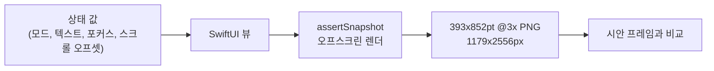

호스트 앱 없이 유닛 테스트로 그린 `TextField`는 포커스를 줘도 커서가 보이지 않는다. 로컬 파일을 가리키는 `AsyncImage`는 1초를 기다려도 플레이스홀더만 보인다. 그런데도 테스트는 통과하고, 그림에서 그 부분만 빠진다.

안드로이드에서처럼 iOS에서도 시안 비교용 스크린샷을 뽑을 수 있는지 확인하다가 이 두 문제를 만났다. 대부분은 잘 됐고, 기록해 둘 만한 것은 이 둘과 그 비슷한 몇 가지였다.

## 상태 값으로 PNG 뽑기

안드로이드에서는 JVM에서 Roborazzi로 Compose 프리뷰를 PNG로 그린다. 크기와 밀도를 시안 프레임에 맞춰 그린 뒤 시안과 비교하므로 기기도 앱 실행도 필요 없다. iOS에서도 같은 흐름을 만들고 싶었다. 화면 하나에 특정 상태(빈 상태, 포커스를 잡고 입력 중, 긴 본문, 600pt 스크롤, 다크 모드)를 넣으면 앱을 빌드하거나 실행하지 않고도 시안 크기 PNG가 나와야 한다.

확인용으로 작은 샘플을 만들었다. 값 타입 상태 하나로만 움직이는 SwiftUI 글 작성 화면과, [swift-snapshot-testing](https://github.com/pointfreeco/swift-snapshot-testing) 1.19.4를 쓰는 유닛 테스트 번들로 이뤄져 있다. 테스트는 iOS 26.5 시뮬레이터에서 `xcodebuild test`로 돌렸다. 테스트 타겟에는 호스트 앱이 없다(`TEST_HOST`를 설정하지 않았다). 테스트 타겟이 화면 소스 파일을 직접 컴파일하므로 앱 타겟은 테스트에 들어가지도, 실행되지도 않는다.



상태 타입은 프리뷰에서도 그대로 쓰는 값 타입이고, 테스트는 이 값을 화면에 넘겨 찍기만 한다.

```swift
struct EditorState: Equatable {
    var title: String
    var body: String
    var isBodyFocused: Bool
    var scrollOffsetY: CGFloat = 0
    var expandsScrollContent = false   // render without ScrollView (see below)
}

final class EditorSnapshotTests: XCTestCase {
    private let frame = SwiftUISnapshotLayout.fixed(width: 393, height: 852)

    func test_typingWithFocus() {
        assertSnapshot(of: EditorScreen(state: .typingFocused), as: .image(layout: frame))
    }
}
```

## 스크롤 위치·다크 모드·글꼴 지원

안드로이드에서 쓰던 기능은 상태로 표현하기만 하면 대부분 iOS에서도 됐다. 왼쪽 열이 필요한 기능이고 오른쪽 열이 iOS에서 쓴 방법이다.

| 필요한 것 | iOS에서 한 방법 |
|---|---|
| 모드, 텍스트, 선택 탭, 첨부 주입 | 상태 값을 뷰에 넘김 |
| 포커스 표시 | 상태 플래그로 포커스 테두리를 그림 |
| 세로 스크롤 위치 | `ScrollPosition(point:)`를 `.scrollPosition`에 바인딩 |
| 가로 스크롤 위치 | 같은 방식, x 오프셋 |
| 50번 항목부터 보이는 lazy 목록 | `ScrollPosition(id:)`와 `.scrollTargetLayout()` |
| 시안 프레임 크기와 밀도 | `.fixed(width:height:)`, @3x로 렌더링 |
| 다크 테마 | `traits: UITraitCollection(userInterfaceStyle: .dark)` |
| 비교용 글꼴 | 번들에 넣은 글꼴을 `CTFontManagerRegisterFontsForURL(..., .process, nil)`로 등록 |

시안과 비교하려면 결과가 매번 같아야 한다. 스냅샷 테스트 19건을 다섯 번 돌렸는데 이미지가 매번 똑같이 나오는 것을 확인했다.

## 스냅샷에서 빠지는 것

### 시스템이 그리는 커서

`onAppear`에서 `@FocusState`를 true로 바꾼 `TextField`를 0.5초 기다렸다가 찍었다. 테두리와 글자는 나왔는데 커서는 없었다. 그래서 비교할 때는 시스템 커서에 기대지 않고, 포커스 테두리처럼 커서도 상태를 보고 직접 그리기로 했다.

```swift
struct CaretText: View {
    let text: String
    let showsCaret: Bool

    var body: some View {
        HStack(spacing: 1) {
            Text(text)
            if showsCaret {
                Rectangle().fill(Color.accentColor).frame(width: 2, height: 22)
            }
            Spacer()
        }
    }
}
```

### 1초를 기다려도 비어 있는 AsyncImage

`AsyncImage`는 비동기로 불러오므로 바로 찍으면 `.empty` 단계가 찍힌다. 기다리면 될 줄 알았는데 파일 URL을 가리키는 `AsyncImage`를 `.wait(for: 1, on: .image(...))`로 기다려도 찍힌 것은 여전히 플레이스홀더였다. 네트워크를 거치지 않는 로컬 파일인데도 그랬다.

결국 안드로이드에서 캡처 전에 이미지를 미리 받아 두던 방법으로 해결했다. 테스트가 이미지를 먼저 읽고 `UIImage`를 상태로 넘기면 스냅샷을 찍는 동안 뷰가 비동기 단계를 거칠 일이 없다.

### 호스트 앱이 필요한 키 윈도우 렌더링

swift-snapshot-testing에는 키 윈도우를 거쳐 그리는 경로(`drawHierarchyInKeyWindow: true`)도 있는데, 이 경로로 그려야 나오는 효과가 더 많다. 하지만 호스트 앱 없이 이 경로를 타면 "requires tests to be run in a host application"이라는 메시지와 함께 크래시가 난다. 그래서 기본 오프스크린 렌더링만 썼다. 블러처럼 실제 창이 있어야 하는 효과는 호스트 앱을 다시 붙이지 않는 한 찍을 수 없다.

### 세로로 긴 시안과 ScrollView

시안 중에는 스크롤 화면 전체를 세로로 긴 프레임 한 장에 그린 것도 있다. 먼저 떠오르는 두 방법을 시도했다.

- 스냅샷 프레임을 키우면 스크롤 뷰만 길어지고 안의 내용은 똑같이 잘린다
- `.sizeThatFits`로 찍으면 `ScrollView` 높이가 0으로 줄어 본문이 사라진다

그래서 `ScrollView` 없이 내용을 펼쳐 그리는 상태 플래그를 넣었는데, 이번에는 `.sizeThatFits`가 높이를 제안하지 않아 여러 줄 텍스트가 잘렸다. `UIHostingController`로 높이를 먼저 재고 그 높이로 고정해서 찍었더니 내용이 전부 나왔다.

```swift
func test_tallFrame_fitsContent() {
    var state = EditorState.scrollAtTop
    state.expandsScrollContent = true
    let screen = EditorScreen(state: state)
    let height = UIHostingController(rootView: screen)
        .sizeThatFits(in: CGSize(width: 393, height: .greatestFiniteMagnitude))
        .height
    assertSnapshot(of: screen, as: .image(layout: .fixed(width: 393, height: height)))
}
```

샘플 화면은 높이가 2,002pt로 나왔고 이미지로는 1179 x 6006px이다.

### 안전 영역과 상태바

시안 프레임에는 상태바와 홈 인디케이터 자리까지 들어 있다. `ViewImageConfig`에 `safeArea`를 줄 수 있어서 393 x 852pt 프레임에 위 59pt, 아래 34pt를 줬더니 내용이 정확히 그만큼 안쪽으로 들어갔다. 다만 상태바 안의 시계와 배터리는 그려지지 않으므로 시안과 비교할 때는 그 띠를 가린다.

### `#Preview` 캡처 불가

`#Preview` 블록은 직접 찍을 방법이 없다. 대신 프리뷰와 테스트가 같은 상태 값을 쓰게 해서, 캔버스에 보이는 그림과 테스트가 찍는 그림이 한 정의에서 나오도록 했다.

## 빠지는 것과 우회 방법

| 항목 | 스냅샷에 나오나 | 우회 |
|---|---|---|
| 시스템 텍스트 커서 | 안 나옴 | 상태로 커서를 그림 |
| `AsyncImage`(1초 대기, 로컬 파일) | 플레이스홀더만 나옴 | `UIImage`를 미리 읽어 상태로 전달 |
| 키 윈도우 렌더링 | 호스트 앱 없으면 크래시 | 기본 오프스크린 렌더링 |
| 블러 등 실제 창이 필요한 효과 | 안 나옴 | 호스트 앱 필요 |
| `ScrollView`를 통한 긴 프레임 | 잘리거나 높이 0 | `ScrollView` 없이 그리고 `UIHostingController`로 높이 측정 |
| 상태바 내용 | 안 나옴 | 레이아웃은 `safeArea`로, 비교할 땐 그 띠를 가림 |
| `#Preview` | 직접은 안 됨 | 프리뷰와 테스트가 상태 값을 공유 |

## 상태로 직접 그리기

빠진 것은 모두 실행 중인 앱이었다면 시스템이 대신 그려 주는 것이었다. 커서와 비동기로 불러오는 이미지가 그렇고 창 수준 효과와 상태바도 그렇다. 어느 것도 에러를 내지 않고 조용히 빠졌다. 테스트는 통과했지만 이미지에서 한 조각이 빠져 있었고, 이대로 시안과 비교하면 실제 앱에는 없는 차이가 리포트에 뜬다.

그래서 스냅샷 테스트를 새로 꾸린다면 처음부터 이 샘플의 방식으로 시작하겠다. 그림에 나와야 하는 것은 전부 뷰가 상태를 보고 직접 그리게 한다. 프로젝트 구조에도 조건이 하나 붙는데, 앱 없이 찍으려면 화면 코드를 테스트 타겟에서 컴파일할 수 있어야 한다. 화면이 앱 모듈의 코드나 에셋에 기대고 있다면 먼저 별도 모듈로 떼어 내야 한다. 어떤 화면을 iOS에서도 비교하기로 정하기 전에는 그 화면 소스 파일을 `TEST_HOST` 없는 테스트 타겟에 넣어 컴파일부터 해 볼 생각이다.
