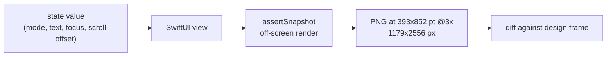

A focused `TextField`, rendered by a unit test with no app behind it, comes out without a text caret. An `AsyncImage` pointed at a local file still shows its placeholder after a full second of waiting. Neither fails the test. They're just not in the picture.

I ran into both while checking whether iOS could produce design-comparison screenshots the way my Android setup does. Most of the answer was good news. These two, and a few others like them, were the part worth writing down.

## State values in, PNGs out

On Android I already render Compose previews to PNG with Roborazzi on the JVM, at the same size and density as the design frames, and diff them against the designs. There's no device and no app launch. I wanted the same on iOS: take a screen, inject a specific state (empty, typing with focus, long text, scrolled 600 pt down, dark mode), and get a PNG at design size without building and running the app.

To find out, I built a small sample. It has a SwiftUI post-editor screen driven entirely by a value-type state, and a unit-test bundle using [swift-snapshot-testing](https://github.com/pointfreeco/swift-snapshot-testing) 1.19.4, run with `xcodebuild test` on an iOS 26.5 simulator. The test target has no host app (`TEST_HOST` isn't set). It compiles the screen's source file directly, so the app target never gets built into the test or launched.



The state type is plain data, the same kind of value a preview would use:

```swift
struct EditorState: Equatable {
    var title: String
    var body: String
    var isBodyFocused: Bool
    var scrollOffsetY: CGFloat = 0
    var expandsScrollContent = false   // render without ScrollView (see below)
}

final class EditorSnapshotTests: XCTestCase {
    private let frame = SwiftUISnapshotLayout.fixed(width: 393, height: 852)

    func test_typingWithFocus() {
        assertSnapshot(of: EditorScreen(state: .typingFocused), as: .image(layout: frame))
    }
}
```

## Scroll position, dark mode and fonts worked

Once I expressed each need as state, most of what the Android side relied on carried over:

| need | how it worked on iOS |
|---|---|
| inject mode, text, selected tab, attachment | pass the state value into the view |
| show focus | draw the focus border from a state flag |
| vertical scroll position | `ScrollPosition(point:)` bound with `.scrollPosition` |
| horizontal scroll position | same, with an x offset |
| lazy list starting at item 50 | `ScrollPosition(id:)` plus `.scrollTargetLayout()` |
| design-frame size and density | `.fixed(width:height:)`, rendered at @3x |
| dark theme | `traits: UITraitCollection(userInterfaceStyle: .dark)` |
| font used for comparison | register the bundled font with `CTFontManagerRegisterFontsForURL(..., .process, nil)` |

For diffing, I cared most about repeatability. I ran all 19 snapshot tests five times, and every run produced identical images.

## Where the picture had holes

### The caret belongs to the system

I set `@FocusState` to true in `onAppear` on a `TextField` and captured after a 0.5-second wait. The field rendered with its border and text and no caret. So I stopped relying on the system caret for comparison and drew one from state, the same way the focus border is drawn:

```swift
struct CaretText: View {
    let text: String
    let showsCaret: Bool

    var body: some View {
        HStack(spacing: 1) {
            Text(text)
            if showsCaret {
                Rectangle().fill(Color.accentColor).frame(width: 2, height: 22)
            }
            Spacer()
        }
    }
}
```

### A one-second wait didn't load AsyncImage

`AsyncImage` loads asynchronously, so a snapshot taken right away shows the `.empty` phase. I expected a wait to fix that. With `.wait(for: 1, on: .image(...))` and a file URL, with no network involved, the captured image was still the placeholder.

What worked was the move I already make on Android, where images are fetched before capture. The test loads the image itself and passes a `UIImage` in through state, so the view never goes through an asynchronous phase while the snapshot is taken.

### The key-window path needs a host app

swift-snapshot-testing can render through the key window (`drawHierarchyInKeyWindow: true`), which handles more effects. Without a host app it crashes with "requires tests to be run in a host application". I stayed on the default off-screen render. That puts blur and anything else that needs a real window out of reach unless you add a host app back.

### Tall design frames and ScrollView

Some designs are drawn as one tall frame that shows the whole scrollable screen. I tried the two obvious approaches:

- a taller fixed frame only made the scroll view taller, and the content inside was clipped the same way
- `.sizeThatFits` collapsed the `ScrollView` to zero height, and the body disappeared

So I added a state flag that renders the content without a `ScrollView`. With the scroll view gone, `.sizeThatFits` doesn't propose a height and multi-line text gets truncated. Measuring the height first with `UIHostingController` and capturing at that fixed size gave the full content:

```swift
func test_tallFrame_fitsContent() {
    var state = EditorState.scrollAtTop
    state.expandsScrollContent = true
    let screen = EditorScreen(state: state)
    let height = UIHostingController(rootView: screen)
        .sizeThatFits(in: CGSize(width: 393, height: .greatestFiniteMagnitude))
        .height
    assertSnapshot(of: screen, as: .image(layout: .fixed(width: 393, height: height)))
}
```

For the sample screen the height came out at 2,002 pt, which gives a 1179 x 6006 px image.

### Safe-area insets, but no status bar

Design frames include the status bar and home indicator areas. `ViewImageConfig` takes a `safeArea`. I gave it 59 pt at the top and 34 pt at the bottom on a 393 x 852 pt frame, and the content moved inward by exactly those amounts. The status bar's content (clock, battery) isn't drawn, though, so I mask that strip when diffing against a design.

### `#Preview` can't be captured

A `#Preview` block can't be captured directly. I made the previews and the tests use the same state values, so the canvas and the test render from one definition.

## Gaps and workarounds

| item | in the snapshot? | workaround |
|---|---|---|
| system text caret | no | draw the caret from state |
| `AsyncImage` (1 s wait, local file) | no, placeholder only | preload a `UIImage`, pass it through state |
| key-window rendering | crashes without a host app | default off-screen render |
| blur and other real-window effects | no | needs a host app |
| tall frame through a `ScrollView` | clipped or zero height | render without `ScrollView`, measure height with `UIHostingController` |
| status bar content | no | `safeArea` for layout, mask the strip when diffing |
| `#Preview` | not directly | share state values between preview and test |

## Drawing everything from state

Every gap was something the system draws for a live app: the caret, asynchronously loaded images, window-level effects, the status bar. None of them failed loudly. The test passed and the image was missing a piece, and a design diff would then report a difference that isn't there in the real app.

A new snapshot suite of mine would start from where this sample ended: anything that has to appear in the picture is state the view draws itself. The other constraint is about project layout. Capturing without the app only works if the screen's code compiles into the test target, so a screen that leans on app-module code or assets has to move into its own module first. Before planning iOS parity for a screen, I'd try compiling its source file into a test target with no `TEST_HOST` and see what breaks.
