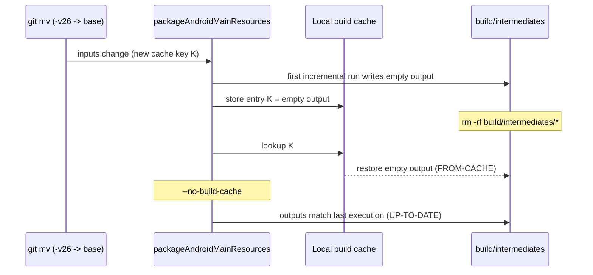

망가진 리소스 출력을 없애려고 중간 빌드 디렉터리를 지웠다. Gradle은 같은 망가진 출력을 `FROM-CACHE` 표시와 함께 되돌려 놓았다. `--no-build-cache`로 다시 돌리니 이번에는 `UP-TO-DATE`라고 했다. 소스 트리는 처음부터 맞았다. 로컬 빌드 캐시가 새로 바뀐 올바른 입력의 키로 빈 결과를 저장해 두었고, 평소 쓰는 정리 방법은 하나같이 그 결과를 다시 내줬다.

빌드 캐시를 켠 뒤 내 프로젝트의 로컬 빌드가 깨진 두 번째 경우다. 첫 번째는 Gradle 데몬 두 개가 부딪친 경합이었다. 캐시를 켜 두고 한 머신에서 여러 프로세스가 Gradle을 돌린다면 어느 쪽이든 겪을 수 있다. 그래서 둘 다 겪은 순서대로 적는다.

## 이 프로젝트에서 Gradle을 돌리는 쪽

프로젝트는 Android와 iOS를 함께 내는 Kotlin Multiplatform 앱이다. 나도 명령줄에서 빌드하고 코딩 에이전트 세션도 빌드하는데, 그동안 Android Studio가 같은 프로젝트를 열어 두고 있다. CI 러너 분을 줄이려고 `gradle.properties`에 `org.gradle.caching=true`를 넣었다. 캐시 액션이 아무것도 저장하지 않던 일까지 [앞 글](/ko/posts/gradle-cache-stored-nothing-on-ci/)에 적었다. 이 설정은 로컬에도 그대로 적용된다. 로컬 빌드도 태스크 출력을 `~/.gradle/caches/build-cache-1` 아래 로컬 캐시에 쓴다.

## Android Studio 데몬이 dex 파일을 지웠다

첫 증상은 불안정한 I/O처럼 보였다. 2026-08-22에 테스트 실행이 이렇게 죽었다.

```
java.nio.file.NoSuchFileException: composeApp/build/test-results/testAndroidHostTest/binary/in-progress-results-generic.bin
java.io.EOFException
```

2026-09-12에는 dex 머지에서 터졌다.

```
com.android.builder.dexing.DexArchiveMergerException: Error while merging dex archives
Caused by: java.nio.file.NoSuchFileException: androidApp/build/intermediates/dex/<flavor>Debug/mergeExtDex<Flavor>Debug
```

어떤 실행에서는 캐시 적재 쪽이 먼저 실패했다.

```
Failed to store cache entry ... Could not pack tree 'outputDir': Could not get file mode for '.../classes4.dex'
```

셋 다 컴파일 에러도 테스트 실패도 아니다. 같은 `build/` 디렉터리에서 두 번째 Gradle 데몬이 일하고 있었다. Android Studio는 열어 둔 프로젝트에 자기 데몬을 따로 띄우고, 그 빌드가 내 명령줄 빌드가 아직 쓰는 출력을 지울 수 있다. 09-12 데몬 로그에 그 장면이 그대로 남았다. 한 데몬이 dex 머지를 끝내고 출력을 캐시에 적재하는 사이 다른 데몬이 `classes.dex`부터 `classes6.dex`까지 지웠다. 적재 단계는 `classes4.dex`를 찾지 못했고 태스크가 실패했다. 지운 쪽 데몬은 자기 로그에 `WatchingVirtualFileSystem ... Handling VFS change REMOVED`를 남긴다. 같은 태스크를 단독으로 다시 돌리니 891ms 만에 `UP-TO-DATE`였다.

캐시가 꺼져 있으면 태스크는 출력을 쓰고 끝난다. 동시에 지워져도 대개 다음 빌드가 다시 만든다. 캐시가 켜져 있으면 캐시 가능한 태스크는 끝날 때 자기 출력을 전부 다시 읽어 엔트리로 묶는다. 그사이 삭제가 끼면 곧바로 오류가 된다. 경합은 원래 있었고 캐시 때문에 빌드가 깨지기 시작했다.

### 두 번째 데몬이 있는지 보기

확인하는 순서를 스크립트 하나로 묶었다.

```bash
#!/usr/bin/env bash
# Is this build failure a compile error, or another Gradle daemon deleting outputs?
log="${1:?usage: $0 <build-log>}"
project="${2:-$(basename "$PWD")}"

errors=$(grep -c '^e: ' "$log" || true)
echo "Kotlin compile errors in log: $errors"
(( errors > 0 )) && { echo "Real compile errors. Fix the code."; exit 1; }

echo "Daemon logs, newest first:"
ls -lt ~/.gradle/daemon/*/daemon-*.out.log | head -5

echo "Daemons that received a build for $project:"
grep -l "Received command.*currentDir=.*$project" ~/.gradle/daemon/*/daemon-*.out.log

echo "Daemons that saw outputs removed under them:"
grep -l 'Handling VFS change REMOVED' ~/.gradle/daemon/*/daemon-*.out.log
```

`e: `로 시작하는 줄이 0개면 Kotlin 컴파일러는 아무 에러도 내지 않았다. 같은 프로젝트 디렉터리를 받은 데몬이 둘이면 경합부터 의심한다.

### clean 대신 태스크 하나만 다시

캐시는 끄지 않았다. 버그는 경합이었고 캐시는 CI 분 때문에 일부러 켠 것이었다. 반사적으로 `clean`하던 버릇도 버렸다. 실패 뒤에 돈 빌드가 이미 디렉터리를 바로잡아 둔 경우가 많다. `classes*.dex`가 다 있으면 실패한 태스크 하나만 단독으로 돌려도 대개 `UP-TO-DATE`로 끝난다. `clean`을 했다면 멀쩡한 빌드 디렉터리를 버리고 전체 재컴파일을 치렀을 것이다. 예외는 테스트 결과 디렉터리다. 손상된 채로 두면 다음 테스트 실행이 곧바로 `EOFException`으로 죽어서 그 디렉터리만은 지운다.

제일 효과가 컸던 건 겹치는 시간을 줄이는 일이었다. 필요한 테스트만 `--tests "*SomeTest*"`로 돌리니 16분이던 실행이 7초가 됐다. 7초짜리 빌드는 무언가와 겹칠 일이 드물다. 08-22 실패는 원인이 더 단순했다. 앞 Gradle 실행이 끝나기 전에 내가 두 번째를 띄웠다. 지금은 백그라운드 빌드가 끝났다고 알려 온 다음에 다음 빌드를 띄운다. 배포 레인은 Gradle 실행이 겹치지 않게 이미 락을 잡는다. Android Studio는 그 락 밖에 있고 죽일 상대도 아니라서 그쪽은 진단으로만 푼다.

## 빈 mipmap 폴더가 맞는 키로 저장됐다

2026-09-16에 `minSdk`를 28에서 29로 올렸다. 29가 하한이 되자 런처 리소스의 `-v24`, `-v26` 한정자가 쓸모없어져서 `git mv`로 기본 폴더로 옮겼다. `mipmap-anydpi-v26/ic_launcher.xml`을 `mipmap-anydpi/`로 옮기는 식이다. 다음 빌드는 앱 모듈의 리소스 처리(`process<Flavor>DebugResources`)에서 실패했다.

```
AAPT: resource mipmap/ic_launcher not found
```

파일은 제자리에 있었다. 잘못된 가설 셋을 지나고서야 캐시를 들여다봤다. 공유 모듈(`composeApp`)의 `packageAndroidMainResources` 태스크가 첫 증분 실행에서 빈 `mipmap-anydpi-v26/` 출력을 내놓았다. Gradle은 그 출력을 새 입력의 캐시 키로 로컬 빌드 캐시에 저장했다. 그 뒤로 입력은 맞았고 그 키와 일치했으니 Gradle로서는 저장된 결과를 의심할 이유가 없었다.



평소 쓰는 복구 방법은 매번 같은 빈 출력을 돌려줬다.

| 시도 | 태스크 결과 | 이유 |
|---|---|---|
| `build/intermediates/*` 삭제 | `FROM-CACHE` | 입력이 같으니 키도 같고 빈 엔트리가 복원된다 |
| `--no-build-cache`로 다시 빌드 | `UP-TO-DATE` | 캐시는 건너뛰지만 up-to-date 검사는 직전 실행과 비교한다. 직전 실행은 복원된 빈 출력이었다 |

캐시는 켜 둔 채 태스크를 강제로 실행시켰다. 그러면 좋은 결과가 나쁜 엔트리를 밀어낸다. Gradle 기본 태스크 옵션 `--rerun`이 태스크 단위로 그렇게 해 준다. 공유 모듈에서 앱까지 이어지는 리소스 태스크 전부에 붙였다.

```bash
./gradlew :composeApp:packageAndroidMainResources --rerun \
          :composeApp:parseAndroidMainLocalResources --rerun \
          :composeApp:compileAndroidMainLibraryResources --rerun \
          :androidApp:merge<Flavor>DebugResources --rerun \
          :androidApp:process<Flavor>DebugResources --rerun
```

태스크 경로가 틀리면 Gradle은 `Selection failed`로 멈춘다. 그래서 이름을 짐작으로 적지 않았다. 실패한 빌드를 `--console=plain`으로 돌리면 실행되는 태스크 경로가 전부 찍히는데, 그 로그에서 이름을 먼저 읽었다.

## 스무 줄짜리 재현

이 동작은 Android 없이도 재현된다. 아래 빌드 스크립트에는 캐시 가능한 태스크가 하나 있다. 이 태스크의 출력은 환경 변수 하나에 따라 달라지는데, 태스크는 그 변수를 읽기만 하고 입력으로 선언하지 않는다. 맞는 입력에 틀린 출력을 내게 만드는 가장 간단한 방법이다.

```groovy
@CacheableTask
abstract class PackageRes extends DefaultTask {
    @InputDirectory @PathSensitive(PathSensitivity.RELATIVE)
    abstract DirectoryProperty getSrc()
    @OutputDirectory
    abstract DirectoryProperty getOut()

    @TaskAction
    void run() {
        def out = getOut().get().asFile
        project.delete(out); out.mkdirs()
        if (System.getenv('BUG') == '1') return   // the bad first run: empty output
        project.copy { from getSrc(); into out }
    }
}

tasks.register('packageRes', PackageRes) {
    src = layout.projectDirectory.dir('res')
    out = layout.buildDirectory.dir('packaged')
}
```

`res/` 아래 파일 하나와 프로젝트 안에 둔 캐시 디렉터리로 Gradle 9.8.1에서 돌린 결과다.

| 단계 | 명령 | 태스크 결과 | 출력 파일 수 |
|---|---|---|---|
| 1 | `BUG=1 gradle --build-cache packageRes` | 실행 | 0 |
| 2 | `rm -rf build` 후 `gradle --build-cache packageRes` | `FROM-CACHE` | 0 |
| 3 | `gradle --no-build-cache packageRes` | `UP-TO-DATE` | 0 |
| 4 | `gradle --build-cache packageRes --rerun` | 실행 | 1 |
| 5 | `rm -rf build` 후 `gradle --build-cache packageRes` | `FROM-CACHE` | 1 |

2단계와 3단계가 실제 빌드에서 막혔던 두 길이다. 5단계에서 `rm -rf build`를 한 번 더 해도 좋은 출력이 복원된다. `--rerun`이 작업 디렉터리와 함께 캐시 엔트리까지 바꿨다는 뜻이다.

## 지금 먼저 보는 곳

두 번 다 처음 본 에러는 원인과 다른 곳을 가리켰다. dex 머지의 `NoSuchFileException`은 두 번째 데몬 때문이었고 리소스를 못 찾는다는 에러는 나쁜 결과를 되풀이한 캐시 엔트리 때문이었다. 그래서 지금은 빌드 디렉터리를 건드리기 전에 코드가 틀렸는지부터 본다. 로그에 `grep -c '^e: '`를 돌리고 소스 트리를 한 번 보면 몇 초 만에 답이 나온다.

빌드 캐시 엔트리의 키는 태스크 입력이라서 엔트리는 그 입력으로 처음 돈 한 번만큼만 믿을 수 있다. 그 한 번이 틀렸다면 출력을 지우거나 한 번 캐시를 건너뛰어도 엔트리에는 닿지 않는다. 해당 태스크에 `--rerun`을 붙이면 닿는다. 캐싱을 끄지 않아도 되고 `~/.gradle/caches`를 지우지 않아도 된다.
