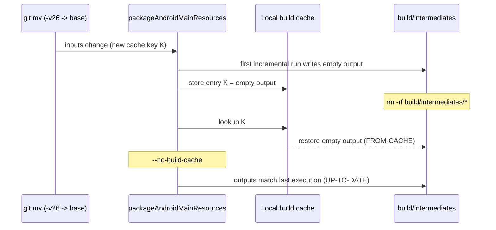

망가진 리소스 출력을 없애려고 중간 빌드 디렉터리를 지웠는데 Gradle이 같은 출력을 `FROM-CACHE` 표시와 함께 다시 가져다 놓았다. `--no-build-cache`로 다시 돌리자 이번에는 `UP-TO-DATE`라고 나왔다. 소스 트리에는 처음부터 문제가 없었다. 로컬 빌드 캐시가 바뀐, 그리고 올바른 입력의 키로 빈 결과를 저장해 두었고, 평소 쓰던 정리 방법은 하나같이 그 빈 결과를 다시 돌려줬다.

빌드 캐시를 켠 뒤 로컬 빌드가 깨진 것은 이번이 두 번째다. 첫 번째는 Gradle 데몬 두 개 사이의 경합이었다. 캐시를 켠 채 한 머신에서 여러 프로세스가 Gradle을 돌린다면 둘 다 어디서든 생길 수 있으므로, 겪은 순서대로 둘 다 정리한다.

## 이 프로젝트에서 Gradle을 돌리는 주체

프로젝트는 안드로이드와 iOS를 함께 내는 Kotlin Multiplatform 앱이다. 나도 터미널에서 빌드하고 코딩 에이전트 세션도 빌드하는데, 그동안 Android Studio가 같은 프로젝트를 열어 두고 있다. CI의 Actions 사용 시간을 줄이려고 `gradle.properties`에 `org.gradle.caching=true`를 넣었고, 캐시 액션이 아무것도 저장하지 않던 일까지 [GitHub Actions Gradle 캐시 글](/ko/posts/gradle-cache-stored-nothing-on-ci/)에 정리했다. 이 설정은 로컬에도 그대로 적용되므로 로컬 빌드도 태스크 출력을 `~/.gradle/caches/build-cache-1` 아래의 로컬 캐시에 쓴다.

## Android Studio 데몬의 dex 파일 삭제

첫 증상은 불안정한 I/O처럼 보였다. 2026-08-22에는 테스트 실행이 다음 에러와 함께 죽었다.

```
java.nio.file.NoSuchFileException: composeApp/build/test-results/testAndroidHostTest/binary/in-progress-results-generic.bin
java.io.EOFException
```

2026-09-12에는 dex 머지에서 실패했다.

```
com.android.builder.dexing.DexArchiveMergerException: Error while merging dex archives
Caused by: java.nio.file.NoSuchFileException: androidApp/build/intermediates/dex/<flavor>Debug/mergeExtDex<Flavor>Debug
```

다른 실행에서는 캐시 저장 쪽이 먼저 실패하기도 했다.

```
Failed to store cache entry ... Could not pack tree 'outputDir': Could not get file mode for '.../classes4.dex'
```

셋 다 컴파일 에러도 테스트 실패도 아니었다. 같은 `build/` 디렉터리에서 두 번째 Gradle 데몬이 돌고 있었던 것이다. Android Studio는 열어 둔 프로젝트용으로 자기 데몬을 따로 띄우는데, 그 빌드가 내 터미널 빌드가 아직 쓰고 있는 출력을 지울 수 있다. 09-12의 데몬 로그에는 그 과정이 그대로 남아 있었다. 한 데몬이 dex 머지를 끝내고 출력을 캐시 엔트리로 묶는 사이 다른 데몬이 `classes.dex`부터 `classes6.dex`까지 지웠다. 묶는 단계는 `classes4.dex`를 찾지 못했고 태스크가 실패했다. 지운 쪽 데몬은 자기 로그에 `WatchingVirtualFileSystem ... Handling VFS change REMOVED`를 남긴다. 같은 태스크를 단독으로 다시 돌리자 891ms 만에 `UP-TO-DATE`로 끝났다.

캐시가 꺼져 있으면 태스크는 출력을 쓰고 끝나므로, 다른 쪽이 동시에 지워도 대개 다음 빌드가 다시 만든다. 하지만 캐시가 켜져 있으면 캐시 가능한 태스크는 끝날 때 자기 출력을 전부 다시 읽어 캐시 엔트리로 묶기 때문에, 그사이 삭제가 끼면 바로 에러가 된다. 경합은 전부터 있었고, 캐시를 켜면서 빌드 실패로 드러났을 뿐이다.

### 두 번째 데몬 확인

확인하는 순서를 스크립트 하나로 묶었다.

```bash
#!/usr/bin/env bash
# Is this build failure a compile error, or another Gradle daemon deleting outputs?
log="${1:?usage: $0 <build-log>}"
project="${2:-$(basename "$PWD")}"

errors=$(grep -c '^e: ' "$log" || true)
echo "Kotlin compile errors in log: $errors"
(( errors > 0 )) && { echo "Real compile errors. Fix the code."; exit 1; }

echo "Daemon logs, newest first:"
ls -lt ~/.gradle/daemon/*/daemon-*.out.log | head -5

echo "Daemons that received a build for $project:"
grep -l "Received command.*currentDir=.*$project" ~/.gradle/daemon/*/daemon-*.out.log

echo "Daemons that saw outputs removed under them:"
grep -l 'Handling VFS change REMOVED' ~/.gradle/daemon/*/daemon-*.out.log
```

`e: `로 시작하는 줄이 0개면 코틀린 컴파일러는 아무 에러도 내지 않은 것이다. 같은 프로젝트 디렉터리로 빌드를 받은 데몬이 둘이면 경합부터 의심한다.

### clean 대신 태스크 하나만 다시 실행

캐시는 끄지 않았다. 문제는 경합이었고 캐시는 CI 사용 시간 때문에 일부러 켠 것이었다. 습관처럼 `clean`을 돌리던 것도 그만뒀다. 실패 뒤에 돈 빌드가 이미 디렉터리를 바로잡아 둔 경우가 많기 때문이다. `classes*.dex`가 다 있으면 실패한 태스크 하나만 단독으로 돌려도 대개 `UP-TO-DATE`로 끝나는데, `clean`을 했다면 멀쩡한 빌드 디렉터리를 버리고 전체를 다시 컴파일했을 것이다. 예외는 테스트 결과 디렉터리다. 손상된 채로 두면 다음 테스트 실행이 바로 `EOFException`으로 죽으므로 그 디렉터리만은 지운다.

가장 효과가 컸던 것은 겹칠 수 있는 시간을 줄이는 일이었다. 필요한 테스트만 `--tests "*SomeTest*"`로 돌리자 16분 걸리던 실행이 7초로 줄었고, 7초짜리 빌드는 다른 빌드와 겹칠 일이 드물다. 08-22 실패는 원인이 더 단순했는데, 앞 Gradle 실행이 끝나기 전에 내가 두 번째 실행을 띄운 것이었다. 지금은 백그라운드 빌드가 끝났다는 알림을 받은 뒤에 다음 빌드를 띄운다. 배포 레인은 Gradle 실행이 겹치지 않도록 이미 락을 잡는다. Android Studio는 그 락 밖에 있고 종료할 대상도 아니라서 그쪽은 진단으로만 대응한다.

## 올바른 키로 저장된 빈 mipmap 폴더

2026-09-16에 `minSdk`를 28에서 29로 올렸다. 29가 하한이 되자 런처 리소스의 `-v24`, `-v26` 한정자가 필요 없어져서 `git mv`로 기본 폴더로 옮겼다. `mipmap-anydpi-v26/ic_launcher.xml`을 `mipmap-anydpi/`로 옮기는 식이다. 그런데 다음 빌드가 앱 모듈의 리소스 처리 태스크(`process<Flavor>DebugResources`)에서 실패했다.

```
AAPT: resource mipmap/ic_launcher not found
```

파일은 제자리에 있었다. 캐시에 생각이 미치기까지 잘못된 가설을 세 개나 거쳤다. 공유 모듈(`composeApp`)의 `packageAndroidMainResources` 태스크가 첫 증분 실행에서 빈 `mipmap-anydpi-v26/` 출력을 냈고, Gradle은 그 출력을 새 입력의 캐시 키로 로컬 빌드 캐시에 저장했다. 그 뒤로는 입력이 올바르고 키도 일치했으므로 Gradle 입장에서는 저장된 결과를 의심할 이유가 없었다.



평소 쓰는 복구 방법으로는 매번 같은 빈 출력이 돌아왔다.

| 시도 | 태스크 결과 | 이유 |
|---|---|---|
| `build/intermediates/*` 삭제 | `FROM-CACHE` | 입력이 같으니 키도 같아서 빈 엔트리가 복원된다 |
| `--no-build-cache`로 다시 빌드 | `UP-TO-DATE` | 캐시는 건너뛰지만 `UP-TO-DATE` 검사는 직전 실행과 비교하는데, 직전 실행이 복원된 빈 출력이었다 |

그래서 캐시는 켜 둔 채 태스크를 강제로 실행해 제대로 된 결과로 잘못된 엔트리를 덮어썼다. Gradle에 기본으로 있는 태스크 옵션 `--rerun`이 태스크 단위로 이 일을 해 준다. 공유 모듈에서 앱 모듈까지 이어지는 리소스 태스크 전부에 붙였다.

```bash
./gradlew :composeApp:packageAndroidMainResources --rerun \
          :composeApp:parseAndroidMainLocalResources --rerun \
          :composeApp:compileAndroidMainLibraryResources --rerun \
          :androidApp:merge<Flavor>DebugResources --rerun \
          :androidApp:process<Flavor>DebugResources --rerun
```

태스크 경로가 틀리면 Gradle은 `Selection failed`로 멈추므로 이름을 짐작으로 적지 않았다. 실패한 빌드를 `--console=plain`으로 돌리면 실행되는 태스크 경로가 전부 찍히는데, 그 로그에서 이름을 읽어 왔다.

## 스무 줄짜리 재현

이 동작은 안드로이드 없이도 재현할 수 있다. 아래 빌드 스크립트에는 캐시 가능한 태스크가 하나 있는데, 이 태스크의 출력은 환경 변수 하나에 따라 달라진다. 태스크는 그 변수를 읽기만 하고 입력으로 선언하지 않는다. 입력은 맞는데 출력은 틀린 태스크를 만드는 방법으로는 내가 아는 가장 간단한 것이다.

```groovy
@CacheableTask
abstract class PackageRes extends DefaultTask {
    @InputDirectory @PathSensitive(PathSensitivity.RELATIVE)
    abstract DirectoryProperty getSrc()
    @OutputDirectory
    abstract DirectoryProperty getOut()

    @TaskAction
    void run() {
        def out = getOut().get().asFile
        project.delete(out); out.mkdirs()
        if (System.getenv('BUG') == '1') return   // the bad first run: empty output
        project.copy { from getSrc(); into out }
    }
}

tasks.register('packageRes', PackageRes) {
    src = layout.projectDirectory.dir('res')
    out = layout.buildDirectory.dir('packaged')
}
```

`res/` 아래에 파일 하나를 두고 캐시 디렉터리를 프로젝트 안에 둔 채 Gradle 9.8.1에서 차례로 돌렸다.

| 단계 | 명령 | 태스크 결과 | 출력 파일 수 |
|---|---|---|---|
| 1 | `BUG=1 gradle --build-cache packageRes` | 실행 | 0 |
| 2 | `rm -rf build` 후 `gradle --build-cache packageRes` | `FROM-CACHE` | 0 |
| 3 | `gradle --no-build-cache packageRes` | `UP-TO-DATE` | 0 |
| 4 | `gradle --build-cache packageRes --rerun` | 실행 | 1 |
| 5 | `rm -rf build` 후 `gradle --build-cache packageRes` | `FROM-CACHE` | 1 |

2단계와 3단계가 실제 빌드에서 막혔던 두 방법이다. 5단계에서 `rm -rf build`를 한 번 더 해도 제대로 된 출력이 복원되는데, `--rerun`이 작업 디렉터리뿐 아니라 캐시 엔트리까지 바꿨다는 뜻이다.

## 지금 먼저 확인하는 것

두 경우 모두 처음 본 에러는 원인과 다른 곳을 가리켰다. dex 머지의 `NoSuchFileException`은 두 번째 데몬 때문이었고, 리소스를 찾지 못한다는 에러는 잘못된 결과가 저장된 캐시 엔트리 때문이었다. 그래서 지금은 빌드 디렉터리를 건드리기 전에 코드가 틀렸는지부터 본다. 로그에 `grep -c '^e: '`를 돌리고 소스 트리를 한 번 보면 몇 초 안에 답이 나온다.

빌드 캐시 엔트리의 키는 태스크 입력이므로 엔트리는 그 입력으로 처음 실행했을 때의 결과가 맞아야만 믿을 수 있다. 그 한 번이 틀렸다면 출력을 지우거나 캐시를 한 번 건너뛰어도 엔트리는 그대로다. 해당 태스크에 `--rerun`을 붙이면 엔트리까지 바뀌므로 캐싱을 끄거나 `~/.gradle/caches`를 지울 필요가 없다.
