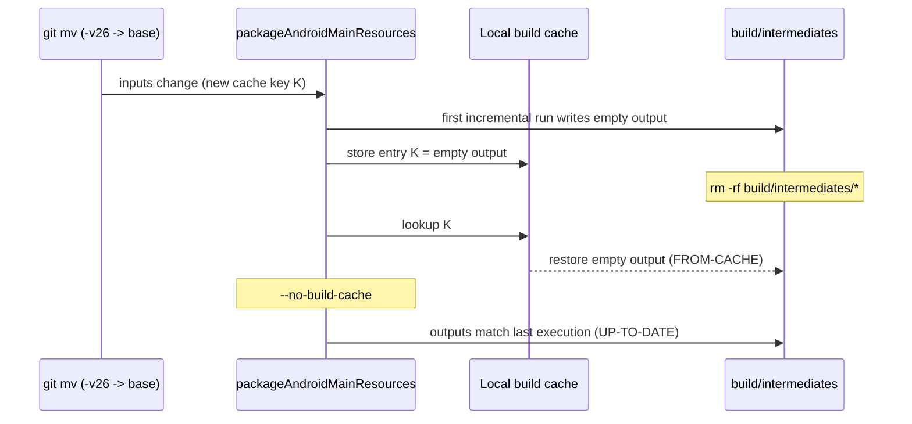

I deleted the intermediate build directory to get rid of a broken resource output, and Gradle put the same broken output back, labelled `FROM-CACHE`. When I ran the task again with `--no-build-cache`, Gradle called it `UP-TO-DATE`. The source tree had been correct the whole time. The local build cache had stored an empty result under the key of the new, correct inputs, and every normal way of cleaning up handed that result back.

That was the second way turning on the build cache broke local builds in my project. The first was a race between two Gradle daemons. Either can happen on any machine where more than one process runs Gradle with the cache on, so I've written up both, in the order they happened.

## Who runs Gradle on this project

The project is a Kotlin Multiplatform app with an Android and an iOS target. I build it from the command line, and so do coding-agent sessions, while Android Studio has the same project open. I'd set `org.gradle.caching=true` in `gradle.properties` to cut CI runner-minutes, and the [earlier post](/posts/gradle-cache-stored-nothing-on-ci/) covers that, including a cache action that stored nothing. The setting applies locally too, so every local build also writes task outputs into the local cache under `~/.gradle/caches/build-cache-1`.

## Android Studio's daemon deleting my dex files

The first symptom looked like flaky I/O. On 2026-08-22 a test run died with:

```
java.nio.file.NoSuchFileException: composeApp/build/test-results/testAndroidHostTest/binary/in-progress-results-generic.bin
java.io.EOFException
```

On 2026-09-12 it was the dex merge:

```
com.android.builder.dexing.DexArchiveMergerException: Error while merging dex archives
Caused by: java.nio.file.NoSuchFileException: androidApp/build/intermediates/dex/<flavor>Debug/mergeExtDex<Flavor>Debug
```

or, on other runs, the cache store tripped first:

```
Failed to store cache entry ... Could not pack tree 'outputDir': Could not get file mode for '.../classes4.dex'
```

None of these is a compile error or a test failure. A second Gradle daemon was working on the same `build/` directory. Android Studio runs its own daemon for the project it has open, and its builds can delete outputs that my command-line build is still using. On 09-12 the daemon logs showed it plainly: one daemon finished the dex merge and started packing the output into the cache, and while it did, the other daemon deleted `classes.dex` through `classes6.dex`. The packing step went looking for `classes4.dex`, didn't find it, and failed the task. The deleting daemon logs `WatchingVirtualFileSystem ... Handling VFS change REMOVED` in its own log. Run again on its own, the same task was `UP-TO-DATE` in 891 ms.

Without the cache, a task writes its outputs and is done, so a concurrent delete usually just means the next build recreates them. With the cache on, every cacheable task reads back all of its outputs at the end to pack them into an entry, and a delete in that window becomes a hard error. The race was there either way. The cache made it fail the build.

### Checking for a second daemon

I check things in this order, so I wrote it as one script:

```bash
#!/usr/bin/env bash
# Is this build failure a compile error, or another Gradle daemon deleting outputs?
log="${1:?usage: $0 <build-log>}"
project="${2:-$(basename "$PWD")}"

errors=$(grep -c '^e: ' "$log" || true)
echo "Kotlin compile errors in log: $errors"
(( errors > 0 )) && { echo "Real compile errors. Fix the code."; exit 1; }

echo "Daemon logs, newest first:"
ls -lt ~/.gradle/daemon/*/daemon-*.out.log | head -5

echo "Daemons that received a build for $project:"
grep -l "Received command.*currentDir=.*$project" ~/.gradle/daemon/*/daemon-*.out.log

echo "Daemons that saw outputs removed under them:"
grep -l 'Handling VFS change REMOVED' ~/.gradle/daemon/*/daemon-*.out.log
```

Zero lines starting with `e: ` means the Kotlin compiler reported nothing. Two daemons with the same project directory make the race the first suspect.

### Rerunning one task instead of clean

I didn't turn the cache off. The race was the bug, and the cache was on for CI minutes. I also stopped reaching for `clean`. Often the build that ran after the failure has already put the directory right. If all the `classes*.dex` files exist, rerunning the one failed task on its own usually ends in `UP-TO-DATE`, and `clean` would have thrown away a good build directory to buy a full recompile. The test-results directory is the exception. Left damaged, it makes the next test run die immediately with `EOFException`, so I delete that one directory.

What helped most was making the window small. Running only the tests I needed with `--tests "*SomeTest*"` took a run from 16 minutes to 7 seconds, and a 7-second build rarely overlaps with anything. The 08-22 failure had a simpler cause: I'd started a second Gradle run before the first finished. Now I wait for a background build to report completion before starting another. The release lanes already take a lock so their Gradle runs never overlap. Android Studio is outside that lock and isn't something I'd kill, so on that side diagnosis is all I have.

## An empty mipmap folder under the right key

On 2026-09-16 I raised `minSdk` from 28 to 29. With 29 as the floor, the `-v24` and `-v26` qualifiers on the launcher resources were dead, so I moved them to the base folders with `git mv`, for example `mipmap-anydpi-v26/ic_launcher.xml` to `mipmap-anydpi/`. The next build failed in the app module's resource processing (`process<Flavor>DebugResources`):

```
AAPT: resource mipmap/ic_launcher not found
```

The file was in the right place. It took me three wrong hypotheses to get to the cache. The first incremental run of the shared module's (`composeApp`) `packageAndroidMainResources` task had produced an empty `mipmap-anydpi-v26/` output, and Gradle stored that output in the local build cache under the cache key of the new inputs. From then on the inputs were correct and matched that key, so Gradle had every reason to trust the stored result.



Each ordinary recovery step returned the same empty output:

| What I tried | Task outcome | Why |
|---|---|---|
| Delete `build/intermediates/*` | `FROM-CACHE` | Same inputs, same key, so the empty entry is restored |
| Rebuild with `--no-build-cache` | `UP-TO-DATE` | The cache is skipped, but the up-to-date check compares against the last execution, which was the restored empty output |

I left caching on and forced the tasks to execute, so their good result would replace the bad entry. Gradle's built-in `--rerun` task option does that per task. I applied it to every task in the resource chain between the shared module and the app:

```bash
./gradlew :composeApp:packageAndroidMainResources --rerun \
          :composeApp:parseAndroidMainLocalResources --rerun \
          :composeApp:compileAndroidMainLibraryResources --rerun \
          :androidApp:merge<Flavor>DebugResources --rerun \
          :androidApp:process<Flavor>DebugResources --rerun
```

A wrong task path makes Gradle stop with `Selection failed`, so I didn't guess the names. I read them from a `--console=plain` log of the failing build, which prints every task path as it runs.

## A twenty-line reproduction

You don't need Android to see this. The build script below has one cacheable task whose output depends on an environment variable it reads but doesn't declare as an input. That's the simplest way I know to make a task produce the wrong output for the right inputs:

```groovy
@CacheableTask
abstract class PackageRes extends DefaultTask {
    @InputDirectory @PathSensitive(PathSensitivity.RELATIVE)
    abstract DirectoryProperty getSrc()
    @OutputDirectory
    abstract DirectoryProperty getOut()

    @TaskAction
    void run() {
        def out = getOut().get().asFile
        project.delete(out); out.mkdirs()
        if (System.getenv('BUG') == '1') return   // the bad first run: empty output
        project.copy { from getSrc(); into out }
    }
}

tasks.register('packageRes', PackageRes) {
    src = layout.projectDirectory.dir('res')
    out = layout.buildDirectory.dir('packaged')
}
```

With one file under `res/` and a project-local cache directory, I ran it on Gradle 9.8.1:

| Step | Command | Task outcome | Files in output |
|---|---|---|---|
| 1 | `BUG=1 gradle --build-cache packageRes` | executed | 0 |
| 2 | `rm -rf build`, then `gradle --build-cache packageRes` | `FROM-CACHE` | 0 |
| 3 | `gradle --no-build-cache packageRes` | `UP-TO-DATE` | 0 |
| 4 | `gradle --build-cache packageRes --rerun` | executed | 1 |
| 5 | `rm -rf build`, then `gradle --build-cache packageRes` | `FROM-CACHE` | 1 |

Steps 2 and 3 are the two dead ends from the real build. In step 5 the restore after another `rm -rf build` brings back the good output, so `--rerun` replaced the cache entry as well as fixing the working directory.

## Where I look first now

In both failures the first error I saw pointed away from the cause. The `NoSuchFileException` in the dex merge came from a second daemon, and the missing resource came from a cache entry replaying a bad result. Before touching the build directory, I now check whether the code is wrong: `grep -c '^e: '` on the log and a look at the source tree answer it in seconds.

A build cache entry is keyed on a task's inputs, so it's only as good as the one run that produced it. When that run was wrong, deleting outputs or skipping the cache for one build doesn't reach the entry. `--rerun` on the specific tasks does, with caching left on and `~/.gradle/caches` left alone.
