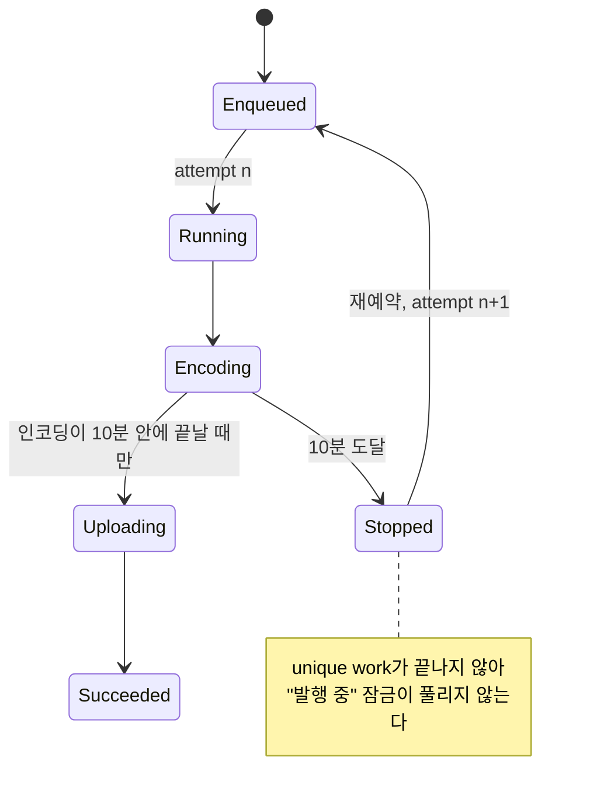

1시간 분량에 60MB짜리 동영상을 붙인 게시물이 끝내 발행되지 않았다. 발행 중에 두 번째 발행을 막는 "발행 중" 잠금도 그대로 걸려 있었다. 앱을 강제 종료해도 폰을 재부팅해도 풀리지 않았다.

어디서 멈춘 건 아니었다. 시스템이 10분째에 발행 워커를 세웠고 워커는 매번 처음부터 다시 시작했다.

## 워커로 옮긴 발행과 unique work 잠금

그해 여름에 발행을 화면 밖으로 옮겼다. 그전에는 에디터가 열려 있는 동안 업로드가 돌았고 진행 상황도 화면에 떴다. 바꾼 뒤로는 에디터가 직렬화한 발행 요청을 `CoroutineWorker`에 넘기고 바로 돌아온다. 느린 일은 워커가 순서대로 맡는다. 기기 동영상을 인코딩해 업로드한 다음, 서버 처리가 끝나길 기다렸다가 첨부하고 게시물을 만든다. 진행 상태는 따로 둔 상태 저장소가 앱 나머지에 알린다.

워커는 `ExistingWorkPolicy.KEEP`으로 unique work에 넣었다. `KEEP`은 두 번째 요청을 아무 말 없이 버린다. 그러면 사용자는 중복 발행이 접수된 줄 안다. 그래서 발행 진입점에서 먼저 확인하고 대놓고 거절하게 했다.

```kotlin
suspend fun isPublishInFlight(): Boolean = withContext(Dispatchers.IO) {
    workManager.getWorkInfosForUniqueWork(PUBLISH_WORK)
        .get()
        .any { !it.state.isFinished }
}
```

이 확인에 메모리 속 "발행 중" 상태를 더한 것이 잠금이다. unique work가 끝난 상태가 아니면 다시 발행할 수 없다. WorkManager는 작업을 자체 데이터베이스에 저장하니 이 잠금은 원래부터 프로세스 종료와 재부팅을 견딘다. 진짜 발행이 돌고 있을 때라면 딱 바라는 동작이다.

## 한 번에 10분, 그다음은 새 인스턴스

앱이 쓰던 WorkManager 2.10.2의 `ListenableWorker` Javadoc에 이렇게 적혀 있다.

> A ListenableWorker is given a maximum of ten minutes to finish its execution and return a Result. After this time has expired, the worker will be signalled to stop and its ListenableFuture will be cancelled.

몇 줄 위에는 선점됐다가 나중에 다시 시작하는 작업은 워커 인스턴스를 새로 만든다고 나온다. 2.10.2 소스에서 결과를 못 돌려주고 멈춘 워커는 `ENQUEUED`로 돌아간다. run attempt count는 작업이 `RUNNING`으로 바뀔 때마다 하나씩 오르고 첫 실행에서는 0이다.

발행은 중간부터 이어 갈 수 없다. 다시 돌면 인코딩도 첫 프레임부터 새로 한다. 1시간짜리 동영상은 기기 인코딩만으로 10분을 넘겨서 매번 비슷한 자리에서 잘렸고 업로드는 하나도 끝나지 못했다. 작업이 끝난 상태에 닿지 못하니 잠금도 풀릴 수 없었다.



예전 화면 방식에서는 이런 일이 없었다. 사용자가 보는 앞에서 포그라운드로 돌았고 시스템 타이머도 걸리지 않았다. 백그라운드 워커로 옮기면서 발행 시간에 천장을 하나 얹었는데 그걸 모르고 넘어갔다.

## 동영상 발행만 foreground 작업으로

긴 작업을 위해 WorkManager가 내놓은 방법은 `setForeground()`다. 알림을 띄운 foreground service 아래에서 워커를 돌리고 이때는 10분 한도가 걸리지 않는다. 이게 필요한 건 기기 동영상이 있는 발행뿐이다. 이미지는 금방 끝나고 원격 URL 동영상은 서버가 가져가니 기기에서 무거운 일을 하지 않는다. 그래서 요청에 기기 동영상 파일이 있을 때만 워커를 올렸다.

Android 14 이상을 타깃으로 하는 앱은 오래 도는 워커마다 foreground service 유형을 지정해야 한다. 유형마다 권한도 따로 있다. 앱 모듈 매니페스트에는 WorkManager의 foreground service에 `dataSync` 유형이 이미 선언돼 있었다.

```xml
<uses-permission android:name="android.permission.FOREGROUND_SERVICE_DATA_SYNC" />
<service
    android:name="androidx.work.impl.foreground.SystemForegroundService"
    android:foregroundServiceType="dataSync" />
```

그래서 워커는 `ForegroundInfo`에 `FOREGROUND_SERVICE_TYPE_DATA_SYNC`를 넘긴다.

Android 12부터는 백그라운드에 있는 앱이 foreground service를 시작하기가 대체로 막혀 있다. 그럴 때 `setForeground()`는 예외를 던진다. 그래서 전환은 되면 좋고 안 되면 그만인 단계로 뒀다. 거절당하면 로그만 남기고 일반 워커로 계속 간다. 짧은 동영상이라면 그래도 10분 안에 끝난다.

## 세 번째 재시작에서 포기한다

foreground로 올리면 10분 정지는 사라진다. 다만 전환은 거절될 수 있고 프로세스는 다른 이유로도 죽는다. 상한이 없으면 그중 무엇이든 사용자를 다시 안 풀리는 잠금 앞에 세운다.

그래서 워커가 자기 재시작 횟수를 센다. 첫 실행과 재시작 두 번까지는 평소대로 발행한다. run attempt count 3으로 시작한 실행은 더 시도하지 않는다. 원래 요청을 담은 실패를 남겨서 사용자가 다시 시도하거나 지울 수 있게 하고 `Result.failure()`를 돌려준다. 실패도 끝난 상태라 unique work가 종료되고 잠금이 풀린다.

이 실패는 콘텐츠 거부 실패와 일부러 구분했다. 앱은 거부된 콘텐츠를 다르게 보여 준다. 다시 시도를 숨기고 삭제만 남긴다. 중단된 발행은 다시 시도할 만하니 평범한 실패로 보여야 한다.

일반적인 이름으로 다시 쓴 워커는 이렇다. 맨 위의 `runAttemptCount` 확인이 상한이다.

```kotlin
override suspend fun doWork(): Result {
    val request = decodeRequest(inputData)
    if (runAttemptCount >= MAX_ATTEMPTS) {    // first run + 2 restarts
        publisher.abandon(request)            // retryable failure, request kept
        return Result.failure()               // finishes the unique work
    }
    if (request.hasLocalVideo) tryPromoteToForeground()
    publisher.run(request)
    return Result.success()
}

private suspend fun tryPromoteToForeground() {
    try {
        setForeground(ForegroundInfo(NOTIFICATION_ID, buildNotification(),
            ServiceInfo.FOREGROUND_SERVICE_TYPE_DATA_SYNC))
    } catch (e: CancellationException) {
        throw e
    } catch (e: Exception) {
        log("foreground promotion refused, continuing as a regular worker", e)
    }
}
```

단위 테스트 두 개를 같이 넣었다. 하나는 포기 처리가 요청을 그대로 담은 재시도 가능한 실패를 남기는지, 그리고 콘텐츠 거부로 표시하지 않는지 본다. 다른 하나는 "기기 동영상 있음"이 기기 동영상에서 켜지는지 본다. 편집을 마친 동영상도 여기에 들고 이미지와 원격 URL 동영상에서는 꺼져야 한다.

## IllegalStateException만 잡았더니 발행이 사라졌다

처음 짠 전환 코드는 `IllegalStateException`만 잡았다. `ForegroundServiceStartNotAllowedException`이 그 하위 타입이라서다. 몇 시간 뒤에 catch 범위를 넓혔다.

`doWork()`에는 바깥 `try`가 따로 있었고 어떤 예외든 `Result.failure()`로 바꿨다. 전환 중에 `IllegalStateException` 말고 다른 예외가 나오면 안쪽 catch를 지나 바깥에 걸린다. 그러면 워커는 발행을 시작하기도 전에 `Result.failure()`를 돌려준다. 그때 상태 저장소는 아직 대기 상태였다. 사용자에게는 실패 안내도 다시 시도 버튼도 뜨지 않았다. 발행이 그냥 사라졌다.

위 코드가 넓힌 뒤의 모습이다. 코루틴 안에서 실패해도 되는 단계라면 `CancellationException`은 그대로 내보낸다. 취소는 실패가 아니기 때문이다. 나머지 예외는 로그만 남기고 삼킨다. 그래야 진짜 작업이 돌고 자기 결과를 직접 알린다.

## lint가 앱 매니페스트를 보지 못했다

몇 주 뒤에 lint가 `setForeground()` 호출에 `SpecifyForegroundServiceType` 경고를 띄우기 시작했다. 이 기능은 동적 기능 모듈에 있었다. 그 모듈의 lint는 앱 모듈 매니페스트를 병합하지 않아서 `SystemForegroundService`에 붙은 `dataSync` 선언을 보지 못했다. 오탐이었다. 그 파일 하나에만 경고를 끄고 이유를 바로 옆에 적어 뒀다. 나중에 경고를 없애려고 선언을 하나 더 넣는 일이 없게 하려는 메모다.

```xml
<!-- Feature-module lint does not merge the app manifest, so it cannot see the
     dataSync type declared on SystemForegroundService there. -->
<issue id="SpecifyForegroundServiceType">
    <ignore path="src/main/kotlin/.../PublishWorker.kt" />
</issue>
```

## 첨부 단계에 시간 예산 하나

10분 벽이 없어지자 반대 질문이 생겼다. 발행은 얼마나 오래 돌게 둬야 할까? 2주 뒤에 파이프라인을 고쳐 앞 동영상을 업로드하는 동안 다음 동영상을 인코딩하게 했다. 단계마다 따로 걸던 타임아웃도 걷어 냈다. 대신 동영상이 있는 게시물에는 첨부 단계 전체(인코딩, 업로드, 서버 처리 대기, 첨부)에 시간 예산 하나만 건다. 이미지만 있는 게시물에는 걸지 않는다. 예산을 넘기면 다시 시도하라는 안내가 뜬다.

예산은 마지막 "게시물 생성" 요청 앞에서 끝난다. 그 요청을 중간에 끊으면 클라이언트는 실패로 아는데 서버에는 게시물이 생겨 있을 수 있다. 이때 다시 시도하면 게시물이 두 개가 된다. 그래서 예산은 버려도 안전한 작업에만 걸었다.

## 바뀐 동작

상황별로 코드가 어느 길을 타는지 정리하면 이렇다.

| 상황 | 전 | 후 |
|---|---|---|
| 기기 동영상, 인코딩+업로드가 10분 초과 | 10분에 멈추고 처음부터 무한 반복, 강제 종료·재부팅 뒤에도 잠금 유지 | foreground 작업으로 돌아 10분에 멈추지 않음 |
| foreground 전환 거절 | 해당 없음 | 일반 워커로 계속, 짧은 동영상은 시간 안에 끝남 |
| 어떤 이유로든 반복 중단 | 상한 없음 | 세 번째 재시작에서 재시도 가능한 실패로 끝나고 잠금 해제 |
| 전환이 예상 밖 예외를 던짐 | 해당 없음(첫 버전에선 발행이 조용히 사라짐) | 로그만 남기고 발행 계속 |
| 이미지나 원격 URL 동영상만 있음 | 일반 워커 | 일반 워커, 변화 없음 |

## 마치며

10분 천장은 `ListenableWorker` 클래스 설명에 적혀 있었다. 나는 그걸 1시간짜리 동영상에 대 보지 않고 발행을 워커로 옮겼다. 지금은 작업을 이런 실행 경계 너머로 옮기기 전에 새 환경이 거는 조건부터 적는다. 시간 한도와 재시작 방식, 재부팅 뒤에 남는 것이다. 그리고 하나하나를 현실에서 가장 긴 입력에 대 본다.

이어서 할 수 없는 긴 워커에는 재시도 상한을 기본으로 넣는다. `KEEP`을 쓴 unique work는 중복 방지 장치이면서 잠금이기도 하다. 워커가 계속 다시 실행될 때 이 잠금을 푸는 건 `doWork()` 맨 위의 `runAttemptCount` 확인이다.
