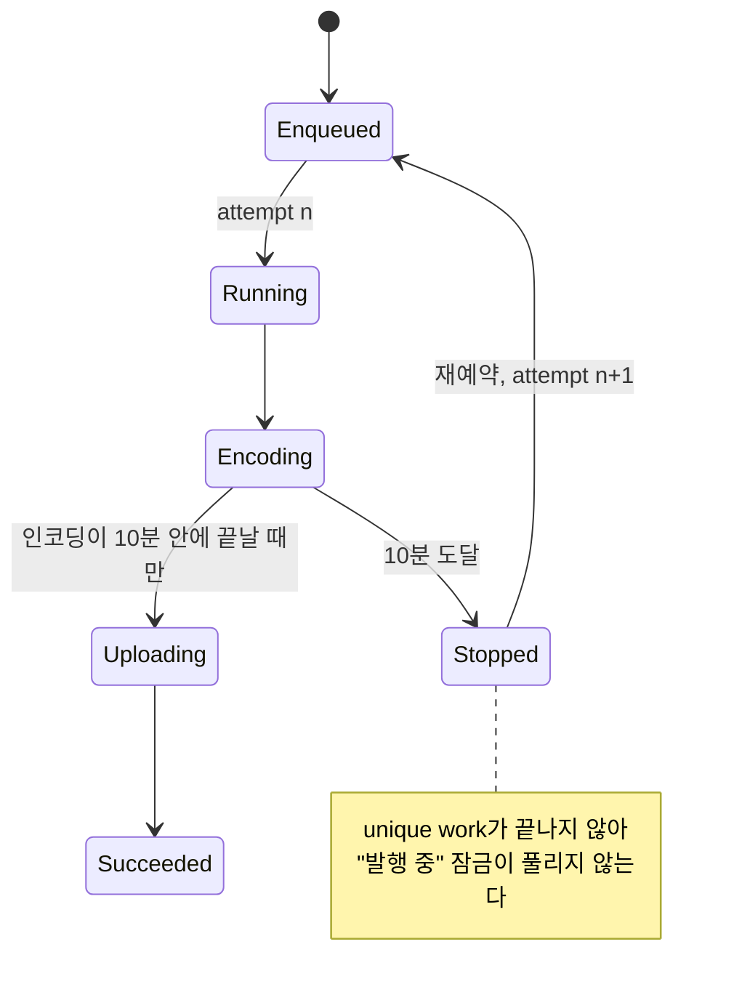

1시간 분량, 60MB짜리 동영상을 붙인 게시물이 끝내 발행되지 않았다. 발행 중에 두 번째 발행을 막는 "발행 중" 잠금도 그대로 걸려 있었는데, 앱을 강제 종료해도 기기를 재부팅해도 풀리지 않았다.

작업이 어딘가에서 멈춰 있는 것은 아니었다. 확인해 보니 시스템이 10분째에 발행 작업을 중단시켰고, 작업은 그때마다 처음부터 다시 돌고 있었다.

## 발행 작업과 unique work 잠금

그해 여름에 발행을 화면에서 백그라운드 작업으로 옮겼다. 그전에는 에디터가 열려 있는 동안 업로드가 돌았고 진행 상황도 화면에 떴는데, 바꾼 뒤로는 에디터가 발행 요청을 직렬화해 `CoroutineWorker`에 넘기기만 하고 바로 끝난다. 느린 일은 `Worker`가 순서대로 맡는다. 기기에 있는 동영상을 인코딩해 업로드하고, 서버 처리가 끝나길 기다렸다가 첨부한 뒤 게시물을 만든다. 진행 상태는 별도의 상태 저장소에 남겨 앱의 다른 부분이 볼 수 있게 한다.

작업은 `ExistingWorkPolicy.KEEP`으로 unique work에 넣었다. `KEEP`은 두 번째 요청을 에러 없이 조용히 버리므로, 이대로 두면 사용자는 중복 발행이 접수된 줄 알게 된다. 그래서 발행 진입점에서 먼저 확인하고 명시적으로 거절하게 했다.

```kotlin
suspend fun isPublishInFlight(): Boolean = withContext(Dispatchers.IO) {
    workManager.getWorkInfosForUniqueWork(PUBLISH_WORK)
        .get()
        .any { !it.state.isFinished }
}
```

이 확인과 메모리에 둔 "발행 중" 상태를 합친 것이 잠금이다. unique work가 종료 상태가 아니면 다시 발행할 수 없다. WorkManager는 작업을 자체 데이터베이스에 저장하므로 이 잠금은 프로세스가 종료되거나 기기를 재부팅해도 유지된다. 발행이 실제로 돌고 있을 때라면 바로 원하던 동작이다.

## 실행당 10분 제한과 Worker 재생성

앱이 쓰던 WorkManager 2.10.2의 `ListenableWorker` Javadoc에는 다음과 같이 적혀 있다.

> A ListenableWorker is given a maximum of ten minutes to finish its execution and return a Result. After this time has expired, the worker will be signalled to stop and its ListenableFuture will be cancelled.

몇 줄 위에는 시스템이 중단시켰다가 나중에 다시 시작하는 작업은 `Worker` 인스턴스를 새로 만든다고 적혀 있다. 2.10.2 소스를 보면 결과를 돌려주지 못하고 멈춘 작업은 `ENQUEUED`로 돌아가고, `runAttemptCount`는 작업이 `RUNNING`으로 바뀔 때마다 하나씩 늘어난다. 첫 실행에서는 0이다.

문제는 발행이 중간부터 이어 갈 수 없는 작업이라는 점이다. 다시 돌면 인코딩도 첫 프레임부터 새로 한다. 1시간짜리 동영상은 기기 인코딩만으로 10분을 넘겼으므로 매번 비슷한 자리에서 잘렸고, 업로드는 한 번도 끝나지 않았다. 작업이 종료 상태(SUCCEEDED/FAILED)가 되지 않으니 잠금도 풀릴 수 없었다. 흐름을 그리면 다음과 같다.



화면에서 발행하던 예전 방식에서는 이런 일이 없었다. 앱이 포그라운드에 있는 동안 돌았으므로 시스템의 실행 제한이 걸리지 않았기 때문이다. 결국 백그라운드 작업으로 옮기면서 발행에 실행 제한이 걸리게 됐는데, 나는 그걸 모르고 넘어갔다.

## 동영상 발행만 포그라운드 서비스로 전환

오래 걸리는 작업을 위해 WorkManager는 `setForeground()`를 제공한다. 알림을 띄운 포그라운드 서비스에서 `Worker`를 돌리는 방식이고, 이때는 10분 제한이 걸리지 않는다. 다만 이 전환이 필요한 것은 기기에 있는 동영상을 올리는 발행뿐이다. 이미지는 금방 끝나고 원격 URL 동영상은 서버가 직접 가져가므로 기기에서 무거운 일을 하지 않는다. 그래서 요청에 기기 동영상 파일이 있을 때만 포그라운드 서비스로 돌렸다.

안드로이드 14 이상을 타겟으로 하는 앱은 오래 도는 작업마다 포그라운드 서비스 유형을 지정해야 하고, 유형마다 권한도 따로 있다. 다행히 앱 모듈 매니페스트에는 WorkManager의 포그라운드 서비스에 `dataSync` 유형이 이미 선언돼 있었다.

```xml
<uses-permission android:name="android.permission.FOREGROUND_SERVICE_DATA_SYNC" />
<service
    android:name="androidx.work.impl.foreground.SystemForegroundService"
    android:foregroundServiceType="dataSync" />
```

따라서 `Worker`는 `ForegroundInfo`에 `FOREGROUND_SERVICE_TYPE_DATA_SYNC`를 넘긴다.

안드로이드 12부터는 백그라운드에 있는 앱이 포그라운드 서비스를 시작하는 것이 대체로 막혀 있고, 그럴 때 `setForeground()`는 예외를 던진다. 그래서 전환은 되면 좋고 안 되면 그만인 단계로 뒀다. 거절당하면 로그만 남기고 일반 작업으로 계속 진행하는데, 짧은 동영상이라면 그래도 10분 안에 끝난다.

## 세 번째 재시작에서 포기하기

포그라운드 서비스로 돌리면 10분 제한에 걸리지 않는다. 하지만 전환이 거절될 수 있고 프로세스는 다른 이유로도 죽을 수 있다. 재시도 상한이 없으면 어느 경우든 사용자는 다시 풀리지 않는 잠금에 걸린다.

그래서 작업 안에서 재시작 횟수를 직접 센다. 첫 실행과 재시작 두 번까지는 평소대로 발행하고, `runAttemptCount`가 3인 상태로 시작한 실행은 더 시도하지 않는다. 대신 원래 요청을 담은 실패 상태를 남겨 사용자가 다시 시도하거나 지울 수 있게 하고 `Result.failure()`를 돌려준다. 실패도 종료 상태이므로 unique work가 끝나고 잠금이 풀린다.

이 실패는 콘텐츠 거부로 인한 실패와 일부러 구분했다. 앱은 거부된 콘텐츠에는 다시 시도를 숨기고 삭제만 보여 주는데, 중단된 발행은 다시 시도할 수 있어야 하므로 일반 실패로 보여야 한다.

실제 이름을 일반적인 이름으로 바꾼 `Worker`는 다음과 같다. 맨 위의 `runAttemptCount` 확인이 재시도 상한이다.

```kotlin
override suspend fun doWork(): Result {
    val request = decodeRequest(inputData)
    if (runAttemptCount >= MAX_ATTEMPTS) {    // first run + 2 restarts
        publisher.abandon(request)            // retryable failure, request kept
        return Result.failure()               // finishes the unique work
    }
    if (request.hasLocalVideo) tryPromoteToForeground()
    publisher.run(request)
    return Result.success()
}

private suspend fun tryPromoteToForeground() {
    try {
        setForeground(ForegroundInfo(NOTIFICATION_ID, buildNotification(),
            ServiceInfo.FOREGROUND_SERVICE_TYPE_DATA_SYNC))
    } catch (e: CancellationException) {
        throw e
    } catch (e: Exception) {
        log("foreground promotion refused, continuing as a regular worker", e)
    }
}
```

유닛 테스트 두 개를 같이 넣었다. 하나는 포기 처리가 요청을 그대로 담은 재시도 가능한 실패를 남기는지, 그리고 그 실패를 콘텐츠 거부로 표시하지 않는지 확인한다. 다른 하나는 "기기 동영상 있음" 판정을 확인한다. 편집을 마친 동영상을 포함해 기기 동영상에서는 참이어야 하고, 이미지와 원격 URL 동영상에서는 거짓이어야 한다.

## IllegalStateException만 잡은 문제

처음 짠 전환 코드는 `IllegalStateException`만 잡았다. `ForegroundServiceStartNotAllowedException`이 그 하위 타입이기 때문이다. 그런데 몇 시간 뒤에 catch 범위를 넓혀야 했다.

`doWork()`에는 바깥 `try`가 따로 있었고, 이 `try`는 어떤 예외든 `Result.failure()`로 바꿨다. 전환 중에 `IllegalStateException`이 아닌 예외가 나오면 안쪽 catch를 지나 바깥에 걸리므로, 작업은 발행을 시작하기도 전에 `Result.failure()`를 돌려준다. 그 시점에 상태 저장소는 아직 대기 상태였기 때문에 사용자에게는 실패 안내도, 다시 시도 버튼도 뜨지 않았다. 발행이 그냥 사라진 것이다.

위 코드가 범위를 넓힌 뒤의 모습이다. 코루틴 안에서 실패해도 되는 단계라면 `CancellationException`은 그대로 다시 던진다. 취소는 실패가 아니기 때문이다. 나머지 예외는 로그만 남기고 삼키는데, 그래야 발행 작업이 계속 돌고 결과도 직접 알릴 수 있다.

## 동적 기능 모듈의 린트 오탐

몇 주 뒤에는 린트가 `setForeground()` 호출에 `SpecifyForegroundServiceType` 경고를 띄우기 시작했다. 이 기능은 동적 기능 모듈에 있었는데, 그 모듈의 린트는 앱 모듈 매니페스트를 병합하지 않으므로 `SystemForegroundService`에 붙은 `dataSync` 선언을 보지 못했다. 즉, 잘못된 경고였다. 그 파일 하나에만 경고를 끄고 이유를 바로 옆에 적어 뒀다. 나중에 누군가 경고를 없애려고 선언을 하나 더 넣지 않게 하려는 메모다.

```xml
<!-- Feature-module lint does not merge the app manifest, so it cannot see the
     dataSync type declared on SystemForegroundService there. -->
<issue id="SpecifyForegroundServiceType">
    <ignore path="src/main/kotlin/.../PublishWorker.kt" />
</issue>
```

## 첨부 단계 전체 타임아웃

10분 실행 제한이 없어지자 이번에는 발행을 얼마나 오래 돌게 둘지 정해야 했다. 2주 뒤에 파이프라인을 고쳐 앞 동영상을 업로드하는 동안 다음 동영상을 인코딩하게 했고, 단계마다 따로 걸던 타임아웃도 걷어 냈다. 대신 동영상이 있는 게시물에는 첨부 단계 전체(인코딩, 업로드, 서버 처리 대기, 첨부)에 타임아웃 하나만 건다. 이미지만 있는 게시물에는 걸지 않고, 제한 시간을 넘기면 다시 시도하라는 안내를 띄운다.

이 타임아웃은 마지막 "게시물 생성" 요청 앞에서 끝난다. 그 요청을 중간에 끊으면 클라이언트는 실패로 아는데 서버에는 게시물이 생겨 있을 수 있고, 이때 다시 시도하면 게시물이 두 개가 되기 때문이다. 그래서 타임아웃은 버려도 안전한 작업에만 걸었다.

## 수정 전후 동작

상황별로 코드가 어느 경로를 타는지 정리하면 다음과 같다.

| 상황 | 전 | 후 |
|---|---|---|
| 기기 동영상, 인코딩+업로드가 10분 초과 | 10분에 멈추고 처음부터 무한 반복, 강제 종료·재부팅 뒤에도 잠금 유지 | 포그라운드 서비스로 돌아 10분에 멈추지 않음 |
| 포그라운드 서비스 전환 거절 | 해당 없음 | 일반 작업으로 계속, 짧은 동영상은 시간 안에 끝남 |
| 어떤 이유로든 반복 중단 | 상한 없음 | 세 번째 재시작에서 재시도 가능한 실패로 끝나고 잠금 해제 |
| 전환이 예상 밖 예외를 던짐 | 해당 없음(첫 버전에선 발행이 조용히 사라짐) | 로그만 남기고 발행 계속 |
| 이미지나 원격 URL 동영상만 있음 | 일반 작업 | 일반 작업, 변화 없음 |

## 정리

10분 실행 제한은 `ListenableWorker` 클래스 설명에 적혀 있었는데, 나는 1시간짜리 동영상을 기준으로 따져 보지 않고 발행을 옮겼다. 그래서 지금은 작업을 WorkManager 같은 다른 실행 환경으로 옮기기 전에 그 환경이 거는 조건부터 적는다. 시간 제한, 재시작 방식, 재부팅 뒤에 남는 것을 적고, 하나하나를 실제로 들어올 수 있는 가장 긴 입력으로 확인한다.

중간부터 이어 갈 수 없는 긴 작업에는 이제 재시도 상한을 기본으로 넣는다. `KEEP`을 쓴 unique work는 중복을 막는 장치이자 잠금이다. 작업이 계속 다시 실행될 때 이 잠금을 풀어 주는 것이 `doWork()` 맨 위의 `runAttemptCount` 확인이다.
