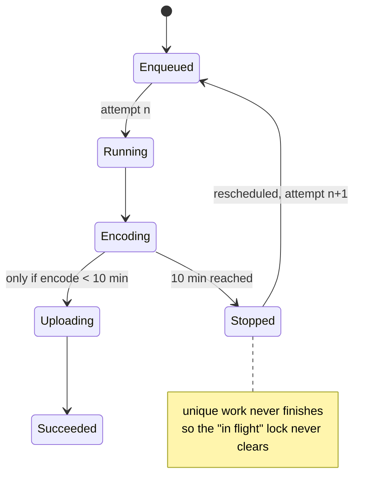

A post with a one-hour, 60 MB video attached never finished publishing. The app's "publishing" lock, which blocks a second publish while one is in flight, stayed on through an app kill and through a reboot of the phone.

Nothing was hanging. The system stopped the publish worker at the 10-minute mark, and the worker started again from the beginning, every time.

## Publishing in a worker, guarded by unique work

Earlier that summer I'd moved publishing off the screen. Before, the uploads ran while the editor was open, with progress shown in the UI. After the change, the editor handed a serialized publish request to a `CoroutineWorker` and returned right away. The worker did the slow part in order: encode local videos, upload them, wait for the server to finish processing them, attach them, and create the post. A separate state store told the rest of the app how it was going.

I enqueued the worker as unique work with `ExistingWorkPolicy.KEEP`. `KEEP` drops a second request without saying anything, and the user would believe a duplicate publish had been accepted. So the publisher checks first and refuses explicitly:

```kotlin
suspend fun isPublishInFlight(): Boolean = withContext(Dispatchers.IO) {
    workManager.getWorkInfosForUniqueWork(PUBLISH_WORK)
        .get()
        .any { !it.state.isFinished }
}
```

That check plus an in-memory "publishing" state is the lock. While the unique work isn't in a finished state, the user can't publish again. WorkManager keeps its work in its own database, so the lock survives process death and reboots by design, which is what you want while a real publish is running.

## Ten minutes per run, then a new instance

The `ListenableWorker` Javadoc in WorkManager 2.10.2, the version the app used, says this:

> A ListenableWorker is given a maximum of ten minutes to finish its execution and return a Result. After this time has expired, the worker will be signalled to stop and its ListenableFuture will be cancelled.

A few lines above, it says that preempted work that's restarted later gets a new worker instance. In the 2.10.2 source, a stopped worker that hasn't returned a result goes back to `ENQUEUED`, and the run attempt count goes up each time the work moves to `RUNNING`. The first run sees 0.

A publish can't resume. A rerun starts encoding again from the first frame. For the one-hour video, local encoding alone took longer than 10 minutes, so every run got cut off at about the same place, before any upload finished. The work never reached a finished state and the lock never cleared:



The old on-screen version never ran into this. It ran in the foreground while the user watched, and no system timer applied. When I moved the work into a background worker, I'd put a ceiling on how long a publish could take without noticing.

## Promoting video publishes to foreground work

For long work, WorkManager offers `setForeground()`. It runs the worker under a foreground service with a notification, and the 10-minute limit no longer applies. Only publishes with a local video need that. Images are quick, and the server fetches a video given by remote URL, so neither does heavy work on the device. I promoted the worker only when the request contained a video file from the device.

An app that targets Android 14 or later has to give every long-running worker a foreground service type, and each type needs its own permission. The app module's manifest already declared the `dataSync` type on WorkManager's foreground service:

```xml
<uses-permission android:name="android.permission.FOREGROUND_SERVICE_DATA_SYNC" />
<service
    android:name="androidx.work.impl.foreground.SystemForegroundService"
    android:foregroundServiceType="dataSync" />
```

So the worker passes `FOREGROUND_SERVICE_TYPE_DATA_SYNC` in its `ForegroundInfo`.

From Android 12, an app in the background generally can't start a foreground service, and `setForeground()` throws when that happens. I made promotion best effort. If it's refused, the worker logs it and carries on as a regular worker, and a short video still finishes inside 10 minutes.

## Giving up on the third restart

Promotion removes the 10-minute stop. It can still be refused, though, and the process can die for other reasons. Without a cap, any of those would put the user back in front of a lock that never clears.

So the worker counts its own restarts. The first run and two restarts publish normally. A run that starts with a run attempt count of 3 doesn't try again. It records a failure that keeps the original request, so the user can retry or delete the post, and returns `Result.failure()`. A failed result is a finished state, so the unique work ends and the lock clears.

I kept that failure separate from a rejected-content failure on purpose. The app shows rejected content differently: retry is hidden and only delete is offered. An interrupted publish is worth retrying, so it has to look like an ordinary failure.

The worker, rewritten with generic names:

```kotlin
override suspend fun doWork(): Result {
    val request = decodeRequest(inputData)
    if (runAttemptCount >= MAX_ATTEMPTS) {    // first run + 2 restarts
        publisher.abandon(request)            // retryable failure, request kept
        return Result.failure()               // finishes the unique work
    }
    if (request.hasLocalVideo) tryPromoteToForeground()
    publisher.run(request)
    return Result.success()
}

private suspend fun tryPromoteToForeground() {
    try {
        setForeground(ForegroundInfo(NOTIFICATION_ID, buildNotification(),
            ServiceInfo.FOREGROUND_SERVICE_TYPE_DATA_SYNC))
    } catch (e: CancellationException) {
        throw e
    } catch (e: Exception) {
        log("foreground promotion refused, continuing as a regular worker", e)
    }
}
```

I added two unit tests with it. One checks that abandoning produces a retryable failure that still carries the request and isn't marked as rejected content. The other checks that "has a local video" is true for device videos, including ones already edited, and false for images and remote URL videos.

## Catching only IllegalStateException dropped publishes

My first version of the promotion caught only `IllegalStateException`, because `ForegroundServiceStartNotAllowedException` is a subtype of it. A few hours later I widened the catch.

`doWork()` had its own outer `try` that turned any exception into `Result.failure()`. If promotion threw something other than `IllegalStateException`, the exception went past the inner catch into the outer one, and the worker returned `Result.failure()` before the publish had even started. The state store was still idle at that point. The user saw no failure message and got no retry button. The publish just disappeared.

The snippet above has the wider catch. For a best-effort step inside a coroutine, I let `CancellationException` through, because cancellation isn't a failure. Everything else gets logged and swallowed, so the real work still runs and reports its own outcome.

## Lint couldn't see the app manifest

Some weeks later, lint started flagging the `setForeground()` call with `SpecifyForegroundServiceType`. The feature lived in a dynamic feature module. That module's lint run doesn't merge the app module's manifest, so it never saw the `dataSync` declaration on `SystemForegroundService`, and the warning was a false positive. I suppressed it for that one file and put the reason next to the suppression, so a later edit doesn't add a second declaration to silence it:

```xml
<!-- Feature-module lint does not merge the app manifest, so it cannot see the
     dataSync type declared on SystemForegroundService there. -->
<issue id="SpecifyForegroundServiceType">
    <ignore path="src/main/kotlin/.../PublishWorker.kt" />
</issue>
```

## One time budget for the attachment phase

With the 10-minute wall gone, I had the opposite question: how long should a publish be allowed to run? Two weeks later I changed the pipeline so the next video encodes while the previous one uploads. I also replaced the separate per-step timeouts with one time budget on the whole attachment phase (encode, upload, wait for server processing, attach) for posts that contain video. Posts with only images don't get the budget. Past the budget, the user gets a retry prompt.

The budget stops before the final "create post" request. If that request were cut off midway, the server could end up with a post the client thinks failed, and a retry would create a duplicate. So the budget covers only work that's safe to abandon.

## Before and after

The rows follow the code paths for each situation:

| situation | before | after |
|---|---|---|
| local video, encode + upload over 10 min | stopped at 10 min, rerun from scratch indefinitely; lock stays through kills and reboots | runs as foreground work, no 10-minute stop |
| foreground promotion refused | n/a | continues as a regular worker; short videos finish in time |
| repeated stops for any reason | unbounded | third restart ends with a retryable failure; lock clears |
| promotion throws an unexpected exception | n/a (first version: publish silently dropped) | logged, publish continues |
| images or remote URL video only | regular worker | regular worker, unchanged |

## Listing the new host's limits first

The 10-minute ceiling is in the class description of `ListenableWorker`, and I moved the publish into a worker without checking it against a one-hour video. Now, before I move work across an execution boundary like that, I write down what the new host imposes: the time limit, what happens on restart, and what persists across reboots. Then I check each one against the longest realistic input.

For a long worker that can't resume, I add the attempt cap by default. Unique work with `KEEP` is a duplicate guard and also a lock. When the worker keeps getting rerun, the `runAttemptCount` check at the top of `doWork()` is what releases it.
