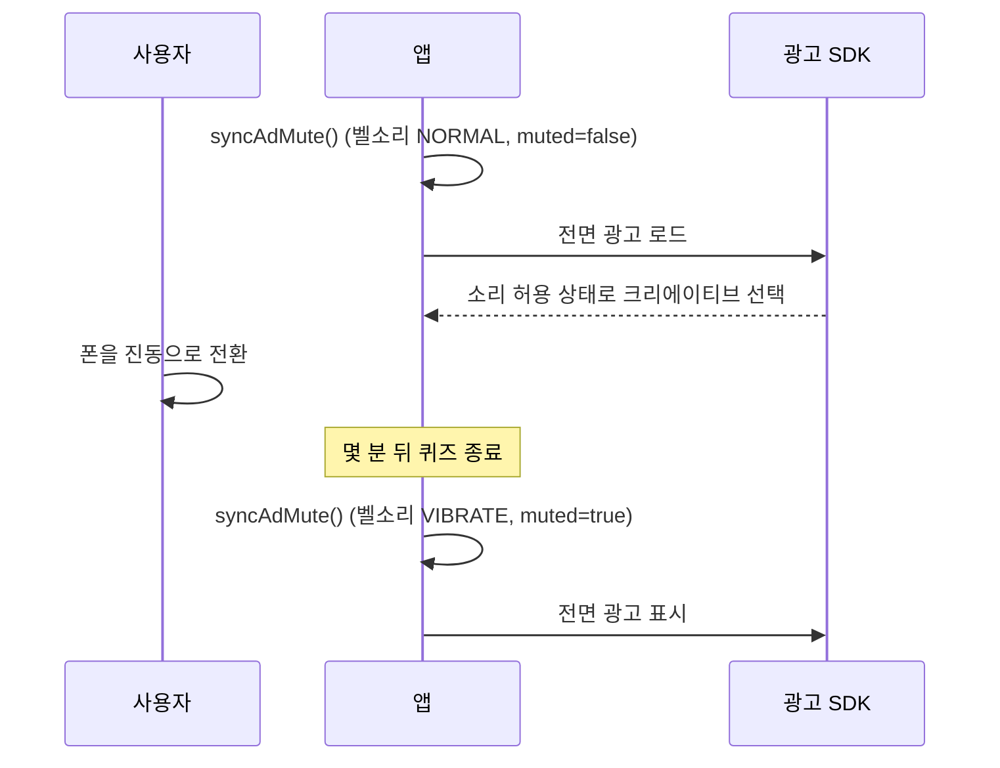

스터디 공간에서 폰을 무음으로 해 뒀는데 전면 광고가 최대 볼륨으로 나왔다는 Play 스토어 리뷰가 달렸다. 찾아보니 앱 어디에서도 광고 SDK에 소리 이야기를 한 적이 없었다. Google Mobile Ads SDK의 기본값은 "앱 볼륨 1, 음소거 아님"이고 Google 공식 샘플 앱도 이 값을 건드리지 않는다. 기본 통합 그대로 내면 이 상태로 출시된다.

## 전체 화면 광고 세 종류, 음소거 호출은 0곳

앱은 Kotlin Multiplatform으로 만든 퀴즈 앱이다. Android에는 전체 화면 광고가 세 종류 있다. 퀴즈 사이의 전면 광고와 보상형 광고, 앱 오픈 광고다. Google Mobile Ads Android SDK 25.4.0을 썼고 minSdk는 29, targetSdk는 37이었다. 전면 광고와 앱 오픈 광고는 기다림 없이 띄우려고 미리 로드해 둔다.

수정 전에 양 플랫폼 코드에서 `setAppMuted`와 `setAppVolume`을 찾아봤는데 부르는 곳이 하나도 없었다. 아무도 아무것도 설정하지 않았다.

## 무음 모드는 미디어 스트림을 건드리지 않는다

Android는 벨소리와 미디어 스트림을 따로 관리한다. 무음·진동 모드는 벨소리와 알림음을 끄고 미디어 볼륨은 그대로 둔다. 광고 동영상은 미디어 스트림으로 재생된다. 사용자가 폰에 있는 "조용히" 수단을 다 써도 전면 광고는 시끄럽게 나온다.

"폰이 무음이다"를 가장 쉽게 판정하는 조건은 `AudioManager.ringerMode != RINGER_MODE_NORMAL`이다. 무음과 진동은 이걸로 잡히지만 방해 금지는 못 잡는다. 중요 알림만 허용하는 방해 금지 모드에서는 벨소리 모드가 여전히 `RINGER_MODE_NORMAL`로 읽힌다. 그래서 두 번째 신호인 `NotificationManager.currentInterruptionFilter`까지 읽어야 했다.

미디어 볼륨은 읽지 않았다. 0이면 광고도 이미 소리가 안 나니 손댈 게 없다.

최종으로 정하고 나중에 테스트로 고정한 판정표다.

| 벨소리 모드 | 방해 금지 필터 | 광고 음소거 |
|---|---|---|
| `NORMAL` | `ALL` | 안 함 |
| `SILENT` | 무관 | 함 |
| `VIBRATE` | 무관 | 함 |
| `NORMAL` | `PRIORITY` | 함 |
| `NORMAL` | `ALARMS` | 함 |
| `NORMAL` | `NONE` | 함 |
| `NORMAL` | `UNKNOWN` | 안 함 |

`UNKNOWN`은 앱이 필터를 읽지 못했다는 뜻이다. 사용자가 무엇을 원하는지는 알 수 없으니 음소거하지 않는다. 잘못 음소거하면 요청마다 동영상 fill을 잃는다. 그래서 읽지 못한 상태는 SDK 기본값으로 돌려보낸다.

## 벨소리를 setAppMuted에 넘긴다

SDK가 이 용도로 문서화한 호출은 `MobileAds.setAppMuted(Boolean)` 하나다. 원래는 게임처럼 자체 소리 토글이 있는 앱을 위한 API다. 내 앱은 광고 말고는 소리 나는 데가 없어서 넘길 앱 설정이 없었다. 그 토글 자리에 벨소리와 방해 금지를 넣었다. SDK는 어느 쪽이든 boolean 하나를 받을 뿐 출처를 모른다. 벨소리를 신호로 쓰기로 한 건 SDK 관행이 아니라 내 제품 판단이다.

```kotlin
fun shouldMute(ringerMode: Int, filter: Int): Boolean =
    ringerMode != AudioManager.RINGER_MODE_NORMAL ||
        filter in setOf(
            NotificationManager.INTERRUPTION_FILTER_PRIORITY,
            NotificationManager.INTERRUPTION_FILTER_ALARMS,
            NotificationManager.INTERRUPTION_FILTER_NONE,
        )

fun syncAdMute(context: Context): Boolean {
    val ringer = context.getSystemService(AudioManager::class.java)
        ?.ringerMode ?: AudioManager.RINGER_MODE_NORMAL
    val filter = context.getSystemService(NotificationManager::class.java)
        ?.currentInterruptionFilter
        ?: NotificationManager.INTERRUPTION_FILTER_UNKNOWN
    return shouldMute(ringer, filter).also { MobileAds.setAppMuted(it) }
}
```

벨소리 모드와 방해 금지 필터는 권한 없이 읽을 수 있다. 매니페스트는 그대로다.

## 로드 직전에 한 번, 표시 직전에 또 한 번

SDK는 크리에이티브를 고를 때 음소거 플래그를 읽는다. 음소거 요청에서는 무음 재생이 안 되는 동영상 크리에이티브가 빠진다. 로드 전에 플래그를 맞추지 않으면 요청이 "음소거 아님"으로 나가고 SDK는 소리가 필요한 크리에이티브를 골라도 된다. 그래서 로드할 때마다 먼저 동기화한다.

미리 로드하면 틈이 생긴다. 로드와 표시 사이에 몇 분이 지날 수 있다. 소리를 켠 채 앱을 열었다가 조용한 방에 들어가 진동으로 바꾼 뒤에야 광고가 뜰 수도 있다. 리뷰에 적힌 상황과 거의 같다.



그래서 표시 직전에도 같은 동기화를 한 번 더 부른다. 벨소리 변화를 받는 브로드캐스트 리시버는 두지 않았다. 로드와 표시 사이에는 플래그가 영향을 줄 일이 없고 그 두 시점에서 동기로 읽으면 충분하다. 광고 세 종류 모두 같은 싱글턴을 주입받아 두 시점에서 부른다. 네이티브 광고의 동영상은 `VideoOptions`로 따로 제어하는데 SDK 기본값 그대로 뒀다.

## iOS는 손대지 않았다

iOS에서는 SDK가 기본으로 오디오 세션을 직접 관리한다. 무음 재생이면 `Ambient`, 소리가 나면 `SoloAmbient`를 쓴다. 두 카테고리 모두 하드웨어 무음 스위치를 따른다. 앱이 `Playback` 같은 카테고리를 강제하지만 않으면 iOS는 이미 제대로 동작하고 내 앱은 `AVAudioSession`을 아예 부르지 않는다. 앱이 세션을 잡으면 SDK 관리와 부딪힐 수 있어서 iOS는 그대로 뒀다.

## 조용할 때는 동영상 fill이 줄어든다

SDK 문서는 음소거 요청이 동영상 fill을 줄인다고 경고한다. fill은 광고 요청이 동영상 광고로 채워지는 비율이다. 무음 재생이 안 되는 크리에이티브가 풀에서 빠지기 때문이다. 이 비용은 기기가 조용할 때만 생겨서 받아들였다. 도서관에서 큰 소리로 광고가 나오면 폰을 든 사람이 곤란해진다. 광고 풀이 조금 작아지는 건 내가 감당하면 된다.

항상 음소거하는 방법도 검토했다. 한 줄이면 되지만 소리를 켜고 쓰는 사용자의 fill까지 줄인다. 벨소리 기반 규칙을 택하고 "항상"은 대비책으로 남겼다. 이 규칙으로 부족하다고 드러나면 새 빌드 없이 remote config로 두 방식을 오가게 할 계획이다.

## 판정 7건과 호스트 테스트 583건

| 확인 항목 | 방법 | 결과 |
|---|---|---|
| 신호별 음소거 판정표 | 호스트 단위 테스트 7건(위 표) | 통과 |
| 모듈 회귀 | 이 변경만 얹은 깨끗한 워크트리에서 Android 호스트 테스트 전체 | 583건, 실패 0 |

리뷰에 적힌 경우는 미리 로드한 전면 광고였고 표시 직전 동기화가 그 경우를 맡는다. 이미 로드된 광고에 표시 시점 `setAppMuted(true)`가 먹힌다고 SDK 문서가 약속하지는 않는다. 2018년에는 일부 크리에이티브가 이 플래그를 무시했고 Google이 버그로 인정해 고쳤다. 늦게 건 플래그를 무시하는 크리에이티브가 있다면 조용한 상태로 바뀔 때 로드된 광고를 버리고 음소거로 다시 요청하면 된다. 이것도 표준 API로 할 수 있다.

요청 쪽은 조건 없이 바뀌었다. 이제 폰이 조용하면 새 요청은 모두 음소거로 나간다. 전에는 한 번도 그러지 않았다.

## SDK가 언제 읽는지 먼저 묻는다

자체 볼륨 슬라이더가 있는 게임이라면 SDK 기본값이 합리적이다. 소리라고는 광고뿐인 앱에서 "음소거 아님"은 기기가 보내는 조용히 하라는 신호를 전부 무시한다. 통합 샘플은 컴파일되는 최소한을 보여 줄 뿐인데 나는 그걸 설정 전부로 여겼다.

SDK가 요청 시점에 읽는 상태는 미리 로드한 객체를 쓸 때쯤이면 낡아 있을 수 있다. 지금은 기기 상태를 SDK에 넘길 때 SDK가 그 값을 언제 읽는지부터 본다. 객체가 그 시점보다 오래 살아남는다면 양 끝에서 맞춘다.
