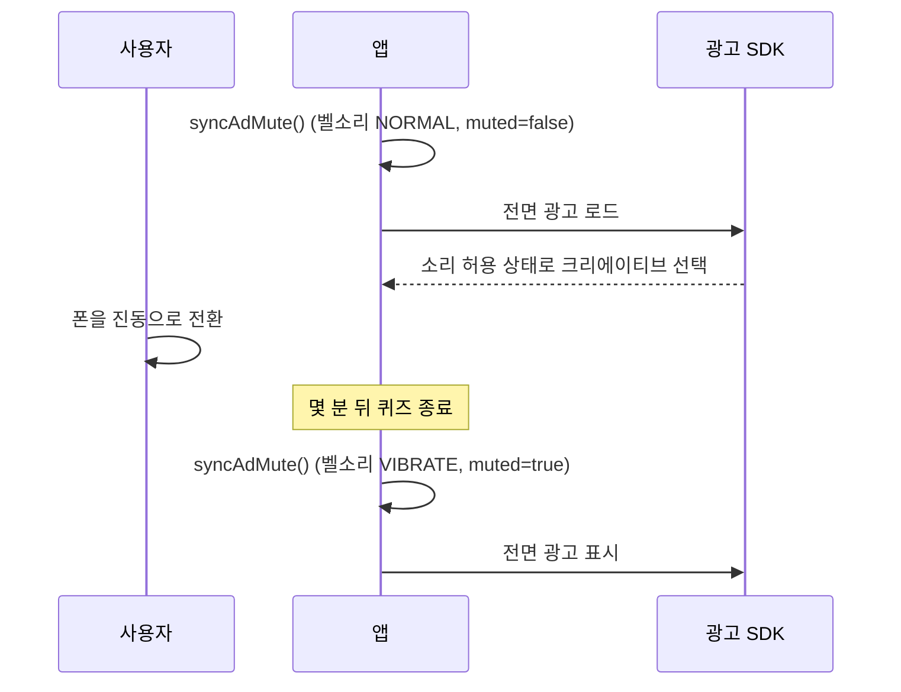

스터디 공간에서 기기를 무음으로 해 뒀는데 전면 광고가 최대 볼륨으로 나왔다는 Play 스토어 리뷰가 달렸다. 확인해 보니 앱 어디에서도 광고 SDK에 소리에 관한 설정을 넘긴 적이 없었다. Google Mobile Ads SDK의 디폴트는 "앱 볼륨 1, 음소거 아님"이고 Google 공식 샘플 앱도 이 값을 건드리지 않으므로, 기본대로 연동하면 이 상태 그대로 출시된다.

## 전체 화면 광고 세 종류와 음소거 호출

앱은 Kotlin Multiplatform으로 만든 퀴즈 앱이고, 안드로이드에는 전체 화면 광고가 세 종류 있다. 퀴즈 사이에 나오는 전면 광고, 보상형 광고, 앱 오픈 광고다. Google Mobile Ads Android SDK 25.4.0을 썼고 `minSdk`는 29, `targetSdk`는 37이었다. 전면 광고와 앱 오픈 광고는 바로 띄우려고 미리 로드해 둔다.

수정 전에 두 플랫폼 코드에서 `setAppMuted`와 `setAppVolume`을 검색했는데 결과가 0건이었다. 즉, 소리를 설정하는 코드가 하나도 없었다.

## 미디어 스트림을 건드리지 않는 무음 모드

안드로이드는 벨소리와 미디어 스트림을 따로 관리한다. 무음·진동 모드는 벨소리와 알림음을 끄지만 미디어 볼륨은 그대로 두는데, 광고 동영상은 미디어 스트림으로 재생된다. 그래서 사용자가 기기를 조용하게 만드는 설정을 다 켜도 전면 광고는 큰 소리로 나온다.

기기가 무음인지 판정하는 가장 쉬운 조건은 `AudioManager.ringerMode != RINGER_MODE_NORMAL`이다. 무음과 진동은 이걸로 잡히지만 방해 금지는 놓친다. 중요 알림만 허용하는 방해 금지 모드에서는 벨소리 모드가 여전히 `RINGER_MODE_NORMAL`로 읽히기 때문이다. 따라서 두 번째 신호인 `NotificationManager.currentInterruptionFilter`까지 읽어야 했다.

미디어 볼륨은 읽지 않았다. 볼륨이 0이면 광고도 이미 소리가 나지 않으므로 손댈 것이 없다.

최종 판정표는 다음과 같고, 나중에 테스트로 고정했다. 벨소리가 일반 모드이고 방해 금지가 꺼져 있을 때만 소리를 허용한다.

| 벨소리 모드 | 방해 금지 필터 | 광고 음소거 |
|---|---|---|
| `NORMAL` | `ALL` | 안 함 |
| `SILENT` | 무관 | 함 |
| `VIBRATE` | 무관 | 함 |
| `NORMAL` | `PRIORITY` | 함 |
| `NORMAL` | `ALARMS` | 함 |
| `NORMAL` | `NONE` | 함 |
| `NORMAL` | `UNKNOWN` | 안 함 |

`UNKNOWN`은 앱이 필터를 읽지 못했다는 뜻이다. 사용자가 무엇을 원하는지 알 수 없으므로 음소거하지 않는다. 잘못 음소거하면 요청마다 동영상 광고 fill을 잃기 때문에, 읽지 못한 상태에서는 SDK 디폴트를 따른다.

## 벨소리 상태를 setAppMuted로 전달

SDK가 이 용도로 문서화한 호출은 `MobileAds.setAppMuted(Boolean)` 하나다. 원래는 게임처럼 자체 소리 토글이 있는 앱을 위한 API인데, 내 앱은 광고 말고는 소리 나는 곳이 없어서 넘길 앱 설정이 없었다. 그래서 그 토글 자리에 벨소리 모드와 방해 금지 상태를 넣었다. SDK는 boolean 하나를 받을 뿐 그 값이 어디서 왔는지는 모른다. 벨소리를 기준으로 삼은 것은 SDK가 권하는 방식이 아니라 내가 제품에 맞춰 정한 것이다.

```kotlin
fun shouldMute(ringerMode: Int, filter: Int): Boolean =
    ringerMode != AudioManager.RINGER_MODE_NORMAL ||
        filter in setOf(
            NotificationManager.INTERRUPTION_FILTER_PRIORITY,
            NotificationManager.INTERRUPTION_FILTER_ALARMS,
            NotificationManager.INTERRUPTION_FILTER_NONE,
        )

fun syncAdMute(context: Context): Boolean {
    val ringer = context.getSystemService(AudioManager::class.java)
        ?.ringerMode ?: AudioManager.RINGER_MODE_NORMAL
    val filter = context.getSystemService(NotificationManager::class.java)
        ?.currentInterruptionFilter
        ?: NotificationManager.INTERRUPTION_FILTER_UNKNOWN
    return shouldMute(ringer, filter).also { MobileAds.setAppMuted(it) }
}
```

벨소리 모드와 방해 금지 필터는 권한 없이 읽을 수 있어서 매니페스트는 바꾸지 않았다.

## 로드 직전과 표시 직전의 동기화

SDK는 크리에이티브를 고를 때 음소거 플래그를 읽고, 음소거된 요청에서는 무음으로 재생할 수 없는 동영상 크리에이티브를 뺀다. 로드 전에 플래그를 맞춰 두지 않으면 요청이 "음소거 아님"으로 나가고, SDK가 소리가 필요한 크리에이티브를 고를 수 있다. 그래서 로드할 때마다 먼저 동기화한다.

그런데 미리 로드해 두면 빈틈이 생긴다. 로드와 표시 사이에 몇 분이 지날 수 있어서, 소리를 켠 채 앱을 열었다가 조용한 방에 들어가 진동으로 바꾼 뒤에야 광고가 뜰 수도 있다. 리뷰에 적힌 상황과 거의 같은 흐름은 다음과 같다.



그래서 표시 직전에도 같은 동기화를 한 번 더 호출한다. 벨소리 변화를 받는 브로드캐스트 리시버는 두지 않았다. 로드와 표시 사이에는 플래그가 영향을 줄 일이 없고, 그 두 시점에 바로 읽으면 충분하기 때문이다. 광고 세 종류 모두 같은 싱글턴을 주입받아 두 시점에서 호출한다. 네이티브 광고의 동영상은 `VideoOptions`로 따로 제어하는데, 이쪽은 SDK 디폴트 그대로 뒀다.

## iOS 오디오 세션

iOS에서는 SDK가 디폴트로 오디오 세션을 직접 관리한다. 음소거 재생이면 `Ambient`, 소리가 나면 `SoloAmbient`를 쓰는데, 두 카테고리 모두 하드웨어 무음 스위치를 따른다. 앱이 `Playback` 같은 카테고리를 강제하지만 않으면 iOS는 이미 제대로 동작하고, 내 앱은 `AVAudioSession`을 아예 건드리지 않는다. 오히려 앱이 세션을 직접 설정하면 SDK와 충돌할 수 있으므로 iOS는 그대로 뒀다.

## 음소거로 줄어드는 동영상 fill

SDK 문서는 음소거 요청이 동영상 fill을 줄인다고 경고한다. fill은 광고 요청이 동영상 광고로 채워지는 비율인데, 무음으로 재생할 수 없는 크리에이티브가 후보에서 빠지기 때문에 줄어든다. 이 비용은 기기가 조용할 때만 생기므로 받아들였다. 도서관에서 광고가 큰 소리로 나오면 기기를 들고 있는 사람이 곤란해지지만, 광고 후보가 조금 줄어드는 것은 내가 감당하면 된다.

항상 음소거하는 방법도 검토했다. 코드 한 줄이면 되지만 소리를 켜고 쓰는 사용자의 fill까지 줄어든다. 그래서 벨소리 기반 규칙을 택하고 "항상 음소거"는 대비책으로 남겼다. 이 규칙으로 부족하면 새 빌드 없이 remote config로 두 방식을 오가게 할 계획이다.

## 판정 케이스 7개와 호스트 테스트 583개

| 확인 항목 | 방법 | 결과 |
|---|---|---|
| 신호별 음소거 판정표 | 호스트 유닛 테스트 7개(위 표) | 통과 |
| 모듈 회귀 | 이 변경만 얹은 깨끗한 worktree에서 안드로이드 호스트 테스트 전체 | 583개, 실패 0 |

리뷰에 적힌 경우는 미리 로드한 전면 광고였고, 표시 직전 동기화가 바로 그 경우를 위한 것이다. 다만 이미 로드된 광고에 표시 시점의 `setAppMuted(true)`가 적용된다고 SDK 문서가 보장하지는 않는다. 2018년에는 일부 크리에이티브가 이 플래그를 무시했고 Google이 버그로 인정해 고쳤다. 늦게 건 플래그를 무시하는 크리에이티브가 있다면, 조용한 상태로 바뀔 때 로드된 광고를 버리고 음소거로 다시 요청하면 된다. 이 방법도 표준 API로 할 수 있다.

요청 쪽은 확실히 달라졌다. 이제 기기가 조용하면 새 요청은 모두 음소거로 나가는데, 전에는 한 번도 그런 적이 없었다.

## 정리

자체 볼륨 슬라이더가 있는 게임이라면 SDK 디폴트가 합리적이다. 하지만 광고 말고는 소리가 나지 않는 앱에서 "음소거 아님"을 그대로 두면, 사용자가 기기를 무음으로 해 둔 설정을 전부 무시하게 된다. 연동 샘플은 빌드되는 최소한의 코드일 뿐인데, 나는 그것을 필요한 설정의 전부로 여겼다.

SDK가 요청 시점에 읽는 상태는 미리 로드한 객체를 실제로 쓸 때쯤이면 이미 바뀌어 있을 수 있다. 그래서 지금은 기기 상태를 SDK에 넘길 때 SDK가 그 값을 언제 읽는지부터 확인하고, 로드한 객체를 그 뒤로 오래 들고 있다면 로드와 표시 양쪽에서 값을 맞춘다.
