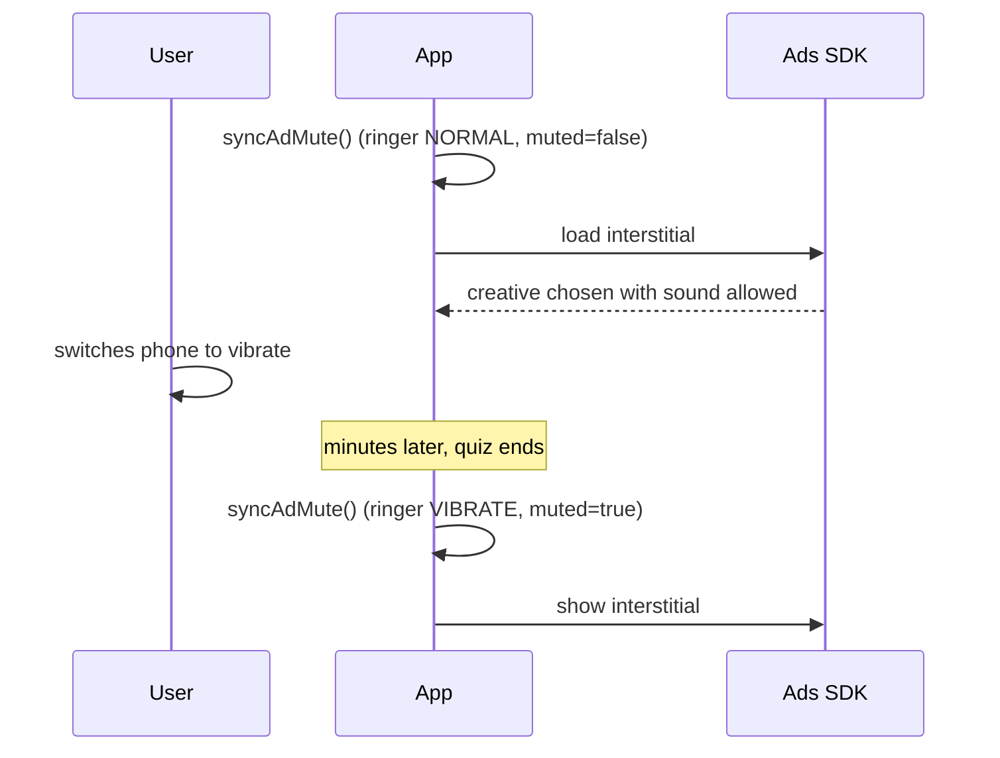

A Play Store review said my app's full-screen ads played at full volume in a study space, on a phone set to silent. I checked, and nothing in the app had ever told the ad SDK anything about sound. The Google Mobile Ads SDK defaults to app volume 1, not muted, and Google's own sample apps leave it that way. A standard integration ships in this state.

## Three full-screen ad types and no mute call

The app is a Kotlin Multiplatform quiz app with three kinds of full-screen ads on Android: interstitials between quizzes, rewarded ads, and app-open ads. It used the Google Mobile Ads Android SDK 25.4.0, with minSdk 29 and targetSdk 37. Interstitial and app-open ads are preloaded so they can show without a wait.

Before the change I searched both platforms' code for `setAppMuted` and `setAppVolume` and found no call to either. Nobody had set anything.

## Silent mode leaves the media stream alone

Android keeps the ringer and the media stream apart. Silent and vibrate modes turn off ringtones and notification sounds and leave the media volume where it was. Ad video plays on the media stream. A user can use every "be quiet" control the phone has and still get a loud interstitial.

The obvious check for "the phone is silent" is `AudioManager.ringerMode != RINGER_MODE_NORMAL`. That catches silent and vibrate. It misses Do Not Disturb, because in priority-only mode the ringer still reads `RINGER_MODE_NORMAL`. So the check needed a second signal, `NotificationManager.currentInterruptionFilter`.

I didn't read media volume. If it's zero, the ad is already silent and there's nothing to fix.

This is the table I settled on and later pinned in tests:

| ringer mode | interruption filter | mute ads? |
|---|---|---|
| `NORMAL` | `ALL` | no |
| `SILENT` | any | yes |
| `VIBRATE` | any | yes |
| `NORMAL` | `PRIORITY` | yes |
| `NORMAL` | `ALARMS` | yes |
| `NORMAL` | `NONE` | yes |
| `NORMAL` | `UNKNOWN` | no |

`UNKNOWN` means the app couldn't read the filter. That says nothing about what the user wants, so I don't mute. A false mute costs video fill on every request, and an unreadable state falls back to the SDK default.

## Feeding the ringer into setAppMuted

The SDK documents one call for this, `MobileAds.setAppMuted(Boolean)`. Google designed it for apps with their own sound toggle, typically games. My app makes no sound of its own besides the ads, so there was no app setting to forward. The ringer and Do Not Disturb take the toggle's place. The SDK gets the same boolean either way and can't tell where it came from, so using the ringer as the signal is my product decision, not SDK convention.

```kotlin
fun shouldMute(ringerMode: Int, filter: Int): Boolean =
    ringerMode != AudioManager.RINGER_MODE_NORMAL ||
        filter in setOf(
            NotificationManager.INTERRUPTION_FILTER_PRIORITY,
            NotificationManager.INTERRUPTION_FILTER_ALARMS,
            NotificationManager.INTERRUPTION_FILTER_NONE,
        )

fun syncAdMute(context: Context): Boolean {
    val ringer = context.getSystemService(AudioManager::class.java)
        ?.ringerMode ?: AudioManager.RINGER_MODE_NORMAL
    val filter = context.getSystemService(NotificationManager::class.java)
        ?.currentInterruptionFilter
        ?: NotificationManager.INTERRUPTION_FILTER_UNKNOWN
    return shouldMute(ringer, filter).also { MobileAds.setAppMuted(it) }
}
```

Reading the ringer mode and the interruption filter needs no permission, so the manifest didn't change.

## Syncing before load and again before show

The SDK reads the mute flag when it picks a creative. A muted request leaves out video creatives that can't play silently. If the flag isn't set before a load, the request goes out as "not muted" and the SDK is free to pick a creative that needs sound. So every load gets a sync first.

Preloading opens a gap. Minutes can pass between load and show. A user can open the app with sound on, walk into a quiet room and switch to vibrate before the ad appears, which is close to what the review described:



So I call the same sync right before every show as well. I didn't add a broadcast receiver for ringer changes. Between load and show nothing happens that the flag could affect, and two synchronous reads at those points cover it. All three ad types get the same singleton injected and call it at both points. Native ads control their video separately through `VideoOptions`, and I left those at the SDK's default.

## Leaving iOS alone

On iOS the SDK manages the audio session by default. It uses `Ambient` when the ad plays muted and `SoloAmbient` when it plays with sound, and both categories respect the hardware silent switch. As long as the app doesn't force a category like `Playback` itself, iOS already behaves, and mine never touches `AVAudioSession`. If the app took over the session it could fight the SDK's management, so I didn't change iOS.

## Less video fill while the phone is quiet

The SDK documentation warns that muted requests reduce video fill, the share of ad requests that come back with a video ad, because creatives that can't play silently drop out of the pool. That cost applies only while the device is quiet, and I accepted it. An ad playing out loud in a library is worse for the person holding the phone than a slightly smaller ad pool is for me.

I also considered muting always. It's one line, and it would shrink fill for users who have sound on and expect it. I kept the ringer-based rule and left "always" as a fallback. If the rule turns out not to be enough, the plan is to switch between the two through remote config without shipping a new build.

## Seven cases and 583 host tests

| check | how | result |
|---|---|---|
| signal-to-mute table | host unit tests, 7 cases (the table above) | pass |
| no regressions in the module | Android host test suite on a clean worktree with only this change | 583 tests, 0 failures |

The review's case was a preloaded interstitial, and the show-time sync is there for it. The SDK documentation doesn't promise that a show-time `setAppMuted(true)` silences an ad that was already loaded. In 2018 some creatives ignored the flag until Google fixed it as a bug. If a creative ignores the late flag, the fallback is to discard the loaded ad when the quiet state changes and request a new one muted, which the standard API also allows.

On the request side the change holds without conditions. Every new request now goes out muted when the phone is quiet, which it never did before.

## Asking when an SDK reads the state

The SDK's default makes sense for a game with its own volume slider. In an app whose only sound is ads, "not muted" ignores every quiet signal the device gives. I had treated the integration samples, which show the minimum that compiles, as the whole configuration.

Any state an SDK reads at request time can go stale by the time a preloaded object is used. When I pass device state into an SDK now, I ask when it reads that state and whether the object can outlive that moment. If it can, I sync at both ends.
