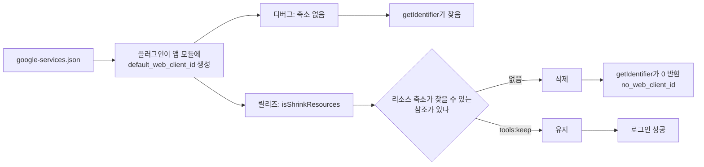

9월 29일부터 10월 1일까지 내가 만든 앱의 안드로이드 버전에서 Google 로그인이 211번 실패했고 성공은 한 번도 없었다. 에러 코드는 매번 `no_web_client_id`였는데, 같은 코드를 디버그 빌드로 돌리면 로그인이 아무 문제 없이 됐다.

원인은 릴리즈 빌드의 리소스 축소 단계에서 지워진 문자열 리소스 하나였다. 그 리소스를 찾는 코드는 분명히 있었지만, 축소 단계가 알아볼 수 있는 방식으로 찾지 않았다.

## 클라이언트 ID 전달 경로

앱은 Kotlin Multiplatform 프로젝트이고 안드로이드 쪽 product flavor가 여섯 개다. AGP 9.2.1과 Kotlin 2.4.20으로 빌드하며, 안드로이드 로그인에는 Firebase Auth와 Credential Manager를 쓴다.

당시에는 로그인을 선택 사항으로 둔 계정 기능을 막 배포한 참이었다. Apple이나 Google로 로그인하면 iOS에서 한 구매가 안드로이드에서도 풀리는 기능이다. 안드로이드의 Google 로그인은 Credential Manager를 거치는데, 이때 OAuth 웹 클라이언트 ID를 `serverClientId`로 넘겨야 한다.

이 ID는 `google-services.json`에서 온다. google-services Gradle 플러그인이 이 파일을 읽어 `default_web_client_id`라는 문자열 리소스를 만든다. 이 리소스는 플러그인을 적용한 모듈에만 생기는데, 내 프로젝트에서는 앱 모듈이 그렇다. 반면 로그인 코드는 Kotlin Multiplatform 공유 라이브러리 모듈에 있다. 그래서 라이브러리 쪽에는 생성된 `R` 항목이 없고, `webClientId()`는 런타임에 이름으로 문자열을 찾는다. 찾은 ID가 0이면 바로 null을 돌려주는 코드는 다음과 같다.

```kotlin
private fun webClientId(context: Context): String? {
    val id = context.resources.getIdentifier(
        "default_web_client_id", "string", context.packageName
    )
    if (id == 0) return null
    return context.getString(id).takeIf { it.isNotBlank() }
}

// 호출하는 쪽
val clientId = webClientId(context) ?: return Failed("no_web_client_id")
```

에러 코드는 일부러 이렇게 정했다. Firebase 콘솔에서 Google 제공자를 켜고 `google-services.json`을 다시 받기 전까지는 이 리소스가 정말로 없기 때문이다. 즉, `no_web_client_id`는 "설정 단계를 하나 빠뜨렸다"는 뜻으로 만든 코드였다.

## 빌드 단계별 값 추적

첫 제보는 앱 안의 문의 양식으로 들어왔다. 계정 연결 실패 이벤트에는 에러 코드가 함께 남으므로 릴리즈 이후 기간을 BigQuery로 조회했는데, 안드로이드 실패는 전부 `no_web_client_id`였고 실패 211번에 성공 0번이었다. 같은 기간 iOS 로그인은 정상이었다.

"설정이 빠졌다"는 뜻의 코드였으니 빠진 설정부터 찾았지만 설정은 다 있었다. 그래서 값이 지나가는 단계를 빌드 순서대로 하나씩 열어 봤다. 생성 단계까지는 모두 "있음"이고 배포한 AAB(Android App Bundle)에서만 "없음"인 것을 확인할 수 있었다.

| 단계 | `default_web_client_id` 있음? |
|---|---|
| `google-services.json`, flavor 여섯 개 모두 | 있음 (OAuth 클라이언트 type 3 항목) |
| `process<Flavor>ReleaseGoogleServices` 결과물 | 있음 |
| 디버그 APK (축소 없음) | 있음 |
| 배포한 2.2.85 릴리즈 AAB의 `base/resources.pb`, flavor 두 개 | 없음 |

생성된 리소스까지는 모든 단계에 문자열이 있었는데, 축소를 거친 뒤에는 사라졌다. 릴리즈 빌드 타입은 `isMinifyEnabled = true`, `isShrinkResources = true`였고 디버그는 둘 다 꺼져 있었다. 범인은 축소 단계였다.

## getIdentifier로 찾는 이름과 리소스 축소

리소스 축소는 쓰인다는 근거를 찾지 못한 리소스를 지운다. `R.string.default_web_client_id`로 참조하면 축소 단계가 그 참조를 따라갈 수 있지만, 런타임에 `getIdentifier`로 넘기는 이름은 그냥 문자열일 뿐이다. 게다가 여기서는 리소스가 생기는 모듈과 그 리소스를 찾는 코드의 모듈이 달랐다.

리소스 축소 문서를 보면 "safe" 모드에서는 코드에 문자열 리터럴로 들어 있는 이름의 리소스를 남긴다. 그래서 이 리소스는 지워지지 않을 줄 알았는데, AGP 9.2.1과 내 구성에서는 지워졌다. 축소된 AAB에서 이 이름은 한 번도 나오지 않았다.

디버그와 릴리즈에서 같은 리소스가 어떻게 되는지 그려 보면 다음과 같다. 둘이 갈리는 지점은 축소 단계가 볼 수 있는 참조가 있느냐다.



## 점검은 왜 통과했나

버전마다 돌리는 릴리즈 점검은 diff를 기준으로 한다. 직전 배포 커밋과 HEAD 사이의 `git diff --name-only`를 읽고 보안 규칙, 스키마, 광고·페이월 진입점처럼 영역별로 티켓을 만드는 방식이다. 2.2.85 점검은 실패 0건으로 끝났는데, 빌드 도중에 사라지는 리소스는 diff에 나오지 않으므로 이 점검으로는 애초에 볼 수 없는 버그였다.

출시 다음 날 실기기에서도 로그인은 잘 됐다. 디버그 빌드는 리소스를 축소하지 않으므로, 이런 버그는 실기기에 릴리즈 빌드를 깔아서 확인해야 잡힌다.

## tools:keep으로 문자열 유지

앱 모듈 main 소스 세트에 XML 파일 하나를 넣어 축소 단계가 이 문자열을 남기게 했다.

```xml
<!-- res/raw/keep_auth.xml -->
<resources xmlns:tools="http://schemas.android.com/tools"
    tools:keep="@string/default_web_client_id" />
```

파일 이름을 `keep.xml`로 하지 않은 데는 이유가 있다. flavor 여섯 개 중 다섯 개에 다른 리소스용 `res/raw/keep.xml`이 이미 있었고, flavor 소스 세트에 같은 이름의 리소스가 있으면 `main` 쪽을 덮어쓴다. `main/res/raw/keep.xml`로 만들었다면 그 다섯 flavor에서는 경고 없이 덮어써졌을 것이다. 이름을 다르게 하면 두 파일이 모두 적용된다.

수정은 안드로이드 전용 핫픽스 2.2.86으로 배포했다. 그 뒤에 머지된 관계없는 기능이 같이 실리지 않도록 이전 master 커밋에서 브랜치를 땄고, iOS에는 같은 버그가 없어서 다시 빌드하지 않았다.

## 릴리즈 AAB에서 이름 세기

소스 트리만 봐서는 결론이 나지 않으므로 릴리즈 번들을 직접 풀어 이름이 몇 번 나오는지 셌다.

```bash
unzip -q -o app/build/outputs/bundle/<flavor>Release/app-<flavor>-release.aab \
  base/resources.pb -d /tmp/aab
strings /tmp/aab/base/resources.pb | grep -c default_web_client_id
```

| 빌드 | `grep -c` 출력 | 안드로이드 Google 로그인 |
|---|---|---|
| 2.2.85 릴리즈 AAB | 0 | 실패 211번, 성공 0번 (9월 29일~10월 1일) |
| `keep_auth.xml`을 넣은 릴리즈 AAB | 1 | 2.2.86에서 수정 |

처음에는 macOS에서 `unzip -p ... | strings | grep -c ...`로 쓰려고 했다. 그런데 내 맥에서는 macOS `strings`가 파이프로 받은 입력에 아무것도 출력하지 않았고, `grep -c`도 아무것도 찍지 않았다. 일치하는 줄이 0건인 것처럼 보이지만 실제로는 `strings`에 입력이 하나도 들어가지 않은 것이다. 파일로 먼저 풀고 경로를 넘기면 이 문제를 피할 수 있다.

## 정리

`no_web_client_id`는 리소스를 찾지 못한 상황을 그대로 알려 줬을 뿐인데, 나는 이 코드를 "설정 단계를 빠뜨렸다"는 뜻으로만 읽고 엉뚱한 곳부터 뒤졌다. 그래서 지금은 에러 코드 이름에 원인이 짐작되어 있어도 가설 하나로만 보고, 이번처럼 빌드 단계마다 값을 직접 확인한다.

`getIdentifier`, 리플렉션, 네이티브 코드나 다른 모듈에서만 참조하는 리소스도 같은 위험이 있다. 디버그와 릴리즈는 바로 이런 리소스를 걷어내는 단계에서 달라지므로, 디버그 빌드로 테스트해서는 이 버그가 보이지 않는다. 이번 경우는 위의 셸 두 줄이면 충분했고, 이 검사만 돌렸어도 2.2.85는 업로드 전에 걸렸다. 지금은 업로드 전에 릴리즈 AAB의 `resources.pb`에서 이름으로 찾는 리소스부터 센다.
