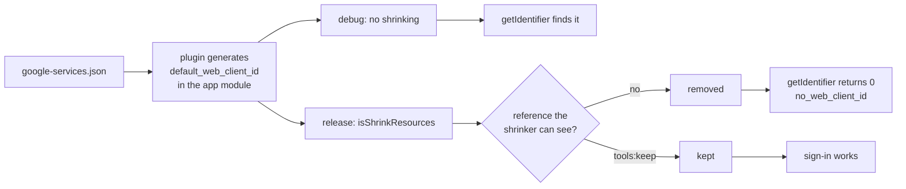

Between 29 September and 1 October, Google sign-in on the Android build of my app failed 211 times and succeeded zero times. Every failure had the error code `no_web_client_id`, and debug builds signed in fine.

The release build's resource shrinker had removed one string resource. The code did look it up, just not in a way the shrinker could trace.

## How the client ID reaches the sign-in code

The app is a Kotlin Multiplatform project with six Android product flavors, built with AGP 9.2.1 and Kotlin 2.4.20. On Android, sign-in uses Firebase Auth with Credential Manager.

I'd just shipped optional accounts: users could sign in with Apple or Google so that a purchase made on iOS would also unlock the app on Android. Credential Manager's Google path needs the OAuth web client ID as `serverClientId`.

That ID comes from `google-services.json`. The google-services Gradle plugin reads the file and generates a string resource called `default_web_client_id` in the module that applies the plugin, which in my project is the app module. The sign-in code lives in a shared Kotlin Multiplatform library module. A library has no generated `R` entry for a resource only the app module gets, so the code looks the string up by name at runtime:

```kotlin
private fun webClientId(context: Context): String? {
    val id = context.resources.getIdentifier(
        "default_web_client_id", "string", context.packageName
    )
    if (id == 0) return null
    return context.getString(id).takeIf { it.isNotBlank() }
}

// caller
val clientId = webClientId(context) ?: return Failed("no_web_client_id")
```

I picked that error code on purpose. During setup the resource really is missing until the Google provider is enabled in the Firebase console and `google-services.json` is downloaded again. `no_web_client_id` was meant to say "you skipped a configuration step".

## Following the client ID through the build

The first report came in through the in-app support form. The analytics event for a failed link carries the error code, so I queried the release window in BigQuery. On Android every failure was `no_web_client_id`, with 211 failures and 0 successes. iOS sign-ins completed normally over the same days.

The error code meant "configuration missing", so I went looking for missing configuration. It was all there. So I followed the value through the build, one stage at a time:

| stage | `default_web_client_id` present? |
|---|---|
| `google-services.json`, all six flavors | yes (OAuth client type 3 entry) |
| output of `process<Flavor>ReleaseGoogleServices` | yes |
| debug APK (no shrinking) | yes |
| shipped 2.2.85 release AAB, `base/resources.pb`, two flavors | no |

It was in every stage up to the generated resources. After shrinking, it was gone. The release build type had `isMinifyEnabled = true` and `isShrinkResources = true`, and debug had neither.

## A name the shrinker can't trace

The resource shrinker removes resources it can't prove are used. It can follow a reference through `R.string.default_web_client_id`. A name passed to `getIdentifier` at runtime is just a string, and here the generated resource and the code asking for it sit in different modules.

The shrinker documentation describes a "safe" mode that keeps resources whose names appear as string literals in code, so I expected this lookup to survive. On AGP 9.2.1 with my setup it didn't. The name appeared zero times in the shrunk AAB.

This is what each build type does with the same generated resource:



## Why the checklist and the device check passed

The release checklist I run before each version reads `git diff --name-only` between the last shipped commit and HEAD, then opens tickets per surface (security rules, schema, ad and paywall entry points). The 2.2.85 audit finished with zero failures. A resource removed during the build never shows up in `git diff`, so the checklist couldn't see it.

According to my release notes, sign-in worked on a real device the day after release. Debug builds don't shrink resources, so a device check catches this kind of bug only when the device runs the release build.

## Keeping the string with `tools:keep`

One XML file in the app module's main source set tells the shrinker to keep the string:

```xml
<!-- res/raw/keep_auth.xml -->
<resources xmlns:tools="http://schemas.android.com/tools"
    tools:keep="@string/default_web_client_id" />
```

I didn't call it `keep.xml`, because five of the six flavors already had their own `res/raw/keep.xml` for unrelated resources. A resource in a flavor source set overrides one with the same name in `main`, so a `main/res/raw/keep.xml` would have been replaced in those five flavor builds without a warning. With a different name, both files apply.

The fix went out as 2.2.86, an Android-only hotfix. I cut it from an earlier master commit so that an unrelated feature merged afterwards wouldn't ride along. iOS didn't have the bug and wasn't rebuilt.

## Counting the name in the AAB

To confirm, I searched the release bundle itself:

```bash
unzip -q -o app/build/outputs/bundle/<flavor>Release/app-<flavor>-release.aab \
  base/resources.pb -d /tmp/aab
strings /tmp/aab/base/resources.pb | grep -c default_web_client_id
```

| build | `grep -c` output | Google sign-in on Android |
|---|---|---|
| 2.2.85 release AAB | 0 | 211 failures, 0 successes (29 Sep to 1 Oct) |
| release AAB with `keep_auth.xml` | 1 | fixed in 2.2.86 |

My first try on macOS was `unzip -p ... | strings | grep -c ...`. On my machine, macOS `strings` produced empty output when fed through a pipe, so `grep -c` printed nothing. That's easy to read as zero matches when `strings` never got any input. Extracting the file first and passing the path avoids it.

## Checking what the app looks up by name

`no_web_client_id` reported what the code saw. I'd attached one cause to it ("you forgot a setup step"), and the shrinker was a second way for the resource to go missing. When an error code carries a guess about the cause, I now treat the guess as one hypothesis and check the value at each stage of the build, the way I eventually did here.

The same risk applies to anything the app finds by name: `getIdentifier`, reflection, resources referenced only from native code or from another module. Debug and release differ in the step that strips those, so a debug test won't show the bug. If your app looks resources up by name, grep the release AAB for those names before upload. For this string it's the two shell lines above, and they would have flagged 2.2.85.
