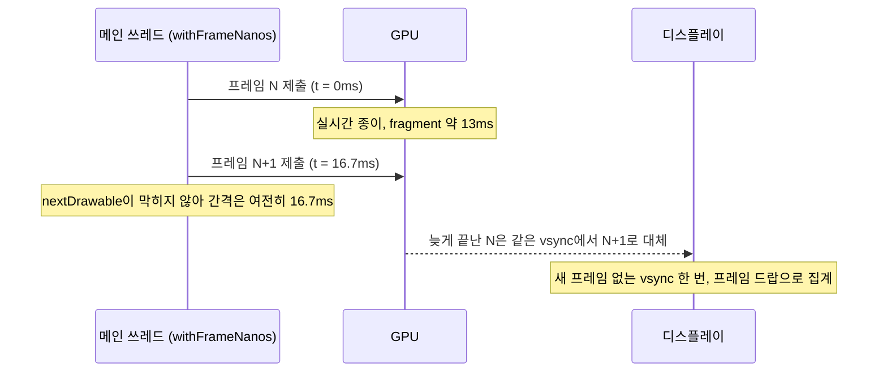

iPhone 13에서 Compose Multiplatform 앱을 스크롤하는 동안 앱 안에서 프레임 간격을 쟀더니 p50(중앙값) 16.7ms, p90 16.7ms였고 20ms를 넘은 프레임은 한 장도 없었다. 그런데 같은 기기의 같은 화면을 Instruments로 보니 그 스크롤에서 프레임 9.1%가 vsync(화면 갱신 신호)를 놓쳤다. 앱은 프레임 요청을 받은 시각을 쟀고 Instruments는 실제로 화면에 나간 프레임을 셌는데, 손가락으로 느낀 버벅임과 맞은 건 Instruments였다.

나는 그날 오전 내내 앱 안에서 잰 숫자를 믿고 수정을 보류했다.

## 문항 카드 뒤에 깐 종이 질감

시험 대비 퀴즈 앱이고, 코틀린으로 한 번 짜서 Compose Multiplatform으로 안드로이드와 iOS에 배포한다. 수정 당시 버전은 Kotlin 2.4.20, Compose Multiplatform 1.12.1이었고 아이폰은 iOS 26.7이었다. 10월 9일에 문항 카드와 해설 영역 뒤에 시험지 느낌을 내는 절차적 셰이더를 깔았다. 텍스처 이미지 없이 런타임 셰이더로 픽셀 단위의 미세한 결을 그리고 그 위에 휘어진 섬유 노이즈 다섯 층을 얹는 방식이다. 처음 그린 뒤로 uniform이 바뀌지 않으므로 KDoc에는 '정적'이라고 적었다.

며칠 뒤 문항을 스크롤할 때 걸리는 느낌이 났고 iOS가 특히 심했다. 그날은 `devicectl`에서 아이폰이 unavailable로 떠서 안드로이드부터 봤다.

## 정지 화면 5초에 614프레임

Galaxy Z Fold7 커버 화면(120Hz)에 릴리즈 빌드를 올리고, 코퍼스에서 가장 긴 문항을 열어 `dumpsys gfxinfo`로 쟀다. 의심 가는 요인이 둘이었으므로 측정용 `setprop` 토글을 임시로 달았고 커밋은 하지 않았다. 조합마다 스와이프 20회로 두 번씩 돌렸다.

| 조합 | 정지 5초 동안 렌더링된 프레임 | 프레임 p50 / p90 | GPU p50 / p90 |
|---|---|---|---|
| 현재(종이 + 정답 점 시계) | 614 (약 123fps) | 12~17 / 14~19ms | 9~15 / 11~16ms |
| 종이 끔 | 614 | 5~8 / 6~8ms | 2~5 / 3~6ms |
| 시계 끔 | 0 | 12~13 / 14~15ms | 10 / 12ms |
| 둘 다 끔 | 0 | 8 / 8ms | 5 / 7ms |

종이 셰이더 하나가 프레임마다 GPU를 7~10ms쯤 더 썼는데, 120Hz의 프레임 예산이 8.3ms이니 이것만으로 예산을 넘는다. '정적'은 uniform이 고정이라는 뜻일 뿐이었다. `drawWithCache`는 셰이더 객체를 캐시할 뿐 픽셀을 들고 있지 않으므로, 카드를 다시 그리는 프레임마다 카드 전체 면적의 섬유 필드를 처음부터 다시 계산한다.

나머지 요인은 시계였다. 선택한 답과 채점된 답에 찍는 점을 노이즈 셰이더로 그렸는데, 멈추지 않는 시간 값으로 그 셰이더를 돌리고 있었다. 그래서 화면은 매 vsync마다 프레임을 요청했고 그 요청은 멈추지 않았다. 아무도 건드리지 않는 문항 뷰어가 5초에 614프레임을 그렸고, 프레임마다 종이 셰이더 비용이 그대로 들었다. 정작 10dp짜리 점에서는 노이즈가 보이지도 않았다.

점을 단색 원으로 바꾸고 시계를 걷어냈더니 호스트 테스트 둘이 깨졌다. 두 테스트 모두 그 시계가 계속 요청하던 프레임에 기대고 있었다.

종이는 디자인상 필요하다고 보고 남겼다. 이제 안드로이드 스크롤 비용은 표의 '시계 끔' 행과 같다.

## 매 vsync마다 프레임을 요청하는 숨은 광고 바

다음 날 iPhone 13(60Hz)을 다시 쓸 수 있게 됐다. Release 구성을 개발 서명으로 설치하고 Instruments의 Animation Hitches 템플릿으로 녹화한 뒤 `hitches-updates` 테이블에서 앱 프로세스 행만 셌다. iOS에는 `adb input`이 없어서 페이지를 연 지 8초 뒤에 `animateScrollBy(±1500px, tween(250))`를 열 번 왕복하는 측정용 패치를 넣었다. 종이는 환경 변수로 끌 수 있게 했고 두 패치는 별도 worktree에서만 빌드했다.

| 빌드 | 종이 | 정지 중 초당 커밋 | 스크롤 중 커밋 간격 p50 / p90 / max |
|---|---|---|---|
| 수정 전 | 켬(2회) | 31~56, 대개 40 | 16.7 / 33.4 / 117ms |
| 수정 전 | 끔 | 60 고정 | 16.7 / 16.7 / 162ms(실행 직후 1회) |
| 광고 바 게이팅 | 켬 | 0 | 16.7 / 33.4 / 33.6ms |
| 광고 바 게이팅 | 끔 | 0~1 | 16.7 / 16.7 / 66.6ms |

녹화에는 Instruments 기본 CLI를 썼다. `hitches-updates`의 행마다 시작 시각과 프로세스가 있으므로 앱 프로세스 행을 초 단위로 세면 된다.

```bash
xcrun xctrace record --template 'Animation Hitches' --device <udid> \
  --all-processes --time-limit 40s --output run.trace
xcrun xctrace export --input run.trace \
  --xpath '/trace-toc/run[@number="1"]/data/table[@schema="hitches-updates"]' > updates.xml
```

저장은 녹화보다 훨씬 오래 걸린다. 5초 녹화를 저장하는 데 94초가 걸렸고, 모든 프로세스를 40초 녹화하면 3~10분이 걸렸다. 멈춘 것처럼 보이지만 중간에 끊으면 녹화가 통째로 날아간다.

정답 점을 고친 뒤에도 가만히 있는 화면이 초당 60번 커밋하고 있었다. 따라가 보니 광고 카운트다운 진행 바였다. 앱 루트에서 세션 내내 컴포지션에 남아 있는 컴포저블인데 표시 여부를 `AnimatedVisibility`에만 연결해 두었고, 셰이더 시계와 `while (true)` 바운스 애니메이션은 그 바깥에 있었다. 그래서 바가 보이든 말든 두 루프가 매 vsync마다 프레임을 요청했다.

안드로이드에서는 이 루프의 비용이 거의 없었다. 숨은 바가 있는데도 앞 표의 '시계 끔' 행은 정지 중 0프레임이다. 반면 iOS에서 샘플 프로파일을 떠 보니 메인 스레드의 24%가 `RenderNode.onDraw`와 `SkPictureRecorder.finishRecordingAsPicture`였다. Compose iOS는 프레임 요청이 오면 장면 전체를 다시 기록해서 Metal 표면 한 장에 다시 그린다. 리컴포지션은 바 안에서 끝났지만, 비용은 종이까지 포함한 전체 래스터화에서 나왔다.

처음에는 루프를 `isVisible`로 막았고, 다음에는 두 루프를 `AnimatedVisibility`의 content 안으로 옮겼다. 이제 바를 숨기면 루프도 컴포지션에서 빠진다. 플래그 확인은 누군가 깜빡할 수 있지만 컴포지션에서 빠진 코드는 프레임을 요청할 수 없다. 그 결과 정지 중 커밋이 0이 됐다.

이런 버그는 안드로이드에서 보이지 않는데 iOS 측정은 한 번에 수십 분씩 걸렸다. 그래서 그날 공통 코드에 방지책을 세 가지 넣었다. 우선 주요 화면을 띄워 두고 Compose가 idle 상태가 되는지 보는 호스트 테스트를 만들었다. 테스트가 정말 잡는지 보려고 문항 화면과 홈 화면에 `while (true) { animateTo(...) }`를 일부러 심어 봤고, 둘 다 실패하는 것을 확인했다. 다음으로 앞의 구조를 공통 규칙으로 정했고, UI 코드에서 `animateTo`나 `withFrameNanos`를 감싼 무한 루프를 막는 검사 스크립트도 넣었다.

idle 테스트는 JVM 호스트에서 도는 일반 Compose UI 테스트라서, 기기 세션은 수십 분이 걸려도 이건 몇 초면 끝난다.

```kotlin
@Test
fun screenGoesIdleWhenLeftAlone() {
    compose.setContent { ScreenUnderTest(state = fixedPreviewState) }
    // 매 vsync 프레임을 요청하는 루프가 있으면 Compose가 영원히 바쁘다.
    // 그러면 이 호출이 돌아오지 않고 테스트는 60초 뒤 AppNotIdleException으로 실패한다.
    compose.waitForIdle()
}
```

흐르는 퀴즈 타이머나 로딩 스피너처럼 움직임 자체가 의미인 화면은 일부러 테스트 대상에서 뺐고, 이유는 KDoc에 적었다.

그래도 종이를 켜면 스크롤 p90이 33.4ms였고 끄면 16.7ms였다. 열 장 중 한 장꼴로 늦었다.

## 앱 안에서 잰 프레임 간격

변하지 않는 픽셀은 한 번만 계산해서 비용을 없애는 것이 보통이다. 안드로이드라면 하드웨어 레이어를 쓰면 되지만, Compose iOS(skiko 위의 Skia)에는 프레임 사이에 픽셀을 들고 있는 레이어가 없어서 직접 구워야 했다.

굽기 프로토타입을 만들고, Instruments 말고 다른 근거도 보고 싶어서 앱 안에서도 쟀다. 스크롤 애니메이션 동안 `withFrameNanos` 콜백 사이 간격을 모드마다 스크롤 40회씩 두 번 모았다.

| 모드 | 프레임 | p50 / p90 / p99 / max | 20ms 초과 |
|---|---|---|---|
| 종이 실시간 | 604, 606 | 16.7 / 16.7 / 16.9 / 17.0ms | 0, 0 |
| 구운 타일 | 605, 601 | 16.7 / 16.7 / 16.8 / 17.2ms | 0, 0 |

두 모드는 차이가 없었고, Instruments의 커밋 간격과도 맞지 않았다. 두 숫자가 서로 다른 쪽을 가리키자 나는 굽기를 보류했다. 타일 모드 셰이더를 되돌리고 다시 시도할 조건을 문서에 적었다. 그런데 기기에서 손으로 스크롤해 보면 여전히 걸렸고, 한 시간 반 뒤에는 iOS가 감당할 수 있을 때까지 문항 카드와 해설에서 종이를 아예 뺐다.

## Metal System Trace로 센 화면 표시 프레임

다음에는 Metal System Trace로 쟀다. 앱의 GPU fragment 시간을 보고, vsync를 놓친 프레임(프레임 드랍)은 실제로 화면에 나간 프레임 기준으로 셌다. `display-surface-queue`는 시스템 전체 값이라서 앱 것만 걸러야 했다. 같은 빌드에서 환경 변수로 종이 모드만 바꾸고 스크롤 스크립트도 같은 것을 썼으며, 모드마다 두 번 쟀다.

| 모드 | 앱 GPU fragment p50 / p90 | 스크롤 중 프레임 드랍 |
|---|---|---|
| 종이 실시간 | 13.06 / 16.94, 13.07 / 16.60ms | 9.1%, 8.6% |
| 종이 끔 | 2.55 / 2.96, 1.72 / 2.96ms | 0.3%, 0.0% |
| 구운 타일(256dp, 3x) | 1.27 / 2.55, 1.57 / 2.58ms | 0.6%, 0.0% |
| 앱 안 `withFrameNanos` | 모든 모드에서 20ms 초과 0 | 구별 불가 |

실시간 종이는 16.7ms 프레임 가운데 13ms를 GPU에서만 썼다. 그런데도 앱이 이걸 몰랐던 이유를 나는 이렇게 본다. 앱은 60fps로 제출하는데, GPU가 늦게 끝낸 drawable은 같은 vsync에서 더 새 drawable에 밀려 버려진다. `nextDrawable`이 막히지 않으니 메인 스레드는 기다릴 일이 없고 `withFrameNanos`는 16.7ms 간격으로 계속 돈다. 버벅임은 파이프라인의 디스플레이 쪽에서만 드러난다.



앱 안 표가 Instruments와 반대 결과를 낸 것은 아니었다. 내가 GPU 시간을 볼 수 없는 도구로 쟀을 뿐이다.

## 256dp 타일 굽기

다른 두 안은 숫자와 비용을 보고 버렸다. 섬유를 세 층으로 줄이면 GPU가 11.3~12.1ms, 두 층이면 6.8~7.1ms였고 프레임 드랍은 각각 9.7%, 1.7%였다. 두 층이어도 타일보다 GPU를 네 배 넘게 쓰고 프레임도 여전히 놓친다. 카드 전체를 굽는 안도 따져 봤다. 긴 문항 카드 하나가 원본 해상도로 십수 MB인데 한 페이지에 두 장이 있고 페이저가 옆 페이지까지 들고 있다. 게다가 해설은 펼칠 때 크기가 바뀌므로 애니메이션 도중에 다시 구워야 한다.

그래서 타일 단위로 굽기로 하고 셰이더에 `iTile` uniform을 추가했다. 값이 0이 아니면 좌표를 타일 크기로 감싸고, 각 축의 마지막 24dp 구간에서는 섬유를 한 타일 앞의 필드 쪽으로 섞는다. 그러면 타일 끝 가장자리가 시작 가장자리와 같은 무늬로 끝난다. 값이 0이면 출력이 예전과 똑같고 안드로이드는 계속 이쪽을 썼다.

iOS에서는 색과 밀도 조합마다 256dp 타일 하나를 메인 스레드 밖의 CPU 래스터 표면에 한 번 그리고, 그 타일을 반복해서 깐다.

```kotlin
// Skia(skiko) 타입. iOS에서 Compose의 Shader는 org.jetbrains.skia.Shader라서
// 결과를 바로 ShaderBrush에 넣는다. 색 관련 uniform은 생략했다.
fun bakeTile(effect: RuntimeEffect, sidePx: Int, density: Float) =
    RuntimeShaderBuilder(effect).run {
        uniform("iResolution", sidePx.toFloat(), sidePx.toFloat())
        uniform("iDensity", density)
        uniform("iTile", sidePx / density)        // 픽셀 경계에서 정확히 감싼다
        val surface = Surface.makeRasterN32Premul(sidePx, sidePx)
        val paint = Paint().apply { shader = makeShader() }
        surface.canvas.drawRect(Rect.makeWH(sidePx.toFloat(), sidePx.toFloat()), paint)
        surface.makeImageSnapshot().makeShader(
            FilterTileMode.REPEAT, FilterTileMode.REPEAT,
            FilterMipmap(FilterMode.NEAREST, MipmapMode.NONE), // 타일은 1:1로 놓인다
        )
    }
```

실제 코드는 `Dispatchers.Default`에서 돌고 최근 타일 여섯 장을 들고 있으며, 타일이 오기 전까지 시트는 단색으로 칠한다. 3x에서 타일 하나를 굽는 데 535~544ms가 걸렸다. 실행할 때마다 0.5초씩 단색이 보이는 게 거슬려서 그날 밤 구운 타일을 Caches 디렉터리에 PNG로 남기게 했다. 키는 셰이더 소스 해시이고, iPhone 13에서 다시 읽는 데 4ms쯤 걸린다.

이음매는 호스트 테스트로 확인했다. 같은 400×600dp 시트를 3x에서 타일 방식과 실시간 방식으로 각각 그려 비교했는데, 밝기 표준편차는 라이트 모드에서 타일 3.851, 실시간 3.847이었고 다크 모드에서는 3.624와 3.620이었다. 타일 경계의 열 간 단차는 3.32로 전체 열 간 단차 중앙값 4.02보다 작으므로 경계가 질감 자체의 노이즈에 묻힌다.

## GPU 13.06ms에서 1.27ms로

측정 조건은 앞 표와 같다. 같은 Release 빌드에서 환경 변수로 모드만 바꾸고 `animateScrollBy` 스크립트로 스크롤하면서 모드마다 두 번, Metal System Trace로 쟀다. 타일을 쓰자 iPhone 13의 앱 GPU fragment 시간이 p50 기준 13.06ms에서 1.27ms로 줄었고, 두 번째 실행에서는 13.07ms에서 1.57ms가 됐다. 스크롤 중 프레임 드랍은 9.1%와 8.6%에서 0.6%와 0.0%로 줄어 종이를 끈 것과 같은 수준이 됐다. 바로 앞 빌드에서는 걸렸던 손 스크롤도 다시 해 봤는데 부드러웠다. 그래서 문항 카드와 해설에 종이를 되돌렸다.

안드로이드는 처음에는 실시간 셰이더를 그대로 썼다. Fold7에서 `iTile = 0`인 새 셰이더는 프레임 p50 12~13ms, p90 15~16ms였고 GPU는 9~10ms와 12~13ms였다. 정지 중 프레임은 0으로 앞의 '시계 끔' 행과 같았다.

10월 15일에는 같은 굽기 방식이 생각지 못한 곳에서도 쓸모가 있었다. 스토어 영상 캡처는 Robolectric 네이티브 그래픽 위에서 도는데, 여기서는 호스트가 런타임 셰이더를 CPU로 픽셀마다 해석한다. 실시간 종이로는 해설 장면 한 프레임에 8,003ms가 걸렸다. 안드로이드에서도 타일을 굽게 했더니(`Picture`를 하드웨어 비트맵으로 만들고 `BitmapShader`로 반복) 섬유 모양은 그대로인 채 161ms로 줄었다.

## 디스플레이 기준 버벅임 측정

이제 Compose iOS에서는 앱 안 프레임 콜백을 버벅임 지표로 쓰지 않는다. 그 값은 앱이 프레임 요청을 언제 받았는지만 알려 줄 뿐, GPU가 제때 끝냈는지나 화면에 나갔는지는 알려 주지 않는다. 그래서 비용이 GPU 쪽에 있으면 앱 안 숫자는 완벽해 보인다. 지금은 측정 전에 지표부터 정하고 Metal System Trace에서 화면에 나간 프레임과 앱 GPU fragment 시간을 본다. 그날은 애초에 문제를 보여 줄 수 없는 숫자만 보다가 오전을 날렸다.

아무도 보지 않는 프레임 루프는 안드로이드에서 비용이 거의 없지만 iOS에서는 장면 전체를 래스터화하는 비용이 든다. skiko에는 '정적' 셰이더의 픽셀을 붙잡아 둘 레이어도 없다. 그래서 공통 코드에서는 절차적 텍스처를 모두 굽고, 끝나지 않는 애니메이션은 돌아야 할 이유가 확인되기 전까지 버그로 본다. 앱이 잰 프레임 간격은 멀쩡한데 iOS 스크롤이 걸린다면, 지금은 코드를 고치기 전에 Metal System Trace부터 녹화한다.
