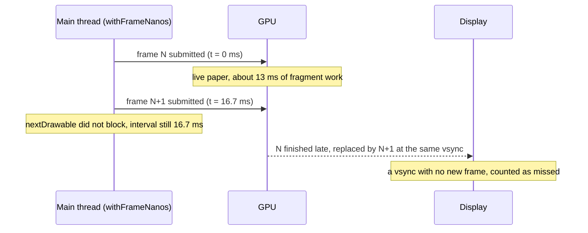

On an iPhone 13, my Compose Multiplatform app timed its own frames during a scroll and got 16.7 ms at p50, 16.7 ms at p90, and no frame over 20 ms. Instruments, on the same phone and the same screen, said 9.1% of the frames in that scroll never made their vsync. The app was timing when it was asked for a frame. Instruments was counting frames that reached the display, and that was the one that matched what I felt under my thumb.

I believed the app's number for one morning and shelved the fix because of it.

## A procedural paper texture behind the question card

The app is an exam-prep quiz app, written once in Kotlin and shipped to Android and iOS with Compose Multiplatform (Kotlin 2.4.20 and Compose Multiplatform 1.12.1 at the time of the fix; the iPhone ran iOS 26.7). On October 9 I put a procedural "exam paper" shader behind the question card and the commentary section. It's an AGSL/SkSL runtime shader with no textures: a fine per-pixel tooth plus five layers of sparse, warped fibre noise. Its uniforms never change after the first draw, so I called it static in the KDoc.

A few days later, scrolling a question felt rough, worst on iOS. That day `devicectl` listed the iPhone as unavailable, so I started on Android.

## 614 frames in five seconds of doing nothing

I put a release build on a Galaxy Z Fold7 cover screen (120 Hz), opened the longest question in the corpus, and read `dumpsys gfxinfo`. I had two suspects, so I added temporary `setprop` toggles for them (never committed) and ran each combination twice with 20 swipes:

| Combination | Frames rendered in 5 s at rest | Frame p50 / p90 | GPU p50 / p90 |
|---|---|---|---|
| Current (paper + answer-dot clock) | 614 (about 123 fps) | 12–17 / 14–19 ms | 9–15 / 11–16 ms |
| Paper off | 614 | 5–8 / 6–8 ms | 2–5 / 3–6 ms |
| Clock off | 0 | 12–13 / 14–15 ms | 10 / 12 ms |
| Both off | 0 | 8 / 8 ms | 5 / 7 ms |

The paper shader added roughly 7 to 10 ms of GPU per frame, which on its own is over the 8.3 ms budget at 120 Hz. "Static" only meant the uniforms were fixed. `drawWithCache` caches the shader object, not the pixels, so every frame that redraws the card reruns the whole fibre field over its full area.

The other suspect was a clock. I'd drawn the selected and graded answer dots with a noise shader driven by an infinite time source, so the screen asked for a frame every vsync forever. With nobody touching it, the viewer drew 614 frames in five seconds and each one paid the full paper cost. At 10 dp the noise on the dot wasn't even visible. I replaced it with a solid circle and removed the clock, and two host tests broke. Both had been relying on the frames that clock kept requesting.

The paper stayed, as a design decision. On Android the scroll now cost what the "clock off" row shows.

## A hidden ad bar requesting a frame every vsync

The next day I got the iPhone 13 (60 Hz) working. I installed a Release build with development signing and recorded with the Animation Hitches template in Instruments, counting the app process's rows in the `hitches-updates` table. iOS has no `adb input`, so a temporary patch scrolled the page with `animateScrollBy(±1500px, tween(250))` ten times each way, eight seconds after the page opened. An environment variable switched the paper off. Both patches lived in a separate worktree.

| Build | Paper | Commits per second at rest | Commit gap while scrolling p50 / p90 / max |
|---|---|---|---|
| Before | on (2 runs) | 31–56, usually 40 | 16.7 / 33.4 / 117 ms |
| Before | off | 60, steady | 16.7 / 16.7 / 162 ms (once, at launch) |
| Ad bar gated | on | 0 | 16.7 / 33.4 / 33.6 ms |
| Ad bar gated | off | 0–1 | 16.7 / 16.7 / 66.6 ms |

The recording is the stock Instruments CLI. Each `hitches-updates` row carries a start time and a process, and I counted the app's rows per second:

```bash
xcrun xctrace record --template 'Animation Hitches' --device <udid> \
  --all-processes --time-limit 40s --output run.trace
xcrun xctrace export --input run.trace \
  --xpath '/trace-toc/run[@number="1"]/data/table[@schema="hitches-updates"]' > updates.xml
```

Saving takes far longer than recording: 94 seconds for a 5-second recording, 3 to 10 minutes for 40 seconds across all processes. It looks hung. If you interrupt it, the whole recording is gone.

With the dot fixed, a still screen was still committing 60 times a second. I traced it to an ad countdown progress bar composed at the app root for the whole session. I'd wired its visibility only into `AnimatedVisibility`. Its shader clock and a `while (true)` bounce animation sat outside, so they requested a frame every vsync whether the bar showed or not.

On Android that cost nothing, and the "clock off" row above has zero frames at rest with the hidden bar present. A sampling profile on iOS put 24% of the main thread in `RenderNode.onDraw` and `SkPictureRecorder.finishRecordingAsPicture`. When a frame is requested, Compose on iOS re-records and redraws the whole scene into one Metal surface. Recomposition stayed inside the bar. Rasterising everything, paper included, was the expensive part.

I gated the loops on `isVisible` first. Then I moved them inside the `AnimatedVisibility` content, so hiding the bar takes them out of composition. Someone can forget to check a flag, but code that has left composition can't request frames. Commits at rest dropped to 0.

I couldn't see this kind of bug on Android, and each iOS measurement took me tens of minutes, so later that day I added three guards in shared code. One is a host test that composes the main screens and asserts Compose goes idle when left alone. To make sure it catches the bug, I planted a `while (true) { animateTo(...) }` in the question screen and in the home screen and watched it fail. The second is the structural rule above. The third is a check script that rejects infinite loops around `animateTo` or `withFrameNanos` in UI code.

The idle test is a plain Compose UI test on the JVM host, so it takes seconds where a device session takes tens of minutes:

```kotlin
@Test
fun screenGoesIdleWhenLeftAlone() {
    compose.setContent { ScreenUnderTest(state = fixedPreviewState) }
    // A loop that requests a frame every vsync keeps Compose busy forever,
    // so this call never returns and the test fails with AppNotIdleException after 60 s.
    compose.waitForIdle()
}
```

Surfaces whose motion is the point (a running quiz timer, a loading spinner) are kept out of the test states on purpose, with the reason in the KDoc.

With paper on, though, the scroll p90 was still 33.4 ms against 16.7 ms with it off. About one frame in ten was late.

## Timing frames inside the app

The usual fix for a pixel cost that never changes is to compute the pixels once. On Android I'd reach for a hardware layer. Compose on iOS (Skia via skiko) has no layer that keeps pixels between frames, so I'd have to bake them myself.

I prototyped the bake. I wanted a second opinion that didn't involve Instruments, so I measured inside the app: the interval between `withFrameNanos` callbacks during the scroll animation, 40 scrolls times two runs per mode.

| Mode | Frames | p50 / p90 / p99 / max | Over 20 ms |
|---|---|---|---|
| Live paper | 604, 606 | 16.7 / 16.7 / 16.9 / 17.0 ms | 0, 0 |
| Baked tile | 605, 601 | 16.7 / 16.7 / 16.8 / 17.2 ms | 0, 0 |

The two modes were indistinguishable. That disagreed with the Instruments commit gaps, and with two numbers pointing different ways I held the bake, reverted the tile-mode shader, and wrote down what would reopen it. Scrolling on the device still felt rough by hand, so an hour and a half later I took the paper off the question card and commentary entirely until iOS could carry it.

## Metal System Trace and displayed frames

Next I used Metal System Trace. I took the app's GPU fragment time and counted missed vsyncs only on frames that reached the display. `display-surface-queue` is system-wide, so I filtered it to the app. Same build, paper mode switched by environment variable, same scroll script, two runs per mode:

| Mode | App GPU fragment p50 / p90 | Missed vsync while scrolling |
|---|---|---|
| Live paper | 13.06 / 16.94, 13.07 / 16.60 ms | 9.1%, 8.6% |
| Paper off | 2.55 / 2.96, 1.72 / 2.96 ms | 0.3%, 0.0% |
| Baked tile (256 dp, 3x) | 1.27 / 2.55, 1.57 / 2.58 ms | 0.6%, 0.0% |
| In-app `withFrameNanos` | 0 frames over 20 ms in every mode | can't tell them apart |

Live paper spent 13 ms of a 16.7 ms frame on the GPU alone. My best explanation for why the app never noticed: the app submits at 60 fps, and a drawable the GPU finishes late is replaced by a newer one at the same vsync and dropped. `nextDrawable` doesn't block, so the main thread never waits and `withFrameNanos` keeps ticking at 16.7 ms. The jank only shows up on the display side of the pipeline:



So the in-app table hadn't contradicted Instruments. I'd measured with an instrument that couldn't see GPU time.

## Baking a 256 dp tile

I dropped two other options. Thinning the fibres to three or two layers brought GPU time to 11.3 to 12.1 ms and 6.8 to 7.1 ms, with 9.7% and 1.7% missed vsyncs. Even two layers cost over four times the tile's GPU time and still dropped frames. Baking the whole card was the other option. A long question card at full resolution is more than ten megabytes, there are two per page plus the neighbours the pager holds, and the commentary changes size as it expands, which would mean re-baking during the animation.

So I baked a tile. I added an `iTile` uniform to the shader. When it's non-zero, coordinates wrap at the tile size, and across the last 24 dp of each axis the fibres blend toward the field one tile back, so the far edge matches what the near edge starts with. When it's zero, the output is identical to before, and that's what Android kept using.

On iOS, I render one 256 dp tile per colour and density once, on a CPU raster surface off the main thread, and repeat it:

```kotlin
// Skia (skiko) types. On iOS, Compose's Shader is org.jetbrains.skia.Shader,
// so the result goes straight into a ShaderBrush. Colour uniforms left out.
fun bakeTile(effect: RuntimeEffect, sidePx: Int, density: Float) =
    RuntimeShaderBuilder(effect).run {
        uniform("iResolution", sidePx.toFloat(), sidePx.toFloat())
        uniform("iDensity", density)
        uniform("iTile", sidePx / density)        // wrap exactly at the pixel edge
        val surface = Surface.makeRasterN32Premul(sidePx, sidePx)
        val paint = Paint().apply { shader = makeShader() }
        surface.canvas.drawRect(Rect.makeWH(sidePx.toFloat(), sidePx.toFloat()), paint)
        surface.makeImageSnapshot().makeShader(
            FilterTileMode.REPEAT, FilterTileMode.REPEAT,
            FilterMipmap(FilterMode.NEAREST, MipmapMode.NONE), // tiles land 1:1
        )
    }
```

The real version runs on `Dispatchers.Default`, keeps the last six tiles, and draws the sheet in its plain colour until the tile arrives. Baking takes 535 to 544 ms per tile at 3x. I didn't like half a second of flat colour on every launch, so that evening I started writing the tiles to the Caches directory as PNGs, keyed by a hash of the shader source. Reading one back takes about 4 ms on the iPhone 13.

To check the seam, a host test renders the same 400×600 dp sheet at 3x tiled and live. Luminance standard deviation is 3.851 tiled vs 3.847 live in light mode and 3.624 vs 3.620 in dark. The column-to-column step at the tile edge is 3.32, under the median column step of 4.02, so the edge sits inside the texture's own noise.

## 13.06 ms of GPU down to 1.27 ms

I measured the tile the same way as the table above: same Release build, mode switched by environment variable, scripted `animateScrollBy` scroll, two runs per mode, Metal System Trace. App GPU fragment time on the iPhone 13 went from 13.06 ms to 1.27 ms at p50 (13.07 to 1.57 ms on the second run). Missed vsyncs while scrolling went from 9.1% and 8.6% to 0.6% and 0.0%, in the same range as paper turned off. I also scrolled by hand, the check the previous build had failed, and it was smooth. Paper went back on the question card and the commentary.

Android stayed on the live shader at first. On the Fold7, the new shader with `iTile = 0` measured frame p50 12 to 13 ms and p90 15 to 16 ms, GPU 9 to 10 and 12 to 13 ms, and zero frames at rest, the same as the earlier "clock off" row.

On October 15 the bake helped somewhere I hadn't planned for. The store-video capture runs under Robolectric's native graphics, where the host interprets the runtime shader per pixel on the CPU. A commentary frame took 8,003 ms with live paper. I baked the tile on Android too (a `Picture` into a hardware bitmap, repeated through a `BitmapShader`), and the frame took 161 ms with the same fibres in the output.

## Measuring jank from the display side

On Compose iOS I no longer use in-app frame callbacks as a jank metric. They report when the app was asked for a frame. Whether the GPU finished it in time, and whether it reached the display, they can't tell you, so when the cost is on the GPU the app looks perfect. I now pick the metric before measuring, and I take it from the display side: displayed frames and the app's GPU fragment time in Metal System Trace. I spent a morning arguing with a number that couldn't have shown the problem.

A frame loop nobody looks at costs nothing on Android and a full-scene rasterisation on iOS, and skiko has no layer to keep a "static" shader's pixels. In shared code I now bake any procedural texture and treat any animation that never ends as a bug until it proves it needs to run. If a Compose iOS scroll feels rough while the app's own frame timing looks fine, record Metal System Trace before changing any code.
