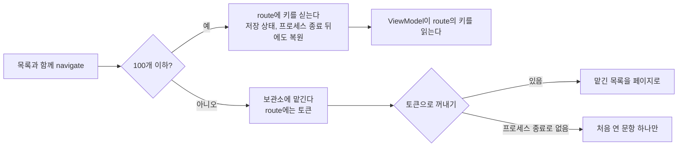

10월에 퀴즈 앱의 뷰어 route가 문항 키 1,611개를 싣고 다녔는데, 그 뷰어를 연 채 앱이 백그라운드로 갈 때마다 안드로이드가 `TransactionTooLargeException`을 던졌다. 반년 전인 4월에는 키 수십 개를 실은 퀴즈 route가 iOS에서 스택 오버플로를 냈다. route에 리스트를 넣는 같은 습관 때문에 플랫폼만 바뀌어 두 번 크래시가 난 것이다. 안드로이드 쪽은 Google Play 사전 출시 테스트 로봇이 찾았다. 그 로봇 때문에 크래시율 경보가 울렸는데, 크래시를 겪은 사용자 가운데 실사용자는 한 명도 없었다.

## route에 리스트를 넣은 이유

앱은 Compose Multiplatform으로 만들었다. 코틀린 코드 하나로 안드로이드와 iOS에 배포하고, 화면 이동은 JetBrains의 멀티플랫폼 Navigation Compose(두 번 모두 2.9.2)와 타입 세이프 route로 한다. 4월에는 Compose Multiplatform 1.10.2와 Kotlin 2.3.10이었고, 10월에는 1.12.1과 2.4.21이었다.

타입 세이프 route는 `@Serializable` data class이므로 `List<QuestionKey>`를 그냥 넣고 싶어지는데, 나도 그렇게 했다. '틀린 문제 다시 풀기'는 틀린 문항 목록을 들고 갔고, '이 문항 열기'는 그 문항과 원래 목록 전체를 함께 들고 가서 옆으로 넘겨 볼 수 있게 했다.

route는 직렬화되고, 그 인자는 백스택 항목의 저장 상태에 들어간다. 둘 다 목록이 길어질수록 비용이 커진다는 것까지는 알았지만, 목록이 얼마나 길어야 한계에 걸리는지는 몰랐다.

## 4월 iOS 재귀 정규식 스택 오버플로

첫 크래시는 iOS의 오답 다시 풀기 퀴즈에서 났다. 스택을 따라가 보니 route를 해석하는 단계에서 죽고 있었다. Kotlin/Native에서 Navigation Compose는 route URI를 정규식으로 매칭하는데, 그쪽 정규식 엔진은 재귀로 동작하므로 URI가 길면 재귀도 깊어진다. 키 26개 언저리부터 스택이 넘쳤다.

그래서 키는 메모리 객체로 옮기고 route에는 '저장소에서 키를 읽어라'라는 boolean 하나만 남겼다. `ViewModel`은 생성될 때 저장소에서 키를 한 번 꺼내 쓰고 비운다.

같은 커밋에서 정규식을 하나 더 고쳤다. 해설 본문의 법 조문 표기를 링크로 바꾸는 검출기가 lookbehind와 상한 없는 수량자(`\s*`, `\d+`)를 쓰고 있었다. 재귀 엔진에서는 수량자가 문자 하나를 소비할 때마다 프레임이 하나 쌓이는데, 해설은 꽤 길 수 있다. 그래서 수량자에 상한을 걸고(`\s{0,5}`, `\d{1,6}`) lookbehind는 빼서, 바로 앞 문자는 매칭이 끝난 뒤 코틀린 코드로 확인하게 했다. 이제 입력이 아무리 길어도 매칭 하나의 재귀 깊이에는 상한이 있다.

다만 이때 고친 건 크래시가 난 route 하나뿐이었다. 문항 뷰어를 비롯해 리스트를 싣던 다른 route는 그대로 두었고, 저장소도 nullable 칸 하나였다. 프로세스가 종료됐다가 복원되면 route는 여전히 '저장소에서 읽어라'라고 하는데 저장소는 비어 있다. 그러면 `ViewModel`의 대체 경로(`consume() ?: emptyList()`)가 퀴즈에 빈 목록을 넘긴다. 그 수정에는 프로세스 종료를 다루는 코드가 없었다.

## 10월 실사용자 없는 크래시율 경보

Play는 28일 동안 사용자 체감 크래시율이 1.09%를 넘는 앱의 스토어 노출을 낮춘다. 사용자가 적은 앱은 Play가 그 비율을 보여 주지 않는데, 내 앱들은 거의 항상 여기에 해당한다. 그래서 같은 비율을 내 데이터로 다시 계산하는 스크립트를 돌린다. 날마다 Crashlytics에서 크래시를 겪은 사용자 수를 애널리틱스의 안드로이드 일일 활성 사용자 수로 나누는 방식이다.

10월 22일에 이 스크립트에서 같은 코드베이스로 만든 앱 두 개가 임계값을 넘었다.

| 앱 | 크래시율(대리 지표) | 크래시 사용자 / 사용자·일 | 임계값 | 그중 실사용자 |
|---|---|---|---|---|
| A | 1.61% | 4 / 249 | 1.09% | 0 |
| B | 2.38% | 1 / 42 | 1.09% | 0 |

Crashlytics 이벤트 REST 엔드포인트는 빈 객체만 돌려줬으므로, 마지막 열은 BigQuery 내보내기 테이블을 직접 조회해 채웠다. fatal 이벤트마다 기기를 뽑는 쿼리는 다음과 같다.

```sql
SELECT DATE(event_timestamp, 'Asia/Seoul') AS day,
       application.display_version AS version,
       device.model AS model,
       SUBSTR(installation_uuid, 1, 8) AS install,
       SUBSTR(issue_title, 1, 40) AS issue
FROM `my-project.firebase_crashlytics.my_app_ANDROID`
WHERE event_timestamp >= TIMESTAMP('2026-09-19')
  AND error_type = 'FATAL'
ORDER BY event_timestamp
```

기간 안의 fatal 이벤트는 전부 Play 사전 출시 보고서 기기에서 나왔다. `sdk_gphone64_arm64` 에뮬레이터들과 OnePlus 8 Pro 한 대가 배포일마다 새 설치 ID로 나타났다. Crashlytics는 테스트 기기와 사용자를 구분하지 않기 때문에, 사용자가 수십 명인 앱이라면 로봇 몇 대만으로도 임계값을 넘는다.

노이즈로 보고 경보를 닫아도 됐다. 그런데 배포할 때마다 같은 자리에서 죽는 로봇은 실사용자도 지나갈 수 있는 경로를 지나고 있는 것이다. 그래서 로봇이 어디서 죽는지 들여다봤더니, 실제 크래시 두 개를 재현하고 있었다.

## 저장 상태 하나에 키 1,611개

첫 번째는 `TransactionTooLargeException`이었고, 2.2.92부터 2.2.97까지 계속 남아 있었다. 경로는 필터를 하나도 걸지 않은 검색 화면이었다. 아무것도 거르지 않으면 검색 목록이 코퍼스 전체가 되므로, 거기서 문항 하나를 열면 코퍼스의 키가 전부 뷰어 route에 실렸다.

키 하나는 route 인자와 `SavedStateHandle` 사본을 합쳐 저장 상태에서 약 370바이트를 차지했기 때문에, 전체 크기는 코퍼스 크기를 거의 그대로 따라갔다.

| 경우 | route의 키 수 | 저장 상태 |
|---|---|---|
| 코퍼스가 큰 앱, 필터 없는 검색 | 1,611 | 약 581KB |
| 코퍼스가 작은 앱, 필터 없는 검색 | 1,409 | 약 541KB |
| 수정 후 route에 남는 가장 긴 목록 | 100 | 약 37KB(키당 370B로 추정) |

뷰어가 백스택에 있는 채로 백그라운드로 가면(메신저로 공유하거나 홈 버튼을 누르면) 액티비티가 상태를 저장하는데, 이때 안드로이드가 `activityStopped`에서 `TransactionTooLargeException`을 던졌다. 필터를 건 목록은 이 정도까지 커지지 않았다.

## 키 100개 기준 분리

4월처럼 목록을 메모리에 두고 플래그만 넘기면 금방 고칠 수 있지만, 그러면 프로세스 종료 뒤 빈 목록이 다시 나온다. 그래서 이번에는 목록을 크기로 나눴다.

키 100개 이하 목록은 지금처럼 route에 싣는다. 키당 370바이트로 치면 37KB쯤이라 한계까지 여유가 많고, 다른 저장 상태처럼 프로세스 종료 뒤에도 복원된다. 앱의 목록은 대부분 이 크기이고, 오답 노트나 퀴즈 결과가 100개를 넘는 일은 드물다.

그보다 긴 목록은 프로세스 안의 작은 보관소에 맡기고, route에는 토큰만 싣는다. 흐름은 다음과 같다.



보관소는 `take()`로 꺼내는 순간 항목을 지운다. `ViewModel`은 route의 키를 먼저 보고, 없으면 보관소를 찾고, 보관소에도 없으면 처음 연 문항 하나만 쓴다.

```kotlin
object HeldLists {
    private const val MAX_HELD = 8
    private val held = LinkedHashMap<Long, List<Key>>()

    fun hold(keys: List<Key>): Long {
        val token = Random.nextLong(0, Long.MAX_VALUE)
        held[token] = keys
        while (held.size > MAX_HELD) held.remove(held.keys.first())
        return token
    }

    fun take(token: Long): List<Key>? = held.remove(token)
}

// 뷰어 ViewModel에서
val pages = routeKeys.takeIf { it.isNotEmpty() }
    ?: token.takeIf { it != NO_TOKEN }
        ?.let { HeldLists.take(it) ?: listOf(openedKey) }
    ?: emptyList()
```

토큰을 난수로 만든 이유는 프로세스가 종료됐다가 복원돼도 route가 예전 토큰을 그대로 들고 오기 때문이다. 새 프로세스에서 0부터 다시 세는 카운터라면 복원된 뷰어에게 나중에 맡긴 엉뚱한 목록을 넘길 수 있다. 63비트 난수라면 새 프로세스가 가진 토큰과 겹칠 가능성이 거의 없다.

보관소는 최대 여덟 개까지만 들고 있고 가장 오래된 것부터 버린다. 뷰어가 만들어지기 전에 화면이 닫히면 그 목록은 아무도 꺼내 가지 않으므로, 상한이 없으면 프로세스가 끝날 때까지 메모리에 남는다.

토큰으로 아무것도 찾지 못하면, 즉 프로세스가 종료됐다가 돌아온 경우에는 처음 연 문항 하나만 보여 준다. 긴 목록이라면 옆으로 넘겨 볼 목록을 잃지만 앱은 계속 동작한다. 나는 이 트레이드오프를 받아들였다. 넘친 곳이 바로 저장 상태였으므로, 긴 목록은 어떤 형태로든 저장 상태에 넣지 않기로 했다.

이 동작은 호스트 테스트로 하나씩 고정했다. 맡긴 토큰으로 열면 뷰어가 그 목록을 받고 보관소에는 아무것도 남지 않는다. 모르는 토큰(프로세스 종료 상황)이면 처음 연 문항 한 장만 나온다. 목록 아홉 개를 맡기면 첫 번째가 빠진다.

## RenderScript 컨텍스트 이중 해제

로봇은 API 30 이하에서 `RSInvalidStateException: Object already destroyed`도 재현하고 있었다. 오래된 기기의 블러는 Haze 라이브러리에서 가져온 코드로 RenderScript를 쓰는데, 블러 노드가 떨어져 나갈 때 정리 함수가 RenderScript 컨텍스트를 해제하고도 참조는 그대로 남겨 두었다. 그래서 다음에 크기가 바뀌면 같은 컨텍스트를 또 해제했다. 업스트림 Haze는 해제한 뒤 참조를 null로 비우므로 나도 똑같이 했고, `release()`는 여러 번 불려도 한 번만 해제하게 만들었다. 가드를 빼면 회귀 테스트가 운영에서 본 예외 그대로 실패하는 것을 확인했다.

## 수정 전후 비교

| | 수정 전 | 수정 후 |
|---|---|---|
| 필터 없는 검색에서 연 뷰어 route의 키 | 1,611 / 1,409(코퍼스 전체) | 0개와 `Long` 토큰 하나 |
| 프로세스 종료 뒤 목록, 100개 이하 | 복원 | 복원 |
| 프로세스 종료 뒤 목록, 100개 초과 | 해당 없음(백그라운드로 갈 때 크래시) | 처음 연 문항만 |

## 정리

타입 세이프 route는 함수 호출처럼 생겨서 다음 화면에 필요한 건 뭐든 넘기고 싶어진다. 하지만 route는 해석해야 하는 URI이면서, 저장 상태에 담겨 parcel로 프로세스 경계를 넘는 데이터이기도 하다. 큰 인자를 어디까지 받아 주는지도 iOS와 안드로이드가 서로 다르다. 4월에 나는 크래시가 난 route 하나만 고쳤는데, 그때 리스트를 싣는 route를 전부 훑었어야 했다. 반년 뒤 안드로이드에서 크래시가 난 곳은 바로 그때 건너뛴 뷰어 route였다.

크래시가 전부 로봇에서 났다는 걸 확인했을 때 처음에는 안도했다. 지금은 크래시율 경보를 판단하기 전에 위 쿼리로 기기부터 확인하고, 로봇 크래시도 걸러 내지 않고 다른 크래시와 함께 백로그에 남긴다.
