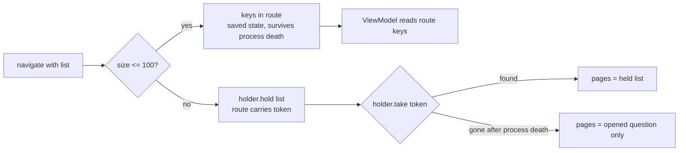

In October a viewer route in my quiz app carried 1,611 question keys, and Android threw `TransactionTooLargeException` every time the app went to the background with that viewer open. Six months earlier, in April, a quiz route carrying a few dozen keys had overflowed the stack on iOS. Same habit, two platforms. Google Play's pre-launch test robots found the Android one, inside a crash-rate alarm that contained zero real users.

## Why the lists were in the routes

The app is built with Compose Multiplatform: one Kotlin codebase for Android and iOS, with JetBrains' multiplatform Navigation Compose (2.9.2 at both fixes) and type-safe routes. In April the build was on Compose Multiplatform 1.10.2 and Kotlin 2.3.10. By October it was on 1.12.1 and 2.4.21.

A type-safe route is a `@Serializable` data class, so putting a `List<QuestionKey>` in it felt natural. "Retry the questions you got wrong" took the wrong ones. "Open this question" took the question plus its neighbors, so you could swipe through the list you came from.

The route gets serialized, and its arguments end up in the back stack entry's saved state. Both costs grow with the list. I knew that much, but I had no idea how long a list it took to hit a limit.

## April: the route URI blew a recursive regex

The first crash was on iOS, in the wrong-answer retry quiz. I traced it to how the route got parsed. On Kotlin/Native, Navigation Compose matches the route URI with a regex, and the regex engine there is recursive, so a long URI means deep recursion. The overflow started at around 26 keys.

I moved the keys into an in-memory object and left the route with one boolean that said "read your keys from the store". The view model consumed the store once on creation.

In the same commit I fixed another regex. The app turns statute references in explanation text into links, and that detector used a lookbehind plus unbounded quantifiers (`\s*`, `\d+`). On a recursive engine every character a quantifier consumes costs a frame, and explanation text can be long. I bounded the quantifiers (`\s{0,5}`, `\d{1,6}`) and replaced the lookbehind with a plain Kotlin check of the preceding character after the match. Each match now has a capped depth however long the input gets.

I fixed only the route that crashed. The other routes that carried lists, the question viewer among them, kept them. The store was also a single nullable slot. After process death the restored route still said "read from the store", the store was empty, and the view model's fallback (`consume() ?: emptyList()`) handed the quiz an empty list. Nothing in that change handled process death.

## October: a crash-rate alarm with no users in it

Play lowers store visibility for apps whose user-perceived crash rate goes over 1.09% across a 28-day window. It doesn't publish that rate for apps with few users, and mine almost always fall into that bucket. So I run a script that recomputes the ratio from my own data: daily Crashlytics-affected users divided by Android daily active users from analytics.

On October 22 it flagged two apps built from this codebase:

| app | crash rate (proxy) | crashed / user-days | threshold | real users among crashes |
|---|---|---|---|---|
| A | 1.61% | 4 / 249 | 1.09% | 0 |
| B | 2.38% | 1 / 42 | 1.09% | 0 |

The Crashlytics events REST endpoint returned an empty object for me, so I got the last column from the BigQuery export. This query lists the device for each fatal event:

```sql
SELECT DATE(event_timestamp, 'Asia/Seoul') AS day,
       application.display_version AS version,
       device.model AS model,
       SUBSTR(installation_uuid, 1, 8) AS install,
       SUBSTR(issue_title, 1, 40) AS issue
FROM `my-project.firebase_crashlytics.my_app_ANDROID`
WHERE event_timestamp >= TIMESTAMP('2026-09-19')
  AND error_type = 'FATAL'
ORDER BY event_timestamp
```

Every fatal event in the window came from Play's pre-launch report devices: `sdk_gphone64_arm64` emulators and one OnePlus 8 Pro, each with a fresh installation ID on a release day. Crashlytics doesn't separate test devices from users. On an app with a few dozen users, a handful of robots is enough to cross the line.

I could have closed the alarm as noise. But a robot that crashes the same way on every release is walking a path a real user can walk, so I looked at what the robots were hitting. They were reproducing two real crashes.

## 1,611 keys in one saved state

The first was the `TransactionTooLargeException`, present from version 2.2.92 through 2.2.97. The path was the search screen with no filter applied. With nothing filtered, the search list is the whole corpus, and opening any question from it put every key in the corpus into the viewer route.

Each key cost about 370 bytes of saved state, counting the route argument and its copy in `SavedStateHandle`, so the total grew with the corpus:

| case | keys in route | saved state |
|---|---|---|
| app with the larger corpus, unfiltered search | 1,611 | ~581 KB |
| app with the smaller corpus, unfiltered search | 1,409 | ~541 KB |
| after the fix, largest list still in the route | 100 | ~37 KB (estimate at ~370 B/key) |

With the viewer on the back stack, the next trip to the background (sharing to a messenger, pressing home) made the activity save its state, and Android threw `TransactionTooLargeException` out of `activityStopped`. A filtered list was never big enough to trigger it.

## Splitting lists at 100 keys

The quick fix was to repeat April: put the list in memory, pass a flag. That would have brought back the empty list after process death, so this time I split lists by size.

Lists of 100 keys or fewer still ride in the route. At about 370 bytes a key that's roughly 37 KB, well under the limit, and they survive process death like any other saved state. Most lists in the app are that size. Wrong-answer notes and quiz results rarely go past 100.

Longer lists go into a small in-process holder, and the route carries a token instead:



The holder and the view model's read look like this:

```kotlin
object HeldLists {
    private const val MAX_HELD = 8
    private val held = LinkedHashMap<Long, List<Key>>()

    fun hold(keys: List<Key>): Long {
        val token = Random.nextLong(0, Long.MAX_VALUE)
        held[token] = keys
        while (held.size > MAX_HELD) held.remove(held.keys.first())
        return token
    }

    fun take(token: Long): List<Key>? = held.remove(token)
}

// In the viewer's ViewModel
val pages = routeKeys.takeIf { it.isNotEmpty() }
    ?: token.takeIf { it != NO_TOKEN }
        ?.let { HeldLists.take(it) ?: listOf(openedKey) }
    ?: emptyList()
```

I made the token random because a restored route still carries its old token after process death. A counter that restarts at 0 in the new process could hand that restored viewer a newer, unrelated list. A random 63-bit value is very unlikely to collide with anything the new process holds.

The holder keeps at most eight entries and drops the oldest. Without that cap, a list whose viewer never got created (popped before composition, say) would stay in memory for the life of the process.

When the token resolves to nothing, which is what happens after process death, the viewer shows the question it was opened on, alone. That's the trade-off I took: for a long list, process death loses the swipe list, and the app keeps running. I chose not to put long lists into saved state in any form, because saved state is what overflowed.

Host tests pin each of these. A held token gives the viewer its pages and leaves nothing in the holder after the read. An unknown token, the process-death case, gives a single page on the opened question. Holding nine lists drops the first one.

## A RenderScript context released twice

The robots also reproduced `RSInvalidStateException: Object already destroyed` on API 30 and below. On old devices the blur effect uses RenderScript through code vendored from the Haze library. When a blur node detached, its cleanup released the RenderScript context but kept the reference, and the next size change released it again. Upstream Haze already nulls the context after release, so I did the same and made `release()` idempotent. The regression test fails with the production exception when the guard is removed.

## Before and after

| | before | after |
|---|---|---|
| keys in the viewer route, unfiltered search | 1,611 / 1,409 (whole corpus) | 0 plus one `Long` token |
| list after process death, ≤100 keys | restored | restored |
| list after process death, >100 keys | n/a: the app crashed on backgrounding | opened question only |

## Auditing routes instead of one route

A type-safe route looks like a function call, so it's tempting to pass whatever the next screen needs. It's also a URI that gets parsed and a record that gets parcelled across a process boundary, and iOS and Android each have their own limit on how big that can get. In April I fixed the route that crashed. I should have treated lists in routes as the bug and gone through every route that carried one. Six months later the viewer route I'd skipped crashed on Android.

My first reaction to "every crash is a robot" was relief. Now, before I judge a crash-rate alarm, I run the device query above, and robot crashes go into the backlog with the others.
