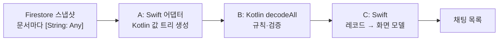

새로 만든 공용 Kotlin 경로에서 첫 500건 채팅 스냅샷의 디코딩 p95가 24.8~28.4ms였다. 예산은 포팅 전에 적어 뒀다. 옛 Swift 경로보다 느리면 안 되고 16ms도 넘으면 안 된다. 두 번째 스냅샷부터는 1.0ms 안팎으로 떨어졌고, 나는 첫 스냅샷 초과를 기록에 남긴 채 출시했다.

## Codable 한 번이 세 단계로 나뉘었다

앱은 Firestore 위에서 도는 2인 채팅이다. iOS 앱이 먼저 있었고 Android 앱은 나중에 만들었다. 두 앱은 업무 규칙과 데이터 파싱을 Kotlin Multiplatform 모듈 하나에서 같이 쓴다. 이 모듈에는 내가 정한 규칙이 있다. Android에도 필요한 일이면 공용 코드에 두고 네이티브에는 렌더링과 얇은 SDK 호출만 남긴다. 속도 때문에 Swift에 로직을 남기려면 브리지가 화면 예산을 깬다는 측정값이 있어야 한다. 그때도 규칙을 Swift로 다시 베끼기보다 호출 모양을 바꾸는 쪽을 먼저 본다.

옮길 것 중 가장 큰 덩어리가 채팅 디코딩이었다. Firestore iOS SDK는 문서마다 `[String: Any]`를 넘겨준다. 옛 경로는 이 맵에 Swift `Codable`을 돌려 화면 모델을 만들었다. 새 경로는 이 일을 셋으로 나눈다.



세 단계 모두 메인 스레드 밖의 직렬 큐에서 돈다. 스냅샷이 느리면 채팅방 첫 화면이 늦게 뜰 뿐 스크롤 프레임은 끊기지 않는다.

## 연결하기 전에 옛 경로부터 쟀다

플랜의 첫 작업은 포트를 하나도 연결하지 않은 상태에서 옛 경로를 재는 일이었다. 실제 문서와 모양이 같은 500건짜리 픽스처를 만들었고 돌릴 때마다 같은 데이터가 나오게 했다. 글이 60%, 메타데이터 키가 40개쯤 붙은 사진이 15%다. 나머지는 음성·링크·장소·미리보기·파일이고 `createdAt`은 마이크로초 단위까지 넣었다. 벤치는 런치 변수로만 켜지는 디버그 전용이다. 워밍업 5회 뒤 50회를 돌고 이를 앱 실행 세 번에 걸쳐 반복한다. 단계별 p50/p95는 앱 Documents 폴더의 JSON 파일로 떨어진다.

시간을 재는 루프는 이렇게 생겼다.

```swift
func measure(runs: Int, warmup: Int = 5, _ body: () -> Void) -> (p50: Double, p95: Double) {
    let clock = ContinuousClock()
    var samples: [Double] = []
    for i in 0 ..< (runs + warmup) {
        let start = clock.now
        body()
        let d = (clock.now - start).components
        guard i >= warmup else { continue }
        samples.append(Double(d.seconds) * 1000 + Double(d.attoseconds) / 1e15)
    }
    samples.sort()
    func pct(_ f: Double) -> Double { samples[min(samples.count - 1, Int(Double(samples.count) * f))] }
    return (pct(0.5), pct(0.95))
}
```

측정은 이 세션에만 쓰는 시뮬레이터(iPhone 17 Pro, iOS 26.5)에서 했다. Debug 설정에 Swift `-O`를 켰고 Kotlin 프레임워크는 Release로 빌드했으며 발열 상태는 nominal이었다. 그날 iPhone 13에 개발 빌드를 깔면 이미 설치된 테스트 빌드를 덮어써야 했다. 그래서 실기기는 건드리지 않고 플랜에 단서부터 적었다. 시뮬레이터는 Mac CPU로 돌아서 목표 기기보다 빠르니 16ms 판정은 낙관적인 값이다.

옛 Swift 경로는 p50 15.47~15.62ms였다. 그런데 A 단계 하나가 p50 10.95~11.14ms를 썼다. Firestore 맵을 Kotlin 값 트리로 바꾸기만 하는 단계다. Kotlin이 필드 하나 읽기도 전에 옛 경로 전체 시간의 70% 정도가 나간 셈이다.

## 실패하면 할 일을 먼저 적었다

이 70%를 보고 게이트를 못 넘을 때 할 일을 순서대로 플랜에 적었다.

1. 증분 디코딩. 어댑터는 추가·수정된 문서와 지금의 id 순서만 넘긴다. Kotlin은 id → 레코드 맵을 들고 있다가 바뀌지 않은 레코드를 같은 인스턴스로 돌려준다.
2. 레코드 인스턴스 → 화면 모델 캐시를 Swift 쪽에 둔다. 범위는 지금 보이는 창이다.
3. 그래도 넘으면 멈추고 숫자를 보고한다. 첫 스냅샷만 넘는지 매번 넘는지 나눠서 적는다.

규칙을 Swift로 되돌리는 안은 목록에 없었다. 포트를 다시 설계하는 안도 없었다. 나중에 숫자가 예산을 넘겨 나왔을 때 따질 거리가 하나도 없었는데, 이게 생각보다 큰 도움이 됐다.

## 24.8~28.4ms를 단계별로 나눠 봤다

Task 6에서 전체 경로를 연결하고 모든 단계를 한 회차 안에서 쟀다. 옛 경로와 새 경로가 같은 시뮬레이터와 같은 발열 상태에서 비교된다. 범위는 앱 실행 세 번의 최솟값과 최댓값이다.

| 단계 (500건, ms) | p50 | p95 |
|---|---|---|
| S: 옛 Swift 경로 | 14.4~15.3 | 15.2~18.4 |
| A: Firestore 맵 → Kotlin 값 트리 | 10.3~10.7 | 11.2~12.8 |
| B: Kotlin `decodeAll` | 9.1~9.6 | 9.7~10.8 |
| C: 레코드 → 화면 모델 | 4.0~4.2 | 4.5~7.0 |
| N = A+B+C, 첫 스냅샷 | 23.4~24.5 | 24.8~28.4 |

게이트 조건은 N의 p95 ≤ min(S p95, 16)이었다. 목표는 많아야 16ms였고 결과는 24.8~28.4ms였다. 실패다.

Kotlin 규칙이 도는 B는 전체의 절반이 안 된다. 가장 큰 단계는 A다. A가 하는 일은 Firestore 값 하나하나를 Kotlin 객체로 감싸는 것뿐이다. 시간 대부분은 아마 이 감싸는 객체를 할당하는 데 들 것이다. 나중에 옮긴 낙서 기능은 문서마다 정수가 수천 개씩 들어 있는데, 남은 비용의 80% 정도가 바로 이 감싸기 단계에서 나왔다.

## 바뀐 문서만 다시 디코딩한다

옛 Swift 경로는 스냅샷 내용이 바뀔 때마다 창 전체를 다시 디코딩했다. 새 메시지가 하나만 와도 15~18ms짜리 전체 디코딩을 또 돌았다. Firestore 리스너는 바뀐 문서를 `documentChanges`로 이미 알려 준다. 첫 번째 대응은 이걸 썼다. 공용 코드는 창을 맵으로 들고 바뀐 문서만 디코딩한다.

```kotlin
class Window<R : Any>(private val decode: (Doc) -> R?) {
    private val byId = HashMap<String, R>()

    fun full(docs: List<Doc>): List<R> {
        byId.clear()
        return docs.mapNotNull { d -> decode(d)?.also { byId[d.id] = it } }
    }

    fun delta(order: List<String>, changed: List<Doc>, removed: List<String>): List<R> {
        removed.forEach { byId.remove(it) }
        changed.forEach { d -> decode(d)?.let { byId[d.id] = it } ?: byId.remove(d.id) }
        if (byId.size > order.size) byId.keys.retainAll(order.toSet())
        return order.mapNotNull { byId[it] }
    }
}
```

바뀌지 않은 레코드는 같은 객체로 돌아온다. 그래서 두 번째 대응에서는 Swift 캐시의 키를 `ObjectIdentifier(record)`로 잡았다. 이때 캐시는 변환한 메시지 옆에 레코드도 강한 참조로 함께 들고 있어야 한다. 식별자만 저장하면 해제된 레코드의 주소를 새 레코드가 물려받아 엉뚱한 항목이 맞을 수 있다.

두 대응을 넣은 뒤 메시지 하나가 추가된 스냅샷을 쟀다. 문서 1건을 변환하고 반영하고 화면 모델로 바꾸는 데 p50 0.78~0.82ms, p95 1.00~1.07ms가 걸렸다. 게이트 안쪽으로 한참 들어온다. 첫 스냅샷은 조금도 나아지지 않았다. 처음 불러올 때는 모든 문서가 새 문서다.

## 세 번째 대응에서 멈췄다

플랜대로 일하던 코딩 에이전트가 세 번째 대응에서 멈추고 플랜이 정한 형식으로 숫자를 보내왔다. 첫 500건 스냅샷은 시뮬레이터에서 25~28ms쯤으로 예산을 넘고 메인 스레드 밖에서 돈다. 그 뒤 스냅샷은 모두 1ms 정도다. 선택지도 두 개 붙어 있었다. 하나는 초과를 받아들이고 전환 작업으로 넘어가는 것이다. 다른 하나는 첫 스냅샷을 더 줄이는 것인데, 대상은 11ms 안팎인 A와 9.5ms 안팎인 B였다. 규칙을 Swift로 옮기지 않는다는 조건은 이때도 그대로였다.

나는 초과를 받아들였다. 판단 근거는 이미 기록에 있던 숫자였다. 이 비용은 채팅방을 열 때 한 번 백그라운드 큐에서 든다. 옛 Swift 경로도 같은 일에 p95 15.2~18.4ms를 썼으니 16ms 아래에서 여유가 있던 것도 아니다. 두 번째 스냅샷부터는 전보다 훨씬 싸졌다. A를 줄이려면 포트의 값 표현을 바꿔야 했는데, 이번 단계에서 하기로 한 일보다 큰 설계 변경이었다.

전환 커밋에서 Swift DTO와 옛 디코더를 지웠다. 이 포트는 다음 TestFlight 빌드에 실려 나갔다. 지표 항목에는 지금도 첫 스냅샷 예산 초과·수용·시뮬레이터 측정이라고 적혀 있다.

남은 Swift `Codable` 타입을 옮긴 다음 플랜도 멈추고 보고하되 포트를 바꾸거나 Swift로 되돌리지 않는다는 규칙을 다시 적고 이 게이트를 가리켰다. 이 규칙은 낙서 기능에서 한 번 더 걸렸다. 새 경로가 옛 경로보다 빨랐지만(첫 스냅샷 p95 153~213ms, 옛 경로 312~362ms) 16ms는 넘지 못했다. 이번에도 판단은 계획에 없던 재작성으로 흘러가지 않고 나에게 돌아왔다.

## iPhone 13에서 브리지 비용을 쟀다

같은 날 오후 그보다 먼저 다른 걱정 하나를 재 봤다. Kotlin을 부르는 일 자체에 드는 비용이다. 안 읽은 메시지 수와 '여기까지 읽었어요' 구분선 규칙이 공용 코드로 옮겨졌는데, 이 규칙은 화면에 보이는 채팅 줄을 입력으로 받는다. 500줄을 브리지 너머로 넘기는 데 오래 걸리면 줄 변환 캐시를 넣을 생각이었다.

이 측정은 iPhone 13(iOS 26.7)에서 했다. `-O` 개발 빌드와 Kotlin Release 빌드로 앱을 세 번 실행했고 실행마다 200번씩 돌렸다. `xctrace`가 기기를 오프라인으로 봐서 Instruments로는 기록을 남기지 못했다. 그래서 앱 안에서 signpost 구간을 `ContinuousClock`으로 쟀다.

| 호출, 500줄, iPhone 13 | p50 (ms) | p95 (ms) | 예산 |
|---|---|---|---|
| 안 읽은 수 | 0.26~0.29 | 0.29~0.31 | 2 |
| 안 읽은 구분선 | 0.38~0.43 | 0.41~0.46 | 2 |

시간 대부분은 Swift 줄을 공용 줄 타입으로 바꾸는 데 들었고 줄당 0.8µs 정도였다. Kotlin 규칙 자체에 드는 시간은 작았다. 캐시는 만들지 않았다. 디코딩 숫자와 나란히 보면 브리지를 건너는 일은 쌌다. 시간을 잡아먹은 건 Kotlin 쪽에 큰 객체 그래프를 만드는 일이었다.

## 보관본은 값마다 태그 키 하나로 바꿨다

전환 작업에서 디스크에 저장하는 전체 채팅 기록 보관본도 바뀌었다. Kotlin 값을 Swift `JSONEncoder`로 넘기려고 합성 `Codable`을 쓰는 enum을 뒀었다. Swift는 이름 없는 연관값을 가진 케이스를 `{"string":{"_0":"…"}}`처럼 인코딩한다. 값 하나에 두 겹이 씌워진다. 보관본 벤치를 따로 만든 뒤 값마다 태그 키 하나만 쓰는 `{"s":"…"}` 형식으로 바꿨다.

| 메시지 5,000건, 시뮬레이터 | v2 (합성 Codable) | v3 (태그 키 하나) |
|---|---|---|
| JSON 크기 | 6.25 MB | 4.46 MB |
| 압축 크기 | 409~410 KB | 367~370 KB |
| 저장 p50 | 342~357 ms | 268~277 ms |
| 저장 p95 | 363~398 ms | 283~303 ms |
| 복원 p50 | 402~413 ms | 384~402 ms |

저장은 p50 기준으로 21% 줄었다. p95는 283~303ms라 예산 300ms 선에 걸쳤고 실행 한 번은 살짝 넘었다. 복원은 3% 움직였다. 나는 5% 미만을 잡음으로 보기 때문에 효과 없음으로 기록했다.

## 마치며

이 포팅을 다시 한다면 플랜을 짜기 전에 A 단계만 따로 픽스처로 재 보겠다. 변환 단계 하나가 옛 경로의 70%를 쓴다는 사실이 진짜 제약이었고 그 뒤는 거기서 따라 나왔다. 이 숫자를 더 일찍 봤다면 큰 문서에 맞는 더 평평한 값 표현을 처음부터 설계했을지도 모른다. 실제로는 같은 날 저녁 낙서 기능에서야 그 필요를 알았다.

게이트와 대응 순서는 다음에도 첫 측정 전에 적는다. 언제 멈추는지와 무엇을 보고하는지까지 적어 둔다. 다음 플랜도 이미 거기서 시작한다.

Kotlin 규칙이 Swift 앱의 실제 동작과 같은지 어떻게 확인했는지는 [다른 글](/ko/posts/swift-source-as-kotlin-test-oracle/)에 적었다.
