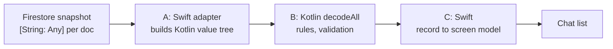

Through the new shared Kotlin path, the first 500-message chat snapshot decoded in 24.8 to 28.4 ms at p95. I'd written the budget before the port: no slower than the old Swift path, and no slower than 16 ms. Every snapshot after the first dropped to about 1.0 ms, and I shipped with the first-snapshot overage on the record.

## Three stages where Codable used to be

The app is a two-person chat on Firestore with an iOS client and a newer Android client. Both share one Kotlin Multiplatform module for business rules and data parsing. My rule for that module: anything Android also needs goes in shared code, and native code keeps only rendering and thin SDK calls. Logic may stay in Swift for speed only when a measurement shows the bridge breaks a screen budget, and even then I'd rather change the shape of the call than copy the rule back into Swift.

Chat decoding was the largest piece to move. Firestore's iOS SDK hands the app a `[String: Any]` per document, and the old path ran Swift `Codable` over that map to produce the screen model. The new path splits the work in three:



All three run on a serial queue off the main thread. A slow snapshot delays the chat's first paint. Scrolling doesn't drop frames.

## A baseline before any wiring

The plan's first task was to time the old path before any of the port was connected. I built a deterministic fixture of 500 documents shaped like real ones: 60% text, 15% photos with about 40 metadata keys each, plus voice, links, places, previews and files, with `createdAt` at microsecond precision. A debug-only benchmark, switched on by a launch variable, decoded the fixture 50 times after 5 warm-up runs, over three separate launches, and wrote p50/p95 per stage to a JSON file in the app's Documents folder.

The timing loop looks like this:

```swift
func measure(runs: Int, warmup: Int = 5, _ body: () -> Void) -> (p50: Double, p95: Double) {
    let clock = ContinuousClock()
    var samples: [Double] = []
    for i in 0 ..< (runs + warmup) {
        let start = clock.now
        body()
        let d = (clock.now - start).components
        guard i >= warmup else { continue }
        samples.append(Double(d.seconds) * 1000 + Double(d.attoseconds) / 1e15)
    }
    samples.sort()
    func pct(_ f: Double) -> Double { samples[min(samples.count - 1, Int(Double(samples.count) * f))] }
    return (pct(0.5), pct(0.95))
}
```

I ran it on a simulator reserved for this session (iPhone 17 Pro, iOS 26.5): Debug configuration with Swift `-O`, the Kotlin framework built in Release, thermal state nominal. Putting a development build on my iPhone 13 that day would have overwritten the test build installed there, so I left the phone alone and wrote the caveat into the plan up front. The simulator runs on the Mac's CPU, which is faster than the target phone, so any verdict against 16 ms is optimistic.

The old Swift path took p50 15.47 to 15.62 ms. Stage A on its own, which only converts Firestore's maps into the Kotlin value tree, took p50 10.95 to 11.14 ms. That's about 70% of the whole old path spent before Kotlin had read a field.

## The fallback order, fixed in advance

Because of that 70%, I wrote into the plan what would happen if the gate failed, in order:

1. Incremental decoding: the adapter passes only added and modified documents plus the current order of IDs, and Kotlin keeps an id-to-record map, so unchanged records come back as the same instances.
2. A Swift cache from record instance to screen model, scoped to the current window.
3. If it still fails, stop and report the numbers, saying whether only the first snapshot fails or every snapshot does.

Moving the rules back into Swift wasn't on the list. Neither was redesigning the port. When the number came in over budget, there was nothing left to argue about, and that helped more than I'd expected.

## 24.8 to 28.4 ms, stage by stage

In Task 6 I wired the full path and timed every stage in the same run, so the old and new paths shared a simulator and a thermal state. Ranges are across the three launches:

| Stage (500 docs, ms) | p50 | p95 |
|---|---|---|
| S: old Swift path | 14.4–15.3 | 15.2–18.4 |
| A: Firestore map to Kotlin value tree | 10.3–10.7 | 11.2–12.8 |
| B: Kotlin `decodeAll` | 9.1–9.6 | 9.7–10.8 |
| C: record to screen model | 4.0–4.2 | 4.5–7.0 |
| N = A+B+C, first snapshot | 23.4–24.5 | 24.8–28.4 |

The gate was p95 of N at or below min(S p95, 16). The target was at most 16 ms and the result was 24.8 to 28.4. It failed.

The Kotlin rules in B are under half the total. A is the largest stage, and all it does is wrap every Firestore value in a Kotlin object. Most of that cost is probably the allocation of those wrappers. A drawing feature I ported later, whose documents carry thousands of integers, spent about 80% of its remaining cost in that same wrapping step.

## Decoding only what changed

The old Swift path re-decoded the whole window every time the snapshot's content changed, so one new message cost another full 15 to 18 ms pass. Firestore's listener already reports which documents changed through `documentChanges`, and the first fallback used it. The shared code keeps the window as a map and decodes only the changes:

```kotlin
class Window<R : Any>(private val decode: (Doc) -> R?) {
    private val byId = HashMap<String, R>()

    fun full(docs: List<Doc>): List<R> {
        byId.clear()
        return docs.mapNotNull { d -> decode(d)?.also { byId[d.id] = it } }
    }

    fun delta(order: List<String>, changed: List<Doc>, removed: List<String>): List<R> {
        removed.forEach { byId.remove(it) }
        changed.forEach { d -> decode(d)?.let { byId[d.id] = it } ?: byId.remove(d.id) }
        if (byId.size > order.size) byId.keys.retainAll(order.toSet())
        return order.mapNotNull { byId[it] }
    }
}
```

Unchanged records come back as the same objects, so the second fallback on the Swift side keys its cache on `ObjectIdentifier(record)`. The cache also holds a strong reference to the record next to the converted message. With only the identifier stored, a new record could get a freed record's address and hit a stale entry.

With both in place, a snapshot that adds one message (one document converted, applied, and mapped) measured p50 0.78 to 0.82 ms and p95 1.00 to 1.07 ms, well inside the gate. The first snapshot gained nothing, since on first load every document is new.

## Stop and report

The coding agent working through the plan stopped at step three and sent me the numbers in the shape the plan asked for. The first 500-message snapshot was over budget, roughly 25 to 28 ms on the simulator, off the main thread. Every later snapshot was about 1 ms. It gave me two options: accept the overage and continue with the switch-over, or go after the first snapshot, where A at about 11 ms and B at about 9.5 ms were the targets, still without moving rules into Swift.

I accepted, based on numbers already on the record. The cost lands once per chat open, on a background queue. The old Swift path was already at 15.2 to 18.4 ms p95 for the same work, so it hadn't been comfortably under 16 either. Every snapshot after the first got much cheaper than before. Shrinking A meant changing the port's value representation, which was a bigger design change than this step was meant to carry.

The switch-over commit deleted the Swift DTOs and the old decoder, and the port went out in the next TestFlight build. The metric entry still reads: first snapshot over budget, accepted, measured on the simulator.

The next plan, for the remaining Swift `Codable` types, repeated the "stop and report, don't swap the port, don't revert to Swift" rule and pointed back to this gate. The rule fired again on the drawing feature. Its new path beat the old one (first snapshot p95 153 to 213 ms against 312 to 362 ms) but still missed 16 ms, and the decision came back to me instead of turning into an unplanned rewrite.

## Timing the bridge on an iPhone 13

Earlier that afternoon I'd measured a different worry: the cost of calling into Kotlin at all. The unread-count and "read up to here" rules had moved to shared code, and they take the visible chat lines as input. If passing 500 lines across the bridge was slow, the plan was to add a conversion cache.

This one ran on the iPhone 13 (iOS 26.7, development build with `-O`, Kotlin Release, 3 launches of 200 iterations). `xctrace` saw the device as offline and Instruments wouldn't record, so I timed the signpost intervals in-app with `ContinuousClock`:

| Call, 500 lines, iPhone 13 | p50 (ms) | p95 (ms) | budget |
|---|---|---|---|
| unread count | 0.26–0.29 | 0.29–0.31 | 2 |
| unread divider | 0.38–0.43 | 0.41–0.46 | 2 |

Most of that time went into converting Swift lines into the shared line type, about 0.8 µs per line. The Kotlin rules themselves cost little, and I didn't build the cache. Next to the decode numbers, crossing the bridge was cheap. Building a large object graph on the Kotlin side was what cost time.

## One tag key per archived value

The switch-over also changed the on-disk chat history archive. To carry Kotlin values through Swift's `JSONEncoder` I'd used an enum with synthesized `Codable`. Swift encodes a case with an unlabeled associated value as `{"string":{"_0":"…"}}`, two levels of nesting per value. I added a benchmark for the archive and switched to a single tag key per value, `{"s":"…"}`:

| 5,000 messages, simulator | v2 (synthesized) | v3 (one tag key) |
|---|---|---|
| JSON size | 6.25 MB | 4.46 MB |
| compressed size | 409–410 KB | 367–370 KB |
| save p50 | 342–357 ms | 268–277 ms |
| save p95 | 363–398 ms | 283–303 ms |
| restore p50 | 402–413 ms | 384–402 ms |

Save dropped 21% at p50. Its p95 of 283 to 303 ms sits on the 300 ms budget line, with one launch just over. Restore moved 3%, under the 5% I treat as noise, so I logged it as no effect.

## Time stage A before writing the plan

If I did this port again, I'd time stage A alone on the fixture before planning anything. One conversion step costing 70% of the old path was the real constraint, and the rest followed from it. With that number earlier, I might have designed a flatter value representation for large documents from the start. As it was, I ran into that need on the drawing feature the same evening.

The gate and the fallback order I'd write the same way, before the first measurement, with the stop condition and the report format spelled out. The next plan already starts from them.

How I checked that the Kotlin rules match what the Swift app actually does is in [a separate post](/posts/swift-source-as-kotlin-test-oracle/).
