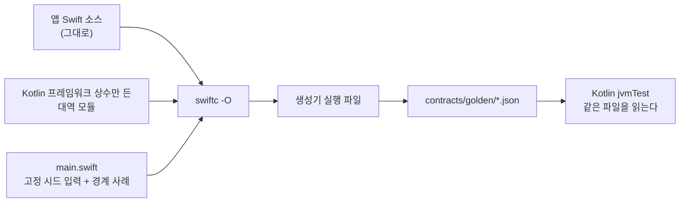

Swift에서 0.3초를 0.1초짜리 칸으로 나누면 2.9999999999999996이 나온다. 여기에 `floor`를 씌우면 300ms에 친 탭은 2번 칸에 들어간다. 내 Kotlin 포트는 밀리초 정수로 `300 / 100`을 계산해서 3번 칸에 넣었다. 산수는 Kotlin이 맞았다. 그런데 iPhone 앱은 이미 다른 답으로 출시돼 있었고, 2인 대결 게임이라 두 폰이 같은 칸을 골라야 했다. 결국 Kotlin을 Swift 방식으로 고쳤다.

이 불일치를 포함해 여덟 군데가 한꺼번에 드러난 건 테스트 기대값을 만드는 방식을 바꾼 뒤였다. Swift 코드를 읽고 기대값을 적는 대신 Swift 코드 자체를 컴파일해서 뽑았다.

## 규칙마다 구현이 두 벌이었다

앱은 Swift로 만든 iOS 앱과 나중에 만든 Android 앱으로 나뉜다. 공용 규칙은 Kotlin Multiplatform 모듈에 두고 iOS 앱이 그걸 부른다. 원래는 모든 규칙을 그렇게 둘 생각이었다. 하지만 Android를 만드는 사이 몇몇 화면 규칙은 Kotlin으로 새로 쓰였고 iPhone 앱은 여전히 자기 Swift 판을 돌렸다. 탭 대결 게임의 규칙과 전적, 마을 화면의 슬롯, 앱 잠금 정책, 앱 안 위키의 마크업 파서가 그랬다.

두 벌이 같은 답을 내는지 보는 테스트는 없었다. Swift 쪽에는 테스트가 아예 없었다. 예전에 정한 대로 Swift는 CI에서 돌리지 않고 계약 파일과는 리뷰로만 맞춘다. Kotlin 단위 테스트는 내가 이해한 규칙을 확인할 뿐이었다.

같은 데이터를 보는 Android 사용자와 iPhone 사용자가 같은 결과를 봐야 했다. 그러려면 한쪽을 기준으로 삼는 테스트가 있어야 한다. 나는 이미 사용자 손에 있는 Swift 구현을 기준으로 골랐다. 설계 문서에도 규칙으로 적었다. 둘이 다르면 Kotlin을 고치고 차이를 기록한다.

## 손으로 옮긴 기대값

프로젝트에는 골든 파일이 이미 있었다. `cases` 배열의 사례마다 `input`과 `expected`를 담은 JSON이고 Kotlin 테스트가 읽는다(서버 쪽은 Node가 읽는다). 앞선 이전 작업의 기대값은 일부가 Swift 출력이었고 나머지는 경계 조건까지 Swift 규칙을 손으로 옮긴 것이었다.

손으로 옮긴 사례에는 내가 떠올린 입력과 내가 믿은 답만 들어간다. 포팅에서 문제가 되는 건 언어가 내 생각과 다르게 움직이는 자리다. 부동소수점 나눗셈이 그렇고 무엇을 공백으로 치는지, `split`이 빈 조각을 어떻게 다루는지도 그렇다. 다르다는 걸 몰랐으니 손으로 적을 수도 없었다. 다른 골든 묶음에 작은 예가 하나 있다. 그 생성기에는 손으로 넣은 기대 배열 `[0,0,0,1]`이 있었는데 Swift 규칙은 그 사례에서 `[1,1,1,0]`을 낸다.

## 앱의 Swift를 그대로 컴파일하고 Kotlin은 대역으로

생성기는 셸 스크립트 하나와 Swift `main.swift` 하나로 되어 있다. 앱 코드를 복사하지 않는다. 앱의 실제 소스 파일을 `swiftc`에 그대로 넘기고 입력을 넣어 JSON을 쓰는 생성기와 함께 링크한다.



Xcode 프로젝트 밖에서 컴파일하려면 대역이 몇 개 필요했다.

- 앱의 Swift 파일은 Kotlin 프레임워크를 `import`한다. 그걸 빌드하는 대신 그 파일들이 읽는 상수(기본 체력, 판 수)만 선언한 작은 대역 모듈을 둔다. 로직은 넣지 않는다.
- 이름으로만 참조되는 타입은 한 줄짜리 대역으로 채운다.
- 함수 하나 때문에 앱 절반을 끌고 오는 파일이면 스크립트가 `awk`로 그 함수만 떼어 온다. 떼어 온 결과가 비어 있으면 바로 실패한다.

입력은 고정 시드 선형 합동 생성기에서 뽑고 손으로 고른 경계 사례를 더한다. 같은 Swift 코드는 늘 바이트까지 같은 JSON을 내니 Swift 쪽 회귀 검사도 덤으로 생긴다. 스크립트를 일반화해서 다시 쓰면 이렇다.

```bash
#!/bin/bash
set -euo pipefail
work="$(mktemp -d)"; trap 'rm -rf "$work"' EXIT

# 1. 앱이 import하는 Kotlin 프레임워크의 대역(상수만).
swiftc -parse-as-library -emit-library -static -emit-module \
  -module-name SharedKit -o "$work/libSharedKit.a" \
  -emit-module-path "$work/SharedKit.swiftmodule" stub/SharedKitStub.swift

# 2. 실제 앱 소스와 생성기를 함께 컴파일.
swiftc -O -swift-version 6 -I "$work" -L "$work" -lSharedKit -o "$work/gen" \
  App/Domain/GameRules.swift App/Domain/LockPolicy.swift gen/main.swift

if [[ "${1:-}" == "--check" ]]; then
  mkdir "$work/out"; "$work/gen" "$work/out"
  for f in "$work/out"/*.json; do
    cmp -s "$f" "golden/$(basename "$f")" || { echo "mismatch: $(basename "$f")" >&2; exit 1; }
  done
  echo "goldens match"
else
  "$work/gen" golden
fi
```

Kotlin 쪽 헬퍼는 골든 파일을 읽어 모든 사례를 돌리고 실패를 다 모은 다음에 단언한다. 한 번 돌리면 불일치가 전부 보인다. 숫자는 값으로 비교한다. Swift `JSONSerialization`은 `0.33333333333333331`로 쓰는데 Kotlin은 가장 짧은 표기로 쓰기 때문이다.

## 맞지 않은 여덟 줄

두 벌로 돌던 규칙에 203사례를 만들었다. 게임 규칙 118, 게임 전적 37, 마을 슬롯 25, 앱 잠금 23이다. 마크업 파서는 60사례로 시작해 날짜 함수에 19사례를 더했다. 대부분은 첫 실행에서 맞았다. 맞지 않은 건 이 여덟 줄이다.

| 규칙 | Kotlin | Swift (출시본) | Kotlin 수정 |
|---|---|---|---|
| 탭 칸 번호 | `ms / 100` 정수 나눗셈 | `Double` 초로 `floor(초 / 0.1)` | 초를 `Double`로 나눈 뒤 내림 |
| 콤보 간격 ≤ 0.25초 | 밀리초 정수 차 | `Double` 초 차. 1.1 − 0.85는 0.25000000000000011이라 콤보가 끊긴다 | `Double` 초로 비교 |
| 마을 등불 id | 아무 위시 id나 | `UUID(uuidString:)`로 읽히는 id만, 대문자로 | 같은 판정, 대문자 |
| 마크업 줄 앞뒤 걷기 | ASCII 공백과 탭 | 유니코드 `Zs`와 탭(NBSP, 전각 공백) | 유니코드 공백 문자 |
| 구분 기호 | `Char` 하나씩 비교 | `Character` 단위 비교라 뒤에 결합 문자·ZWJ·이모지 수식자가 붙으면 기호가 아니다 | 문자소 단위 판정 |
| `[[|라벨]]`, `[[a||b]]` | 빈 조각 유지 | `split`은 기본으로 빈 조각을 버린다 | 빈 조각 버림 |
| 평문의 `\s` | JVM 정규식, ASCII만 | ICU, 유니코드 `White_Space` | 유니코드 공백 |
| 위키 일지 날짜 `2026-02-30` | 버림 | `Calendar.date(from:)`가 3월 2일로 넘긴다. 13월은 다음 해로, 0일은 전달 말일로 | 같은 방식으로 넘김 |

탭 칸 번호 줄에 걸린 값은 300, 600, 700, 2300ms였고 모두 Kotlin이 한 칸 앞섰다. 이름을 일반화한 핵심 변경은 이렇다.

```kotlin
const val SLOT_MS = 100L

// 전: 정확하지만 iPhone 앱과 다르다.
fun slotOld(elapsedMs: Long): Int = (elapsedMs / SLOT_MS).toInt()

// 후: Swift와 같은 Double 연산. 300ms -> 2.9999999999999996 -> 2번 칸.
fun slot(elapsedMs: Long): Int =
    if (elapsedMs < 0) -1 else kotlin.math.floor(elapsedMs / 1000.0 / (SLOT_MS / 1000.0)).toInt()
```

부동소수점 오차까지 일부러 따라 하는 게 처음엔 꺼림칙했다. 그래도 iPhone과 Android 폰이 같은 탭을 같은 칸에 넣어야 게임이 된다. 일지 날짜도 같은 판단이었다. 엄격하게 거르는 Kotlin 쪽이 더 낫다고 볼 수도 있지만 지금 iPhone 앱은 그런 날짜를 받는다.

## Kotlin을 일부러 망가뜨려 봤다

통과하는 모습만 본 골든 묶음은 믿기 어려웠다. 묶음을 만들 때마다 Kotlin 규칙에 돌연변이를 일부러 넣었다. 골든 테스트가 하나하나 실패하는지 본 뒤 되돌렸다. 게임·마을·잠금 규칙의 돌연변이 19개는 모두 잡혔고 마크업 파서는 7개 중 7개가 잡혔다. 일지 날짜를 옛 엄격한 동작으로 되돌려도 골든이 실패했다.

처음 고른 돌연변이 하나는 살아남았다. 특별전 규칙의 'D+1 문턱'을 옮기는 돌연변이였는데 알고 보니 동치 돌연변이라 어떤 출력도 바꿀 수 없었다. '아직 오지 않은 날은 거른다'는 필터를 없애는 돌연변이로 바꾸자 골든이 잡았다.

## 캐시에서 온 초록불과 1.1MB짜리 diff

테스트 태스크는 골든 디렉터리 경로를 시스템 프로퍼티로만 받고 있었다. Gradle 빌드 캐시는 선언된 입력으로 키를 만들고 문자열 프로퍼티는 그냥 문자열일 뿐이다. 그래서 골든 JSON만 고치고 테스트를 돌렸더니 아무것도 실행하지 않은 채 캐시에서 초록불이 나왔다. 디렉터리를 입력으로 선언하자 해결됐다.

```kotlin
tasks.withType<Test>().configureEach {
    val golden = rootDir.resolve("../contracts/golden")
    systemProperty("golden.dir", golden.absolutePath)
    inputs.dir(golden)
        .withPathSensitivity(PathSensitivity.RELATIVE)
        .withPropertyName("golden")
}
```

이 수정이 들어가기 전까지 하네스 README에는 `--rerun`을 붙이라고 적어 두었다.

게임 규칙 골든은 시뮬레이션한 판마다 칸별 탭 수를 담는다. `.prettyPrinted`를 켠 `JSONSerialization`은 배열 원소를 한 줄에 하나씩 쓴다. 파일이 1.1MB까지 커져 diff로는 리뷰할 수가 없었다. 생성기를 고쳐 스칼라만 든 배열은 한 줄로 접게 했다. 203사례와 값은 그대로이고 크기는 0.39MB로 줄었다. `--check`도 여전히 일치한다.

## Swift 판이 멈춘 뒤에는 커밋에 고정한다

이 방법은 iPhone 앱이 그 규칙의 Swift 판을 돌리는 동안만 통한다. 공용 Kotlin을 부르도록 바뀌면 작업 트리의 Swift 소스는 사용자에게 보이는 값을 더는 계산하지 않는다. 그때 거기서 골든을 다시 뽑으면 Kotlin을 Kotlin으로 테스트하게 된다.

앱 안 지식 그래프 규칙은 같은 날 조금 뒤에 공용 코드로 옮겼다. 그래서 이 규칙의 생성기는 작업 트리를 읽지 않는다. 이전 직전의 고정 커밋에서 `git show <커밋>:경로`로 Swift 파일을 꺼내 컴파일한다. 스크립트 머리 주석에는 이 스크립트가 처음 골든의 출처 기록이라고 적었다. 앞으로 동작을 바꿀 때는 골든 파일부터 고치고 그다음에 Kotlin을 고친다는 것도 함께 적었다. 손으로 넣은 `[0,0,0,1]`이 나온 곳도 이 추출 작업이었다. 출력은 두 번 뽑았고 두 결과는 비트까지 같았다. 이 규칙들은 대부분 `Double`로 하는 기하 계산이다. 그래서 Kotlin 테스트는 파일마다 상대 오차 한도를 따로 둔다. 한 묶음은 1e-6이고 나머지는 1e-4나 2e-4다.

## 하네스부터 만들었어야 했다

이전 작업을 다시 시작한다면 실제 소스를 컴파일하는 하네스를 중간이 아니라 맨 처음에 만들겠다. Swift 출력으로 만든 초기 골든은 첫 실행부터 Kotlin과 Node 모두와 맞았다. 손으로 옮긴 골든은 내가 코드를 읽은 만큼만 정확했다. 위 표의 줄 대부분은 내가 손으로 적지 못했을 것이다. 줄마다 숫자와 공백, 날짜가 무슨 뜻인지를 두고 Swift와 Kotlin이 말없이 어긋난 자리다.

규칙이 두 벌인 동안에는 생성기가 출시 중인 Swift를 컴파일하고 `--check`가 바이트 하나라도 바뀌면 실패한다. Kotlin 한 벌만 남으면 Swift 소스를 이전 직전 커밋에 고정하고 동작 변경은 골든 파일에서 시작한다.

같은 포트의 성능 쪽 이야기는 [다른 글](/ko/posts/kmp-chat-decode-performance-gate/)에 적었다. 공용 Kotlin 경로가 미리 정한 지연 관문을 넘지 못했는데도 출시한 과정이다.
