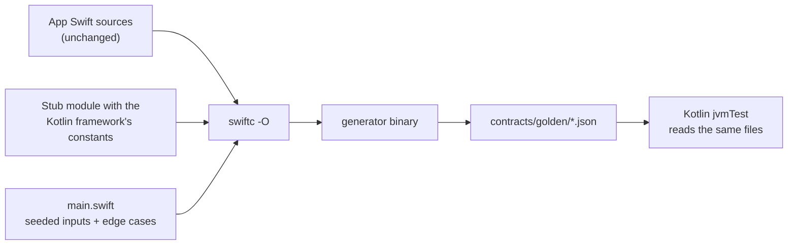

In Swift, 0.3 seconds divided by a 0.1-second slot is 2.9999999999999996, so `floor` puts a tap at 300 ms in slot 2. My Kotlin port used integer milliseconds, `300 / 100`, and put it in slot 3. Kotlin's arithmetic was right, but the iPhone app had already shipped the other answer. In a two-player game both phones have to agree on the slot, so I changed Kotlin to compute it the Swift way.

I found that mismatch and seven others after I stopped writing test expectations from my reading of the Swift code and started generating them by compiling the Swift code itself.

## Two copies of each rule, no test between them

The app has an iOS client in Swift and a newer Android client. Shared rules live in a Kotlin Multiplatform module that the iOS app calls into, and that was the plan for everything. During the Android build-out, though, some screen rules got written fresh in Kotlin while the iPhone app kept running its own Swift version: a tapping-battle game's rules and stats, the slots on a village screen, the app-lock policy, and the markup parser for the in-app wiki.

Nothing checked that the two copies agreed. The Swift side had no tests. By an earlier decision Swift doesn't run in CI and is matched to the contract files by review only. The Kotlin unit tests checked what I thought the rule was.

I wanted an Android user and an iPhone user looking at the same data to see the same result, which needs a test where one side is the reference. I picked the Swift implementation because users already had it, and wrote the rule into the design: when they differ, fix Kotlin and record the difference.

## Expectations I'd transcribed by hand

The project already had golden files. Each is JSON with `cases`, each case holding `input` and `expected`, and Kotlin tests read them (Node reads them for the server side). For earlier migrations, some of those expected values were Swift output and some were Swift rules I'd transcribed by hand, boundary conditions and all.

A transcribed case only holds the inputs I thought of, with the answers I believed. In a port the cases that matter are the ones where the language does something I hadn't considered: floating-point division, what counts as whitespace, how `split` treats empty pieces. I couldn't have written those by hand because I didn't know they were different. There's one small, direct example in another set of goldens. Its generator carried a hand-entered expected array, `[0,0,0,1]`, and the Swift rule computes `[1,1,1,0]` for that case.

## Compiling the app's Swift against a stubbed Kotlin framework

The generator is a shell script plus one Swift `main.swift`. It doesn't copy app code. It passes the app's own source files to `swiftc` and links them with a generator that feeds in inputs and writes JSON.



Getting the app's files to compile outside the Xcode project took some stubbing:

- The app's Swift files `import` the Kotlin framework. Instead of building it, a tiny stub module declares just the constants those files read (a base HP, a round count), with no logic.
- Types referenced only by name get one-line stubs.
- When one function lives in a file that drags in half the app, the script extracts only that function with `awk` and fails loudly if the extraction comes back empty.

Inputs come from a fixed-seed linear congruential generator plus hand-picked edge cases. The same Swift code always produces byte-identical JSON, so the goldens also work as a regression check on the Swift side. A rewritten, generic version of the script:

```bash
#!/bin/bash
set -euo pipefail
work="$(mktemp -d)"; trap 'rm -rf "$work"' EXIT

# 1. Stand-in for the Kotlin framework the app imports (constants only).
swiftc -parse-as-library -emit-library -static -emit-module \
  -module-name SharedKit -o "$work/libSharedKit.a" \
  -emit-module-path "$work/SharedKit.swiftmodule" stub/SharedKitStub.swift

# 2. Real app sources + the generator, compiled together.
swiftc -O -swift-version 6 -I "$work" -L "$work" -lSharedKit -o "$work/gen" \
  App/Domain/GameRules.swift App/Domain/LockPolicy.swift gen/main.swift

if [[ "${1:-}" == "--check" ]]; then
  mkdir "$work/out"; "$work/gen" "$work/out"
  for f in "$work/out"/*.json; do
    cmp -s "$f" "golden/$(basename "$f")" || { echo "mismatch: $(basename "$f")" >&2; exit 1; }
  done
  echo "goldens match"
else
  "$work/gen" golden
fi
```

On the Kotlin side, one helper reads a golden file, runs every case, and collects all failures before asserting, so one run lists every mismatch. It compares numbers by value because Swift's `JSONSerialization` writes `0.33333333333333331` where Kotlin writes the shortest form.

## Eight rows that didn't match

The two-copy rules got 203 cases: game rules (118), game stats (37), village slots (25) and app lock (23). The markup parser got 60 cases, then 19 more for a date function. Most rules matched on the first run. These didn't:

| Rule | Kotlin did | Swift (shipped) did | Fix in Kotlin |
|---|---|---|---|
| Tap slot index | `ms / 100` integer division | `floor(seconds / 0.1)` in `Double` | divide seconds as `Double`, then floor |
| Combo gap ≤ 0.25 s | integer ms difference | `Double` seconds difference; 1.1 − 0.85 is 0.25000000000000011, so the combo breaks | compare `Double` seconds |
| Village lantern IDs | any wish ID | only IDs that parse as `UUID(uuidString:)`, uppercased | same check, uppercase |
| Markup line trimming | ASCII space and tab | Unicode `Zs` plus tab (NBSP, ideographic space) | Unicode space separators |
| Marker characters | compared single `Char`s | compared `Character`s, so a marker followed by a combining mark, ZWJ, or emoji modifier is not a marker | grapheme-aware check |
| `[[|label]]`, `[[a||b]]` | kept empty pieces | `split` drops empty pieces by default | drop empties |
| Plain-text `\s` | JVM regex, ASCII only | ICU, Unicode `White_Space` | Unicode whitespace |
| Wiki journal date `2026-02-30` | rejected | `Calendar.date(from:)` rolls it to March 2; month 13 goes to next year, day 0 to the previous month's end | roll over the same way |

The tap-slot row affects 300, 600, 700 and 2300 ms, where Kotlin was one slot ahead. The core of that change, with generic names:

```kotlin
const val SLOT_MS = 100L

// Before: exact, but not what the iPhone app does.
fun slotOld(elapsedMs: Long): Int = (elapsedMs / SLOT_MS).toInt()

// After: same Double arithmetic as Swift, so 300 ms -> 2.9999999999999996 -> slot 2.
fun slot(elapsedMs: Long): Int =
    if (elapsedMs < 0) -1 else kotlin.math.floor(elapsedMs / 1000.0 / (SLOT_MS / 1000.0)).toInt()
```

Copying a float artifact on purpose looked wrong to me at first. I kept it because the game only works if an iPhone and an Android phone put the same tap in the same slot. The journal date was the same kind of choice. The strict Kotlin behavior is arguably better, but the iPhone app accepts those dates today.

## Breaking Kotlin on purpose

I didn't trust a golden suite I'd only seen pass. After each batch I made deliberate mutations to the Kotlin rules, checked that a golden test failed for each, and reverted them. All 19 mutations in the game, village and lock rules were caught, and 7 of 7 in the markup parser. Putting the old strict journal-date behavior back also made its golden fail.

One of the first mutations I picked survived. Moving a "D+1" threshold in a special-match rule turned out to be an equivalent mutant: it couldn't change any output. I swapped it for a mutation that removed the "skip days that haven't happened yet" filter, and the goldens caught that one.

## A green run from cache, and a 1.1 MB diff

The test task found the golden directory through a system property holding its path. Gradle's build cache keys on declared inputs, and a string property is just a string. After I edited only a golden JSON file, the next test run came back green from cache without running anything. Declaring the directory as an input fixed it:

```kotlin
tasks.withType<Test>().configureEach {
    val golden = rootDir.resolve("../contracts/golden")
    systemProperty("golden.dir", golden.absolutePath)
    inputs.dir(golden)
        .withPathSensitivity(PathSensitivity.RELATIVE)
        .withPropertyName("golden")
}
```

Until that landed, the harness README told people to run with `--rerun`.

The game-rule goldens record a per-slot tap count for every simulated round, and `JSONSerialization` with `.prettyPrinted` puts every array element on its own line. The files came to 1.1 MB, too large to review in a diff. I changed the generator to fold arrays that contain only scalars onto one line. It's the same 203 cases with the same values in 0.39 MB, and `--check` still matches.

## Pinning the Swift source once it stops running

This works only while the iPhone app runs its own Swift version of a rule. Once it calls the shared Kotlin instead, the Swift source in the working tree doesn't compute anything users see. Goldens regenerated from it after that would test Kotlin against itself.

The in-app knowledge-graph rules moved to shared code later the same day, so their generator doesn't read the working tree. It pulls the Swift files from a fixed commit just before the migration with `git show <commit>:path` and compiles those. The script's header says it's the record of where the first goldens came from, and that from now on behavior changes go golden file first, then Kotlin. The hand-entered `[0,0,0,1]` turned up in that same extraction. I generated the output twice and the two runs were bit-identical. Those rules are mostly geometry in `Double`, so the Kotlin test compares with a relative tolerance per file: 1e-6 for one set, 1e-4 or 2e-4 for the others.

## Building the harness first

I'd build the compile-the-real-source harness at the start of a migration next time, instead of halfway through. The early goldens that were Swift output matched Kotlin and Node on the first run. The ones I transcribed by hand were only ever as good as my reading, and I doubt I'd have written most rows of that table myself. Each one is a place where Swift and Kotlin quietly disagree about what a number, a space, or a date means.

While a rule has two copies, the generator compiles the shipping Swift and `--check` fails on any byte that changed. Once only the Kotlin copy runs, the Swift source is pinned to the last commit before the move, and a behavior change starts in the golden file.

The performance side of the same port, where the shared Kotlin path missed a pre-set latency gate and I shipped it anyway, is in [a separate post](/posts/kmp-chat-decode-performance-gate/).
